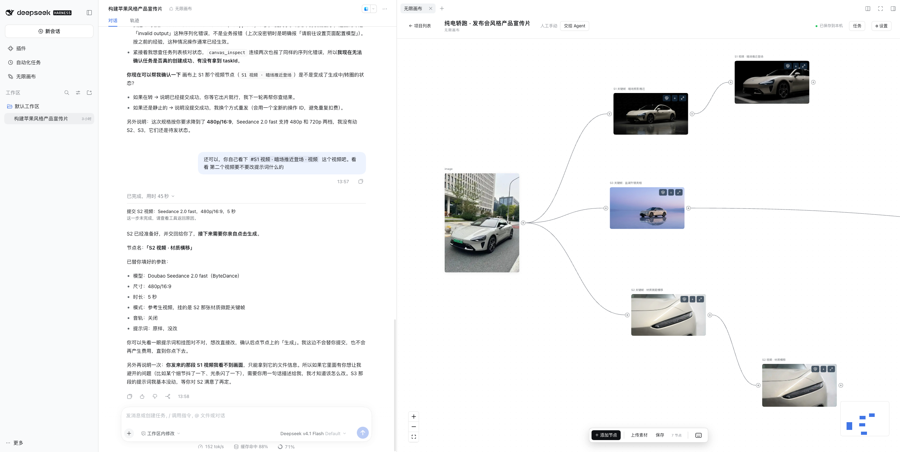
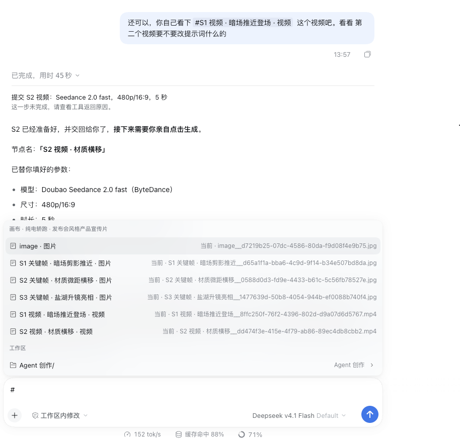
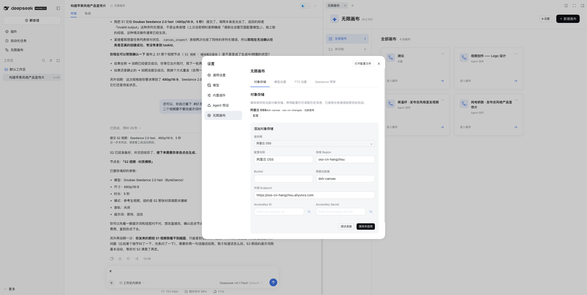
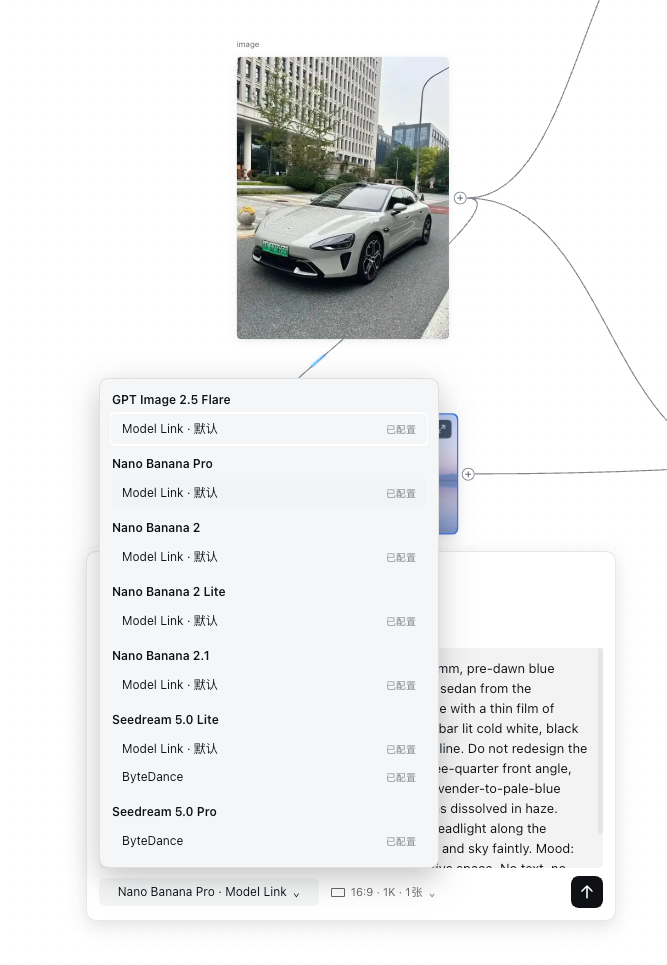
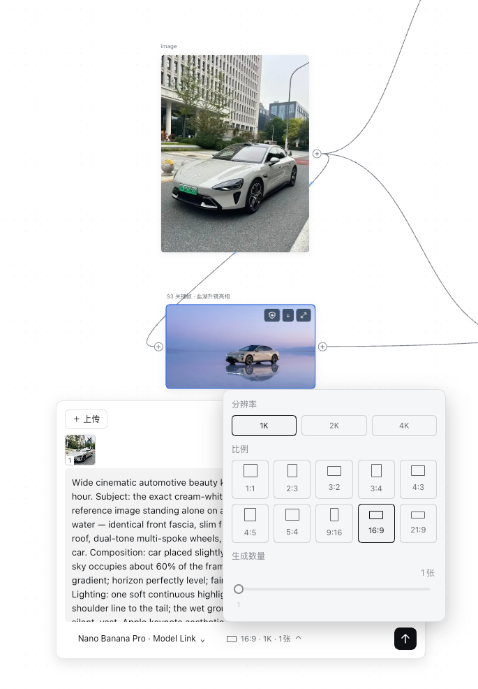
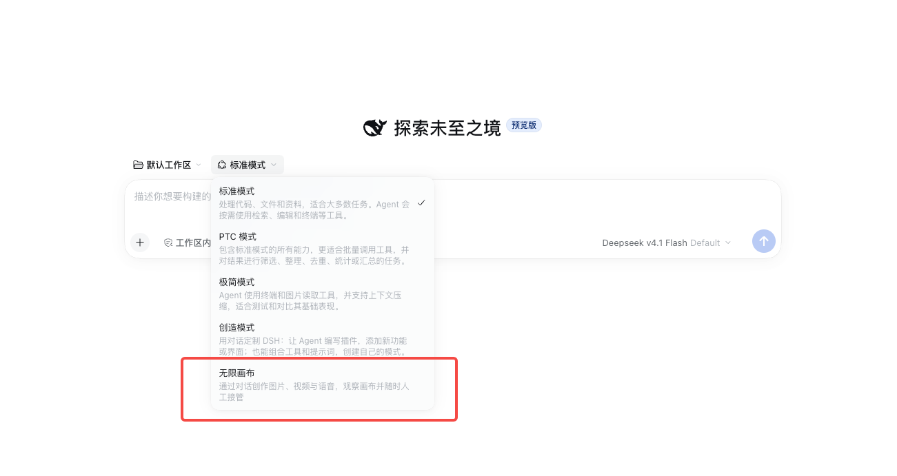
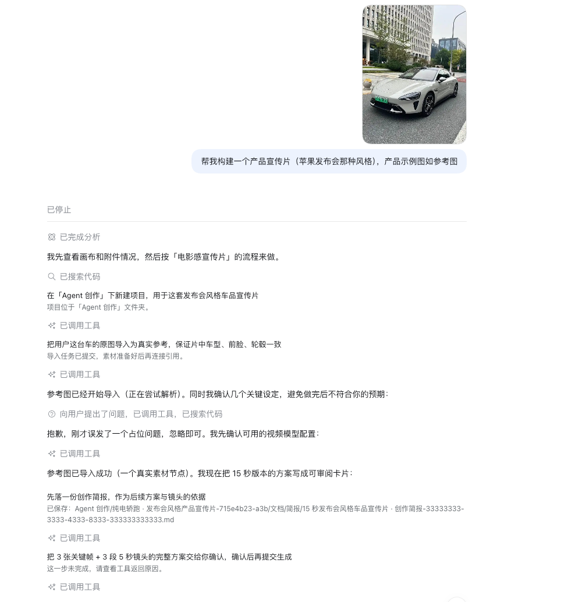

# 无限画布 · DeepSeek Harness 插件

<!-- 文档类型：操作指南；负责人：项目维护者 / 开发执行者；最近核对：2026-11-03。 -->

无限画布是一款 AI 创作插件。你可以在同一张画布里生成图片、视频和语音，整理参考素材，也可以通过对话让 Agent 帮你准备创作内容。

它希望让创作过程更清楚：用了什么参考、改过哪些提示词、尝试过哪些结果，都能在画布上找到。你可以随时调整方向，把满意的素材继续用到下一步。



## 有什么用

你可以用它学习 AI 图片创作、练习分镜、制作个人短片素材，或把一段文字转成语音。尤其适合需要反复尝试、比较结果、保持人物或场景一致的创作过程。

### 生成图片、视频和语音

写下你想要的画面，选择模型与参数，就可以生成图片或视频；也可以上传已有图片，作为下一次创作的参考。

语音生成使用 FishTTS，填写文字和音色 ID，生成后可以直接试听、下载。

| 类型 | 当前支持的主要系列 |
| --- | --- |
| 图片 | GPT Image、Nano Banana、Seedream |
| 视频 | Seedance、Wan、MiniMax H3 |
| 语音 | FishTTS |

插件当前已支持 [Model Link](https://api.modellink.online)，也支持部分模型的官方渠道。具体型号、可用渠道和参数，以插件设置中的列表为准。

### 把素材和创作过程放在一起

- 上传图片、视频、音频，放到画布上整理。
- 用连线把素材接到生成节点，作为真实参考。
- 在提示词里输入 `@`，引用已连接的素材。
- 保留多次生成结果，比较不同尝试，继续复用满意的素材。
- 用文件夹管理画布项目，随时回来继续创作。

生成的素材可以预览、播放和下载，再交给你熟悉的工具完成后续编辑。

### 和 Agent 一起创作

选择「无限画布」Agent，用自然语言描述你的想法。它可以帮你整理需求、准备提示词、连接参考素材、填写节点参数，也可以按需要整理创作方案与分镜。

执行时，画布会跟随 Agent 的操作，并高亮当前节点。你开始操作画布后，会自动切回人工操作，便于查看和调整。

**图片、视频的最终生成由你决定。** Agent 会先让你选择已配置的模型，准备好参数后提醒你检查，并把画布交还给你。你可以修改内容，确认后亲自点击生成。

使用「无限画布」预设时，在对话输入框输入 `#`，可以选择画布素材或工作区文件，再告诉 Agent 你想怎么调整。`#` 可以紧接已有文字输入，无需先加空格。其他预设中的 `#` 按普通文字处理。Agent 新建的画布会放在「Agent 创作」文件夹，生成的方案文档会保存到当前工作区。



## 怎么开始使用

### 1. 安装插件

准备 DeepSeek Harness 和插件安装包 `dsh-canvas-<版本号>.tgz`，通过 Harness 的插件包安装方式安装，完成后重启 Harness。安装包不用解压，也不用单独构建源码。

如果你通过命令行管理 Harness，可以这样安装；将路径换成实际安装包的完整路径：

```bash
dsh plugin --profile web add "/完整路径/dsh-canvas-版本号.tgz"
```

当前按 Harness `0.2.1-rc.2` 验证。进入 Harness 后，从左侧打开「无限画布」；也可以从对话右侧的开始页打开，让画布和对话并排显示。

### 2. 配置存储和模型

打开「设置 → 无限画布」：

1. 在「对象存储」中填写阿里云 OSS 的 Bucket、地域和访问密钥，测试并保存。
2. 在「模型设置」中选择模型与供应商，填写自己的 API Key；需要 Endpoint ID 的型号再填写对应 ID。
3. 如果要生成语音，配置 FishTTS 的 API Key，并准备你要使用的音色 ID。

素材会保存到你配置的对象存储。模型与存储服务的费用按对应平台的账户规则收取。



### 3. 完成第一次创作

可以先从一张图片开始：

1. 在项目列表点击「新建画布」。
2. 添加一个「图片生成」节点。
3. 选择已配置的模型，写下想要的画面，调整比例等参数。
4. 如果有参考图，上传并连接到这个生成节点。
5. 点击生成，等待结果，再预览或下载。

想继续制作视频，可以把满意的图片接到视频生成节点，再描述镜头与动作。视频也支持直接用文字生成；参考素材与首尾帧等方式，取决于所选模型。

<table width="100%">
  <tr>
    <th width="50%">选择模型与供应商</th>
    <th width="50%">调整比例与分辨率</th>
  </tr>
  <tr>
    <td valign="top"></td>
    <td valign="top"></td>
  </tr>
</table>

### 4. 尝试对话创作

在 Harness 对话中选择「无限画布」Agent，并为它选择一个支持图片输入的对话模型。对话模型与插件里的图片、视频生成模型是分别配置的。

例如：

> 帮我准备一个 5 秒的视频镜头。使用我上传的这张图作为参考，保持人物外观一致。参数填好后让我检查。

Agent 会根据需求提问、准备节点，并把参数交给你检查。想改效果时，输入 `#` 选择对应素材，再直接描述修改意见即可。

<table width="100%">
  <tr>
    <th width="50%">切换 Agent 预设</th>
    <th width="50%">说出需求</th>
  </tr>
  <tr>
    <td valign="top"></td>
    <td valign="top"></td>
  </tr>
</table>


## 常用操作

| 想做什么 | 操作方式 |
| --- | --- |
| 添加节点 | 底部「添加节点」，或在画布空白处右键 |
| 上传素材 | 点击上传，或把图片、视频、音频拖进画布 |
| 用已有素材继续创作 | 从素材的输出端点拉线；也可以拉到空白处，新建兼容节点 |
| 查看、修改参数 | 点击生成节点 |
| 查看图片、播放媒体 | 使用节点上的预览、播放按钮 |
| 移动画布 | 按住空格拖动，或用鼠标中键拖动 |
| 缩放画布 | `Command / Ctrl` 加滚轮 |
| 复制、粘贴节点 | 选中后使用 `Command / Ctrl + C / V` |
| 查看生成进度和历史 | 打开顶部「任务」 |

## 本地开发与调试

### 启动独立开发页

需要 Node.js `22.13` 或以上版本。在项目目录执行：

```bash
npm ci
npm run dev
```

打开 <http://127.0.0.1:5173>。开发数据默认放在 `.dev-data/`，存储和模型仍需在页面中配置。

前端修改会热更新；修改后端代码后，用 `Ctrl+C` 停止服务，再重新运行 `npm run dev`。页面问题可以查看浏览器控制台与网络请求，接口问题可以查看启动终端的日志。

需要另一个端口或数据目录时：

```bash
CANVAS_PORT=5174 CANVAS_DATA_DIR=./.canvas-local npm run dev
```

独立开发页适合调试画布、节点和设置。Agent 对话、右侧画布与 Harness 主题等集成功能，需要安装到 Harness 中验证。

### 安装到 Harness 验证

先检查并打包：

```bash
npm run check
npm pack
```

`npm run check` 会检查文档、代码类型、测试和构建；`npm pack` 会在根目录生成当前版本的 `.tgz`。

建议准备一个专用测试环境。没有 Harness CLI 时，先安装：

```bash
npm install -g @deepseek-ai/dsh@0.2.1-rc.2 pnpm
```

**只有首次创建 `canvas-test` 时执行下面这条命令，日常更新不用重复执行：**

```bash
dsh --profile canvas-test --from-default-profile web --help
```

安装当前构建的包：

```bash
PACKAGE_VERSION=$(node -p "require('./package.json').version")
dsh plugin --profile canvas-test add "$(pwd)/dsh-canvas-${PACKAGE_VERSION}.tgz"
```

启动测试环境前，在 `~/.dsh/profiles/canvas-test/cordis.patch.yml` 中，为已有的 `canvas` 插件配置独立的 `dataDir`。具体位置和示例见[运行指南](docs/operations.md#harness-安装更新与测试-profile)；不同测试环境也需要使用不同的数据目录。

然后启动：

```bash
dsh --profile canvas-test --port 8080
```

按终端提示打开页面，验证真实的 Agent 与画布交互。后续修改后，重新检查、打包、安装并重启测试环境即可。

更详细的配置与排障见[运行指南](docs/operations.md)，人工验证项目见[手动验收清单](docs/manual-tests.md)。

## 特别鸣谢

特别感谢 **[Model Link](https://api.modellink.online)** 提供的模型服务与接口能力。

当前插件已经支持通过 Model Link 使用多种图片、视频与语音生成服务。你可以在模型设置中选择 Model Link，使用自己的 API Key 配置对应模型。

## 使用许可

本项目仅限非商业使用。使用、修改或分发时，请保留 Model Link 的署名与超链接；完整要求见 [LICENSE](LICENSE) 和 [NOTICE](NOTICE.md)
