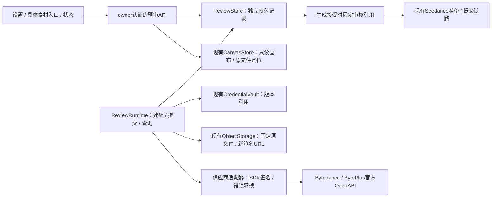
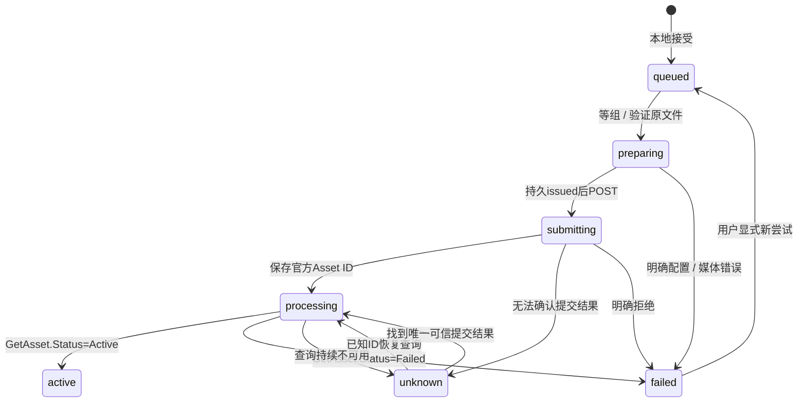

# Seedance 预审技术设计提案

文档类型：设计提案；负责人：项目维护者 / 开发执行者；核对日期：2026-10-29。

状态：用户已批准，0.2.54已按此设计实施。配套交互：[Seedance 预审设计](seedance-review-design.html)。本页保留批准时提案细节；当前精确行为与检查见[ADR-0059](../docs/adr/0059-seedance-asset-review-and-frozen-generation-references.md)、[接口参考](../docs/data-api.md)与[验证记录](../docs/verification.md)，以下“建议 / 尚未实现”措辞属于原提案历史。

## 决策与约束

决策问题：如何在不改变既有画布、素材和生成任务数据结构的情况下，增加可恢复、按素材与供应商隔离的送审能力？

建议采用单插件内独立预审模块与独立持久库；后台负责建组、提交和查询，Client 只读按实际素材身份派生的状态。当前插件仍为0.2.53，本设计不触发版本更新、打包、安装、重启或云端操作。

| 驱动因素 | 对设计的影响 |
| --- | --- |
| 用户要求所有媒体节点都可送审，历史逐输出支持 | 以原文件 assetId 为对象，nodeId / taskId 只是显示与审计上下文 |
| 两家供应商、项目、账号权限相互隔离 | 不共享 Group ID / Asset ID / 通过状态 |
| 必须保持存量数据结构 | 不向 CanvasNode.params、Asset、旧 TaskSnapshot 写入预审状态；不修改canvas.sqlite既有DDL |
| CreateAsset为异步，且未提供提交幂等保证 / 审核完成Webhook | 本地登记、去重、持久调度与查询恢复；结果不明时不自动重新POST |
| 真人组绑定单个人物 | 自动建组仅使用AIGC；真人从官方已认证组选择，画布可关联多个人物组 |
| 生成与预审都依赖外部服务 | 单独调度，网络预算有界；云端故障不能阻塞本地画布创建 / 编辑 |
| 用户确认通过传Asset ID，未送审或失败仍传URL | 预审不是生成门槛；逐参考选择来源，接受后不因后来审核完成改变 |

不采用的方案及代价：

| 方案 | 原因 |
| --- | --- |
| 将状态写入节点或生成参数 | 主图 / 历史切换易串状态，同一素材多处重复；违反数据结构约束 |
| 使用一个全局Group | 失去画布组织与项目隔离；用户不便管理 / 删除 |
| 新建画布等待两家CreateAssetGroup全部返回 | 任一家断网 / 缺权限会使本地画布创建失败 |
| 在既有SQLite中新建任务表并跨表事务 | 原子性较好，但违反当前不得改变既有数据库结构的约束 |
| 只在浏览器轮询 | 隐藏页面、离开画布和刷新使任务失去连续性 |
| 把所有内容发到AIGC组 | 官方虚拟内容边界不允许将此视为真人认证方案 |

正面后果：旧画布与任务格式保持；状态可在多处一致显示；审核与生成隔离；两家故障独立。

负面后果：新增一个本地持久库 / 备份对象；主库与预审库不能跨库原子提交，需要恢复对账；采用Asset URI的新生成任务增加回退兼容约束。

可逆性：界面 / 适配器是可逆边界；云端组与资产创建会占用权益，不由卸载或回退自动删除。更换存储实现需迁移独立预审记录。若维护者以后允许既有库增表，可重审跨库方案；已采用Asset URI的任务必须保留固定引用，不能回退后改用原URL重新提交。

## 模块与数据流

沿用单实例owner认证、宿主生命周期和数据目录锁。不新增服务进程，不让浏览器持有轮询队列。ReviewRuntime随Harness停止和启动，电脑关闭时不会继续本地执行。

| 上下文 | 责任与数据 | 相邻关系 / 适配面 |
| --- | --- | --- |
| CanvasStore | 原画布、节点、素材、ObjectLocator；现有维护者 / 持久层 | 预审模块只读消费稳定身份；不反向写审核结果 |
| ReviewSettings / Vault | 供应商配置版本、三个敏感字段；Host维护者 | 预审接受时固定版本引用；公开DTO只返回掩码 |
| ReviewStore / Runtime | 建组意图、素材任务、结果、due / lease；预审模块维护者 | 向Client提供本地状态；将官方Processing / Active / Failed翻译为领域状态 |
| AssetReviewProvider | 官方签名、请求、分页、错误；厂商适配器维护者 | 反腐层：隔离域名 / 区域 / ResponseMetadata / Result / ID差异，不写SQL |
| ObjectStorage | 已持久化原文件和签名；媒体模块维护者 | 提供受限定位与按需URL；预审不上传封面、波形或任意用户URL |
| GenerationBinding | requestId / taskId对应的固定Asset URI；生成模块维护者 | 消费预审通过记录；历史快照和旧任务保持原语义 |

依赖方向：shared只定义纯类型和校验；Client不导入Host、SQL或签名SDK；供应商适配器不依赖React或数据库；审核任务不混入生成历史卡片。

## 配置与凭据

两份稳定的供应商配置身份，包含provider、profileId、revision及内部资源域；ProjectName、AK、SK均以Vault版本存储。公开GET只返回三个掩码、是否配置及配置修订，不返回明文ProjectName。

用户显式点击眼睛时，限定owner、供应商配置与字段的只读POST返回当前单字段，Cache-Control和请求缓存策略均为no-store。浏览器预览仅短暂内存，取消 / 隐藏 / 切页 / 禁用时清除与中止；迟到响应不显示。与0.2.53显隐规则一致，例外是用户明确授权的单字段查看，不执行附件中“前端绝不接收任何AK/SK”的绝对规则。

AK/SK首次或替换时成对提供；编辑留空保留，掩码不作为新值。ProjectName区分大小写，新配置默认default；测试连接只调用指定项目ListAssetGroups读取，不创造外部资源。

接受任务时固定provider、profileId、revision、真实ProjectName、credentialRef、组绑定、审核策略。后续设置变化不切换任务账号 / 项目。账号身份不能从AK字符串推断：轮换后检查旧组的可访问性；401/403归为权限问题，不归为不存在，不能因此盲目重建。

禁止Client指定任意Vault引用、域名、签名区域或素材URL；所有敏感配置只允许当前owner通过严格字段白名单访问。错误信息先清理签名URL、Authorization、AK/SK及Token，再保留官方Code和可读Message；不宣称已观察真实账户结果。

## 官方调用边界

| 项目 | Bytedance | BytePlus |
| --- | --- | --- |
| Host | ark.cn-beijing.volcengineapi.com | ark.ap-southeast-1.byteplusapi.com |
| Region | cn-beijing | ap-southeast-1 |
| Service / Version | ark / 2024-01-01 | ark / 2024-01-01 |
| 认证 | AK/SK HMAC-SHA256 | AK/SK HMAC-SHA256 |
| 建虚拟组 | CreateAssetGroup，GroupType=AIGC | 同Action；需核对目标账户能力 |
| 送审 / 查询 | CreateAsset / GetAsset | CreateAsset / GetAsset |
| 策略 | 不发送Moderation | 首轮明确Default |

SDK签名库和版本尚未选定，属于实现前核验项：优先官方SDK，必须通过离线签名向量验证精确Host / Region / Service / UTC日期 / JSON字节。BytePlus真人结果文档存在签名Scope示例冲突，不能照抄cn-beijing。

素材文件实际格式与尺寸要按CreateAsset要求验证；不能只检查扩展名，也不能无条件复用目前Seedance参考校验器对视频编码 / 模型时长的更窄限制。入库规则与模型引用规则各自验证，不重写原媒体元数据或原字节。

官方ID按原文保留，不能强制转小写。附件海外示例有Asset-大小写差异，应作为不透明官方ID处理，在构建asset://URI时只允许可信接口返回且经安全格式检查的值。

附件第9节type=input_image不是当前视频请求格式；图片依旧type=image_url，视频video_url，音频audio_url，role及引用顺序不变。

## 持久对象与去重

建议新增独立`seedance-review.sqlite`（位置与权限在实现时依照dataDir惯例），不修改`canvas.sqlite`。下列为逻辑对象，非已落实的DDL：

| 对象 | 保存内容 / 身份 |
| --- | --- |
| review_profiles | 稳定profileId、provider、revision、Vault引用、资源域和掩码投影 |
| group_bindings | owner + canvasId + provider +资源域 + ProjectName；AIGC建组操作身份、状态、官方Group ID |
| human_group_bindings | 上述上下文加经官方核验的真人Group ID / 人物标签；一画布可关联多个组 |
| review_jobs | 本地requestId、素材身份、固定配置和定位、groupBindingId、issued、外部ID、due / lease、失败与结果 |
| review_results | 对应素材 / 组 / 策略的最新可用结果，以及历史尝试 |
| generation_review_bindings | 原生成requestId / taskId、按referenceIds顺序固定的原URL或Asset URI、官方上下文和元数据引用 |

去重键建议：

`owner + canvasId + assetId + originalSha256 + provider + resourceScope + project + groupBindingId + moderationStrategy`

nodeId只用于“从哪个位置提交”的审计，不参与素材去重。同一个原文件被多个节点引用，共享相同上下文的记录；跨画布仍各自绑定组，不默认跨画布合并资产。主图切换、改名、旋转预览和搬移不改变原文件hash，不使审核失效。

配置修订与资源域分开：同账号密钥轮换经核验可继续使用旧资源，不因revision变化盲目重传；改ProjectName / 确认更换资源域需要新的组，原任务配置仍固定。

## 画布创建与跨库恢复

采用“画布创建先提交本地 + 后台建组”的交互；用户所说同步提交在这里指同次创建操作登记，不等待云端完成。

主库与预审库无跨库原子保证。具体恢复方案：

1. 成功创建画布后尝试幂等登记本轮已配置供应商的建组意图；失败不撤销已创建的画布。
2. 新配置启用时保存生效时间 / 激活基线；启动与维护扫描只对其后新建的现存画布补齐漏登记意图，不批量创建所有旧画布组。
3. 在首次进入预审 / 送审时ensure对应绑定，覆盖旧画布、复制画布和同时间戳边界；本地唯一键合并并发登记。
4. 稳定本地操作ID生成组Name（限64字符），名称前缀可读、后缀包含操作身份；改画布名称不重建。
5. issued之后回执丢失，先ListAssetGroups分页查找并精确核对Name、项目、组类型和本地操作上下文。只有唯一可信匹配才绑定；不以一次空列表证明没有创建。
6. 缺配置、创建失败、结果不确定都不影响画布编辑；送审任务等待 / 报错该供应商，另一家可独立继续。

启动恢复不能只扫描当前打开画布。删除画布后不再补建，不自动删除云端组；以只读主库归属检查停止无主任务，避免孤立本地写入或晚到响应复活已删除内容。

## 异步状态与恢复

只有Active对应审核通过。HTTP200、获得Asset ID、调用成功均不等于审核通过。queued / preparing / submitting / processing在节点旁统一“审核中”；unknown独立显示待确认，不显示红色内容失败。

ReviewRuntime使用独立due / lease队列，受宿主关闭与锁失效保护。已有Asset ID重启后只查询；无ID且已issued不自动重发。官方CreateAsset没有已确认的幂等参数，本地防重复不能承诺远端exactly-once。

建议以稳定操作ID生成Asset Name；ListAssets恢复时名称查询是模糊搜索，必须再精确核对Name、GroupId、ProjectName、类型及尝试上下文。多个候选 / 无法证明关联时保留unknown供用户核对；不能拿“同名素材”直接视为同一原字节。

处理恢复优先级：已知ID查询 > 不明提交结果对账 > 明确失败的用户重试。未知原任务不允许“自动重试上传”；结束本地等待不表示云端任务已取消，不默认调用DeleteAsset。

性能建议（设计参数，非官方SLA）：提交每供应商最多2个并发网络步骤，实际配额低则降低；查询初始间隔5秒，持续Processing逐渐放慢至30秒并加入抖动，429 / 5xx按供应商退避。共享账号的其他客户端可能占用配额，不能仅按官方100 QPS上限计算可用额度。长时间Processing不按固定时长宣判Failed。

Client每活跃画布合并读取本地状态，仅轮询有活动任务的集合，不每节点启动计时器。关闭页面暂停Client读取，Host继续；状态更新只触发相关标题 / 卡片的展示，不重挂媒体或重新测量节点几何。

## 本地API提案

以下接口为拟议契约，不代表已注册路由：

| 接口 | 行为 |
| --- | --- |
| GET / POST seedance-review-settings | 掩码读与版本化保存，两家独立 |
| POST seedance-review-settings-test | 指定项目只读权限测试，不创造Group / Asset |
| POST settings-secret（新增严格scope） | owner显式查看本预审配置的ProjectName / AK / SK单字段 |
| POST asset-reviews?canvas=... | requestId、assetId、provider、profileId、groupBindingId；本地接受后返回202和任务身份 |
| GET asset-reviews?canvas=... | 按有限assetIds / revision批量读取状态；公开DTO无Vault引用或临时签名URL |
| GET asset-review?canvas=...&id=... | 任务 / 结果详情、供应商、阶段、脱敏原因、官方ID |
| POST asset-review-action?canvas=... | 恢复查询 / 结果对账 / 明确失败的新尝试；严格状态转换 |
| GET review-groups?canvas=... | 默认虚拟组状态与该供应商项目下可选真人组；真人列表分页加载 |

资产不存在、原文件未ready、归属不匹配或配置缺失在接受前拒绝；不会创建伪任务。重复requestId内容一致返回原任务，内容不一致409。内容级重复复用活动 / Active记录。上传URL由Host通过locator生成，API不接受任意URL。

H5认证方案作为明确范围边界：首轮只选择已认证真人组，无组时给官方控制台入口。若用户决定在插件内完整认证，需要另行设计公网回调 / 官方H5跳转、30分钟Token、授权结果核验和人物组绑定，不使用客户端resultCode单独作为认证成功依据。

## 固定生成引用与兼容性

按用户确认规则，Active且属于当前供应商 / 账号资源域 / 项目时使用Asset URI；未送审、明确失败、Processing、unknown或没有当前上下文匹配的通过记录时，使用原URL，仍允许视频生成。独立的模型格式 / 参数验证保持。

逐份referenceIds选择来源，一个任务可以混用Asset URI与原URL。来源在生成接受时固定，保持referenceIds顺序和frames / reference角色；之后审核从Processing变为Active只影响下一次生成，不改变、取消或重提当次视频任务。

建议先在预审库按既有生成requestId登记prepare绑定，再让主库接受生成；失败的prepare成为可回收本地记录，不影响原图。主库接受成功但链接确认中断时，恢复程序通过task_details.request_id关联原绑定；Runtime必须取得固定绑定后才发出任务，缺失不能悄悄降级URL。

旧任务没有新绑定时沿用原逻辑，不据后来审核结果改写已接受快照。新任务引用的原文件hash、官方Asset ID、ProjectName、账号域和凭据版本在接受后不可变。官方资产后续失效 / 授权撤回则错误反馈，不重新上传或重新创建生成任务。

GenerationRuntime停止 / 回退限制：已经接受依赖新绑定的任务未完成时，不能直接安装不认识该绑定的旧插件继续处理，否则可能改用原URL。必须先排空任务或保持新版查询 / 停止发出，再回退。备份覆盖主库、独立预审库、Vault和原媒体，不能仅备份canvas.sqlite。

相同供应商下正在预审 / 失败 / unknown不阻止生成，直接按规则选择原URL；另一家通过或旧项目记录不当作当前Asset URI。Model Link不使用官方Asset URI，无供应商切换 / 自动双份送审。

## 可检验的设计约束

下列是后续实施的检查规格，本轮没有新增或运行产品测试：

| 属性 | 指标 / 阈值 | 证据与执行时机 | 失败响应 |
| --- | --- | --- | --- |
| 依赖方向 | shared无Node/React依赖；Client不导入Host；适配器不写SQL | 构建 / 类型与模块依赖检查，每轮实现 | 停止合并 / 打包 |
| 存量兼容 | 既有DDL、图JSON、原Asset / TaskSnapshot字节结构零变化 | 旧数据fixture与更新前后身份审计，每轮交付 | 停止安装，修复或恢复 |
| 供应商 / 资源隔离 | 任何跨provider、project或未核验资源域的Asset URI不可用于生成；无匹配通过时选URL | 交叉引用反例，接受与恢复测试 | 拒绝错误Asset URI，不阻塞合法URL路径 |
| 素材身份 | 换主图 / 历史输出 / 改字节后不继承错误状态 | 真实主图 / 多历史 / 多输出交互检查 | 阻止显示或提交错误目标 |
| 本地接受不依赖云端 | cloud永不返回时仍接受持久任务或明确本地拒绝，不等待CreateAsset | 挂起适配器的请求测试 | 修复同步网络泄漏 |
| 无重复上传 | 连点 / lost response / restart不追加未授权CreateAsset | 故障注入与远端调用计数；每次状态机改动 | 保留unknown并停止重发 |
| 状态真实性 | 只有Active显示通过；Processing/HTTP200不通过；网络异常不伪装Failed | 服务协议替身与UI状态检查 | 拒绝发布 |
| 默认保密 | 普通GET不含三个字段明文；显式读取严格owner+字段，无缓存 | DTO / 权限 / 迟到响应测试，每次配置修改 | 停止新增读取 |
| 可用性 / 配额 | 配置并发上限、每任务建议5–30秒查询；429可降速 | 虚拟时钟 / 调用计数 / 背压测试，每次Runtime修改 | 降速 / 暂停该供应商 |
| 生成身份固定 | 接受后URI、顺序、roles不因新审核 / 配置而变化 | 断点 / 重启 / 迟到审核 / 轮换测试 | 不发出缺失或变化绑定 |
| URL路径保留 | 未送审 / 失败 / 审核中 / unknown仍接受合法生成，单请求可混用URL和Asset URI | 来源选择与接受后固定回归，每次引用逻辑修改 | 修复额外预审门槛 |
| 隔离故障 | 预审API故障不影响画布编辑 / 媒体播放，另一供应商可用 | 故障适配器与Client交互检查 | 隔离预审步骤 |

拟议本地检查入口：现有npm run check、产物核验，加预审状态机 / 签名 / 不变数据 / 真正XYFlow交互回归。浏览器视觉、真实权益和真实模型效果仍由用户手动验收；本轮不调用浏览器、凭据、送审或生成接口。

## 风险与核验责任

| 风险 | 可能性 / 影响 | 应对与负责人 |
| --- | --- | --- |
| 将真人发往AIGC自动组 | 高 / 高：不能满足目标 | 产品明确路径，真人用认证组；用户确认首轮范围，开发者严格组类型检查 |
| Cloud POST已成功但本地未知 | 中 / 高：重复资源 / 权益消耗 | issued持久化、精确对账、unknown禁止重发；Runtime维护者 |
| 配置更换后跨账号 / 项目误用 | 中 / 高：引用失败 / 误归属 | 固定上下文、可访问性验证、失败不降级；配置与生成模块维护者 |
| 两个数据库恢复不一致 | 中 / 高：孤立任务 / 生成引用丢失 | 幂等prepare、启动对账、共同备份、回退排空；持久层维护者 |
| 大量素材轮询争夺网络 / 配额 | 中 / 中 | 有界步骤、共享查询预算、Processing放慢；Runtime维护者 |
| 标记遮挡标题 / 触发历史编辑 | 中 / 中 | 状态只在相关素材轻量叠层，按钮事件隔离和键盘说明；Client维护者，用户视觉验收 |
| 文档示例与SDK / 当前权限不一致 | 中 / 高 | 签名向量及真实账号只读核验，创建权限 / 权益单独验收；供应商适配器维护者 |
| 缺少Assets完成时间SLA | 已确认 / 中 | 显示真实阶段，持续查询或待确认，不承诺固定完成时间；产品与Runtime共同维护 |

运行依赖的采用标准：官方SDK可本地升级 / 替换，精确错误和RequestId可脱敏诊断；预审故障可隔离，旧正常画布与原模型URL链路仍可用；若官方不支持当前权益、项目或真人路径，禁止静默改组 / 切供应商，保留已有本地结果。

实现前仅两类重点待核验：

1. **官方协议与真实权限**：SDK固定版本、海外签名区域、账号 / 项目访问、权益、授权函、真人组可查询权限、Asset ID格式；没有用真实AK/SK验证。
2. **持久恢复与兼容性**：独立库生命周期、跨库prepare / 对账与固定生成引用、已接受任务的旧版本回退门槛；实施前以故障测试证明，不能以设计文字替代结果。
