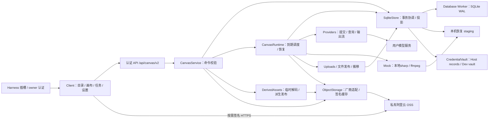

# 当前架构与执行流程

文档类型：解释；负责人：项目维护者；最近核对：2026-10-29。每次模块 / SDK / 存储边界变化时复核。

当前是单个 Harness 插件中的模块化实现。决定和取舍见 [ADR](adr/index.md)，精确接口见[数据参考](data-api.md)。

0.2.71由Client的CREATABLE_NODES / createCanvasNode统一底部添加、空白右键和输出拉线到空白三个入口。useNodeCreationMenu适配React Flow公开事件，确认实际空白命中并冻结坐标 / 输出asset；UiPointMenu复用Harness公共Menu / portal与画布禁选作用域。直接连线和快捷创建共用connectReference，useCanvas.getGraph及同步edit updater在最新图上返回完整节点 / 边，沿用Seedance归一和GraphMutation；临时线只在ViewportPortal显示，不持久化或调用生成。新增类型必须同时维护三个入口与默认 / 校验 / 渲染 / 测试，见[ADR-0066](adr/0066-shared-node-creation-entrances.md)。

0.2.67的canvasFileDrop在window捕获文件拖放，按可见画布矩形、最终坐标和顶层命中决定唯一接收方；画布内停止传播并直接调用当前上传回调，画布外保留Harness原document附件监听。首次接管调用无载荷dragend清理原Agent蒙版，隔离画布来源的dragleave以保持跨区深度。回调引用随提交更新，隐藏 / 卸载移除监听，原上传协议、五槽 / 胶囊和两库保持，见[ADR-0065](adr/0065-exclusive-canvas-file-drop.md)。

0.2.65的CanvasApi共享ResumableUploads管理器缓存原Blob / UUID后最多占五个槽，其余排队；GET upload-status与POST upload字节仍分为buffered / streaming，Host journal与幂等导入保持。UploadCapsules只投影当前画布前五项和剩余计数，最多五个真实BorderBeam；复用NodeLoadingContext的主题 / 暂停。身份或数字位数改变时只测量最多六个小元素，用原生animate变换平滑补位，连续完成先保留当前动画位移；进度变化不测量媒体、不重播入场。见[ADR-0063](adr/0063-resumable-uploads-and-progress-capsules.md)与[ADR-0064](adr/0064-bounded-upload-capsules-and-five-transfers.md)。

0.2.55的CanvasReviewState先从掩码settings推导任一家configured，再按画布读取预审状态；按钮仅订阅共享布尔可用性，未配置不请求状态 / 云端组。已有设置保存 / 关闭与激活刷新路径沿用，不增Host路由或持久格式。HistoryNode合并折叠操作栏；0.2.56画布根的单个非passive捕获监听将节点操作栏普通wheel与修饰键wheel都转交renderer原生处理，分别平移 / 缩放，保留坐标、两轴惯性与倍率限制，隐藏 / 卸载移除监听。

0.2.57 ReviewButton额外订阅当前asset的结果，两家Active才隐藏；SeedanceReviewDialog从掩码配置与原任务推导可选供应商，切到另一家清空人物组 / 路径，成功详情不渲染。UiSelect复用公开Menu的ReactNode label携带悬停原因，原生与独立模式均校验disabled，全部不可用时保留无选项占位。ProjectList用同一UiModal / UiInput替换浏览器prompt，新建 / 改名共用NameDialog，原CatalogCommand身份 / revision / folderId保持，错误保留本地输入；Host与两库不改变。

0.2.54新增独立[ReviewStore](../src/host/review/store.ts) / [ReviewRuntime](../src/host/review/runtime.ts)：设置 → Vault版本；送审API → 独立预审库 → 官方适配器 → 原文件OSS URL；异步结果 → Client按assetId订阅；生成接受前 → requestId固定来源 → 现有Providers。两家各自有界网络并发，Host锁 / writer token共同约束；Cloud失败不改变原画布。主库DDL、Asset、TaskSnapshot保持，独立预审库schema 1纳入备份。新任务缺绑定不派发，旧任务用原URL；详见[ADR-0059](adr/0059-seedance-asset-review-and-frozen-generation-references.md)。

0.2.53的SecretField仅在用户点击眼睛后通过owner认证POST settings-secret读取当前单字段，常规目录继续Key掩码。SqliteStore验证配置身份 / owner并只读当前Key；显示预览不写草稿，控件隐藏 / 取消 / 禁用时清除并拒绝迟到响应。任务固定Vault引用不受查看或编辑影响，无新持久格式；见[ADR-0058](adr/0058-masked-settings-and-explicit-secret-reveal.md)。

Seedream在同一Providers边界增加原生JSON请求，逻辑型号与路由EP分开；SqliteStore在接受任务时固定model快照与Vault binding，配置轮换不影响任务。Client仅按完整配置展示型号，EP只在设置输入；图片字节仍走暂存 → OSS发布，不改图 / DDL和后台调度。协议与错误边界见[ADR-0053](adr/0053-seedream-endpoint-routing-and-model-identity.md)。

Seedance复用相同配置、任务队列和OSS结果发布边界。Client与Host通过[shared/seedance](../src/shared/seedance.ts)统一模式 / 连线限制，[帧分配](../src/client/SeedanceFrameRoles.tsx)以已有assetId显式记录角色。任务参考固定ObjectLocator后，[临时流式检查](../src/host/media/seedanceReferences.ts)逐份核验hash与实际元数据，全部检查完成才签名24小时URL；POST创建与至少3秒间隔GET查询由Providers / Runtime执行，成功公开视频URL不转发Key。新增协议和可选参数只写已有JSON字段，不更改schema / 23表，见[ADR-0055](adr/0055-seedance-video-modes-and-independent-provider-routing.md)。

0.2.51在画布图编辑入口统一处理引用变化：只对入边变化的Seedance节点推导模式，未变的边直接返回，拖动不触发参数全量同步。空引用text、首连reference、frames仅手动，清空角色与模式和边同次保存；Host只在图校验 / 新提交时使用有效模式，Providers与历史快照保持，见[ADR-0056](adr/0056-seedance-mode-inference-from-references.md)。

0.2.49按[ADR-0054](adr/0054-no-result-submission-failure-and-seedream-id-correction.md)将无可用结果 / 外部ID的提交错误标为本地failed；启动修正符合条件的历史unknown而不重提。模型配置原子更正Lite ID，保留UUID / EP / Vault及历史快照；Client失败分支优先显示静态红色感叹号。

节点任务和媒体加载共用[NodeLoading](../src/client/NodeLoading.tsx)：任务组合`border-beam@1.4.1` / `thinking-orbs@0.3.2`，文件加载直接用`img-fx@0.5.1` ImageGeneration 像素效果与`three@0.186.1`共享GPU。NodeLoadingBoundary汇总内部媒体就绪，不嵌套重复Loading；SignedImage等当前链接 / decode，VideoPlayer等首帧，AudioPlayer等元数据 / 波形结束。工作区单份主题订阅向依赖传Harness显式主题 / 表面色与隐藏状态，离屏 / 减少动态效果暂停，最后一个媒体实例释放GPU；无WebGL2或初始化失败时静态单色提示。动画为装饰，status仅供屏幕阅读器；任务与媒体阶段见[ADR-0046](adr/0046-dependency-backed-whole-node-loading.md)、[ADR-0061](adr/0061-dependency-backed-media-pixel-loading.md)。

## 组件与职责

| 实际模块 | 职责 / 边界 |
| --- | --- |
| [shared/contracts](../src/shared/contracts.ts)、[v2](../src/shared/v2.ts) | 图 / 任务 DTO、领域验证、规范化 hash；不依赖 Node I/O / React / SDK |
| [client/index](../src/client/index.tsx) | main / sidebar / settings 插槽、右侧类型与正文两阶段注册 / disposer、样式生命周期；不依赖 Harness workspaces，所有入口共享API |
| [client/ui](../src/client/ui.tsx) | 共享宿主通用组件、单选组合与独立开发兜底；仅 Harness 入口导入官方运行时，不复制内部组件 / CSS |
| [CanvasApp](../src/client/Canvas.tsx) / [ProjectList](../src/client/ProjectList.tsx) | 默认项目列表、一级目录管理、点击进入编辑器；页面内保留文件夹筛选 |
| [CanvasWorkspace](../src/client/Canvas.tsx) / [Settings](../src/client/Settings.tsx) | React Flow、保存后返回列表、上传 / 拖拽、资源 / 生成名称、任务详情、共用对象存储 / 模型 / TTS设置 |
| [canvasTextSelection](../src/client/canvasTextSelection.tsx) / [CSS](../src/client/styles.css) | 画布及owned portal默认禁止文字选中，原生输入 / 可编辑 / 显式复制区域开放；公共Menu由context传作用域，画布外不受影响，见ADR-0060 |
| [ObjectStorageSettings](../src/client/ObjectStorageSettings.tsx) / [mediaUrlCache](../src/client/mediaUrlCache.ts) / [SignedMedia](../src/client/SignedMedia.tsx) | 单活动目标与配置脱敏、100项共享批量缓存、过期刷新与播放位置恢复；不持有AK |
| [RelationshipEdge](../src/client/RelationshipEdge.tsx) | BaseEdge保留Bezier / 标签 / 热区，仅单选直接入出边叠加CSS流光；浏览器投影，不进入持久图 |
| [TaskDialog](../src/client/TaskDialog.tsx) / [UiDateTimeRangePicker](../src/client/UiDateTimeRangePicker.tsx) / [UiPagination](../src/client/UiPagination.tsx) | 显式联合查询、目录表格、保留列表的详情返回、取消过期请求；通用本地时区双月日期范围与受控分页 |
| [useCanvas](../src/client/useCanvas.ts) / [api](../src/client/api.ts) | 草稿与基线、对象 hash / 变更批次、重试 identity、冲突、状态读取；隐藏侧栏暂停轮询但保留自动保存，不直连模型 |
| [MentionPromptEditor](../src/client/MentionPromptEditor.tsx) / [控制器](../src/client/promptEditorController.ts) / [promptReferences](../src/client/promptReferences.ts) | 生图 / 生视频共享@编辑、光标 / 输入法 / 原子标签、portal候选与合法自动入边；只改既有prompt和edges |
| [promptMentions](../src/shared/promptMentions.ts) | UUID字符串解析、引用编号；Service构建快照前验证和解析，历史任务 / 节点原字符串不重写 |
| [TtsEditor](../src/client/TtsEditor.tsx) / [EmotionTextArea](../src/client/EmotionTextArea.tsx) / [TtsSettings](../src/client/TtsSettings.tsx) | 无模型 / 入边的语音参数、计数器、文档原始情绪标签与全局服务配置；Client只调owner API |
| [host/index](../src/host/index.ts) | apply / inject / effects；connection 与 credentials 适配 |
| [service](../src/host/service.ts) | 请求 Schema、图 / 输入 / 引用 / 队列校验、任务动作和媒体读取 |
| [runtime](../src/host/runtime.ts) | 自有 AbortController、active 网络步骤、SQL due / lease、启动恢复、停止 |
| [sqlite-store](../src/host/sqlite-store.ts) | 单写者锁、图 / 目录事务、宿主投影、任务详情、对象定位与发布 / 搬移清单；store.ts 保留类型 / 重导出 |
| [persistence](../src/host/persistence/database.ts) | SQL RPC、Worker 单连接、FK / CAS / token 校验，schema 为可执行字典 |
| [media/files](../src/host/media/files.ts)、[uploads](../src/host/media/uploads.ts) | 安全名称、流接收 / hash / fsync、固定目标暂存与后台OSS发布、导入任务 |
| [resumableUploads](../src/client/resumableUploads.ts)、[uploadCache](../src/client/uploadCache.ts)、[uploadJournal](../src/host/media/uploadJournal.ts) | 原Blob / UUID先缓存，4MiB块与确认offset，独立原子journal，Runtime恢复 / 停止收尾、幂等导入与引用连接；两库DDL不变 |
| [object-storage](../src/host/object-storage/service.ts) / [aliyun](../src/host/object-storage/aliyun.ts) / [derived](../src/host/object-storage/derived.ts) | 厂商隔离、SHA / ETag / version身份校验、V4签名与2048项缓存、探测、临时解码和派生对象定位 |
| [media/previews](../src/host/media/previews.ts) | 独立封面缓存、sharp / ffmpeg解码；不修改资产 / 任务 / DDL，Service停止时取消并等待处理 |
| [media/waveforms](../src/host/media/waveforms.ts) / [AudioNode](../src/client/AudioNode.tsx) / [AudioPlayer](../src/client/AudioPlayer.tsx) | 真实PCM流式幅度、小JSON派生缓存、仅输出的音频卡片 / 自定义定位播放；复用认证media与共享媒体事件，不写原资产或任务 |
| [ResourceNode](../src/client/ResourceNode.tsx) / [mediaLayout](../src/client/mediaLayout.ts) | 纯媒体、悬浮名称、顶部操作栏、宽高比、当前页面旋转 / 单视频播放；原文件模态与下载仍走media |
| [credentials](../src/host/credentials.ts) | Harness 持久 record 与开发 LocalVault；新 Key 新版本 |
| [providers](../src/host/providers.ts) | 协议请求、外部 ID / 状态 / 错误与输出流；不写 SQL / 图 |
| [mockModels](../src/shared/mockModels.ts) / [mockGeneration](../src/host/mockGeneration.ts) | 固定 Mock 能力 / 严格快照身份；本地渲染暂存文件，复用同一Runtime发布 / 恢复，不读取Key或调用模型网络 |
| [GenerationNode](../src/client/GenerationNode.tsx) / [GenerationParameters](../src/client/GenerationParameters.tsx) | 最小空态、媒体无父外框、分组仅主图端点、固定收起 / 展开隐藏编辑、动态参数弹层；只改变显示，旧边assetId保持 |
| [generationHistory](../src/client/generationHistory.ts) / [HistoryNode](../src/client/HistoryNode.tsx) / [useGenerationSubmission](../src/client/useGenerationSubmission.ts) | 既有任务派生提交顺序、立即临时卡片和确切requestId核对；逐卡片Loading / 媒体，展开逐素材端点；不向图持久化卡片或handle |
| [dev/server](../src/dev/server.ts) | 回环会话认证和 Vite；复用同一应用 / Runtime |

提案中的 application / TaskCommands 独立目录目前收敛在 Service / Store 方法，没有建立所有拟议类。SQL由Service / Uploads与Store协调；OSS探测、上传和Copy在串行写队列外，提交使用CAS。启动投影仍载入全部画布 / 资产 / 生成历史，增量SQL不等于端到端只遍历增量。

右侧正文从宿主插槽的useTabInfo读取visible；keepMounted由宿主管理会话、停靠和标签存活，CanvasApp只保留项目与图的React状态。活跃状态不进入useCanvas载入effect的依赖，不以切换显示重建基线；媒体、键盘、弹窗与合成提示按活跃状态停止，命名容器查询适应实际面板宽度。Host API / Runtime / DB均无变更；装配依据见[ADR-0034](adr/0034-conversation-sidebar-canvas.md)。

## 生命周期与执行

1. 校验 Node≥22.13 / 配置，取得 dataDir heartbeat 锁并兼容旧 PID 锁。
2. 开 SQLite Worker：WAL、FULL、FK；事务内升级旧task_active_node唯一索引为非唯一，校验schema、任务目录 / 详情完整性，更新运行token；不改变表或业务行。
3. 载入配置 / 凭据版本和投影；只接受schema 3，旧库明确拒绝，不导入旧JSON。
4. Runtime 恢复原 ID / 输出；issued 无确认转待确认。注册认证 exact routes，通过 ctx.effect 管理释放。
5. 停止时拒绝新 handler，停止领取、abort 可取消 IO、等待活动步骤，关 DB 后释放锁。fsync 等 OS 调用不保证固定收尾时限。

页面 / Peer / Request 不拥有 Runtime。已接受生成和完整接收的 import 不随页面关闭取消。停止 Harness、卸载后台插件或关机会停止本地执行；数据库线程不是独立守护进程。官方依据和反例见 [ADR-0017](adr/0017-harness-official-cases-and-badcases.md)。

生成请求只提交已保存的节点与修订，事务登记catalog + details +固定references / storage_targets后返回202。Runtime先从OSS准备固定参考，URL协议重新签名24小时，文件协议保持；准备成功后持久issued再提交模型。回执 / 外部ID持久化后按due查询；输出描述和对象key固定，暂存发布 / 核验后登记输出关系，全部完成才成功。

0.2.44同节点可接受多个生成任务，保持全局并发 / 队列与删除忙碌检查。客户端点击即插入临时卡片，保存 / POST后以requestId关联接受结果，GET失败不丢接受回执；未知响应不重提。历史按createdAt / 接受顺序展示，每张任务独立Loading，结果输出端点由edge.assetId派生；收起仅保留已连接的隐藏锚点。具体规则和唯一索引升级见[ADR-0050](adr/0050-submission-history-and-expanded-result-ports.md)。

历史查看由[useHistoryInspection](../src/client/useHistoryInspection.ts)管理卡片选择、认证快照缓存 / 取消及最新输入恢复；独立[GenerationSnapshotEditor](../src/client/GenerationSnapshotEditor.tsx)没有任何写入 / 生成回调，按被点击素材位置显示原快照。收起关闭面板，再点击收起堆叠且恢复完成才挂载原可编辑FloatingEditor，后续轮询不重置草稿；所有展示状态仅内存，Host和schema保持。见[ADR-0051](adr/0051-readonly-submission-inspection.md)。

0.2.42新增`gemini-image`原生适配器，0.2.43按供应商区分：Gemini调用Interactions与Google Header，Model Link调用generateContent与Bearer；分别提取最终图片，共享Base64格式 / 限额 / 元数据校验和原Runtime暂存 / OSS发布。只为Banana输出传入实际图片宽高，使用既有资产字段；不改变Worker、DDL、图或恢复身份。目录与能力见[ADR-0048](adr/0048-banana-native-image-protocol.md)，协议更正见[ADR-0049](adr/0049-modellink-banana-generate-content.md)。

生成网络步骤有配置并发；远端等待释放槽。导入 / 对象搬移另有有界维护扫描，网络发布不占Store写队列；暂存接收、元信息、启动投影与首次派生解码仍有开销，尚无大画布延迟或总容量承诺。

## 数据、引用与恢复

SQLite 是结构数据事实来源；宿主投影仅在成功 COMMIT 后发布。图 hash / receipt、目录修订、任务两表和清单独立但共享事务协调。节点 / 边通过稳定 asset ID 引用字节；名称改变只改变目标与实际位置。

对象与SQL不跨介质原子：先staging manifest，上传OSS禁止覆盖并HEAD核验，再ready；重启按同key续跑，已有暂存不重新下载输出。搬移Copy后用row_version + layout_revision CAS，过期操作superseded，原对象保留。数据库存对象定位，临时URL不持久化；密钥轮换刷新历史读取，已接受任务凭据版本保持。本次指定旧历史清理是离线操作，不属于正常启动。

Harness Vault 依赖 ctx.credentials 公共 record，不假定宿主具体加密实现。开发 vault 文件权限 0600，包含明文 Key。公开任务摘要不含私有输出 URL / Key；详情包含脱敏错误与原输入快照。owner 认证是整个插件实例边界，不是多人 ACL。

## 构建与浏览器

0.2.47按[ADR-0052](adr/0052-position-and-content-render-isolation.md)分离位置与内容：快照全字段共享、所属节点任务 / 资产索引和FlowNode复用；MediaNode仅忽略未读取的position，React Flow仍用实时位置更新连线。选择与Loading Context稳定，生成端点按几何签名测量。FloatingEditor定位层跟当前坐标，逻辑内容复用；引用插入通过实时graph getter写图，显示投影不参与持久写入。纯移动保留图边，相同坐标无草稿更新。Host / schema / API与原保存 / 轮询频率保持；15节点计数回归不是实际FPS或容量成绩。

[build.mjs](../scripts/build.mjs) 清理 lib，构建 Node ESM 与 Harness lazy client 工厂；共享 React / React DOM / JSX runtime / Cordis / Zod / Harness UI primitives，React Flow 私有打包。worker.mjs / schema.sql 放 lib 根，避免 bundled import.meta.url 位置变化导致缺文件。两个入口产出声明。控件复用边界见 [ADR-0020](adr/0020-harness-shared-ui-primitives.md)。

浏览器入口默认挂载 `ProjectList`，只读取目录；点击项目后挂载 `ReactFlowProvider` / `CanvasWorkspace`。返回等待 `flush` 成功，再卸载图与状态轮询；失败保留编辑器。文件接收 / 生成提交中暂停返回，已接受任务继续归宿主 Runtime 管理。页面刷新回列表，不新增路由 / 持久默认项目；见 [ADR-0018](adr/0018-project-list-before-canvas-editor.md)。

React Flow稳定nodeTypes / memo和IntersectionObserver控制可见媒体。图片 / 视频节点仅加载压缩封面，点击选中的视频才挂载循环播放器，移出 / 取消选择卸载。封面 / 波形在Host临时解码并上传OSS，派生定位入库，队列独立于付费任务。认证media original / preview GET / HEAD重定向，Client按需批量URL解析，1小时链接剩余不足5分钟刷新并恢复播放位置，见[ADR-0043](adr/0043-object-storage-and-expiring-media-access.md)。waveform小JSON通过认证Host同源返回，2048项 / 1小时有界内存缓存、8192字节限额、同身份读取合并，见[ADR-0045](adr/0045-same-origin-waveforms-and-ratio-order.md)。Bezier只影响边的视图映射；用户提供的SVG由[MediaIcon](../src/client/MediaIcon.tsx)统一呈现。

0.2.28使用稳定edgeTypes / memo自定义Bezier边。基础投影只依赖图边、素材与连线选择；焦点投影仅克隆单选节点的直接入出边，相关data.flowing仅浏览器使用，不相关对象复用。BaseEdge保持原交互，SVG亮段由归一化CSS动画沿source到target推进，没有逐帧React更新 / 路径测量 / 模糊滤镜。active、框选和每Workspace一个visibilitychange监听控制流光挂载，减少动态效果为静态蓝线；见[ADR-0036](adr/0036-selected-node-relationship-flow.md)。

[gpu.ts](../src/client/gpu.ts) 检查CSS能力、WebGL / 可选WebGPU硬件标识；软件 / 未确认时回退，不保存 / 上传显卡标识。0.2.20由[视口订阅](../src/client/useViewportCompositing.ts)监听实际transform，仅确认硬件且固定倍率平移暂设will-change:transform；倍率变化、混合缩放、静止200ms、隐藏 / 失焦和卸载释放。基础translate:none，React Flow inline transform保持；状态只写容器属性，不逐帧React重绘或重挂媒体。实际清晰度 / 图层 / 性能仍待人工测量，见[ADR-0032](adr/0032-scale-aware-viewport-compositing.md)和[验证记录](verification.md)。

0.2.21保留React Flow Pane的矩形、指针捕获与自动平移，由[框选订阅](../src/client/useMarqueeSelection.ts)读取已提交矩形并通过[严格几何判断](../src/client/marqueeSelection.ts)重建完整选择，阻止原生未测量候选直接进入受控选择。FlowNode的展示尺寸仅存在浏览器，尺寸缓存按结果 / 旋转 / 分组身份隔离，供屏幕外节点判断；不修改CanvasNode持久格式。同步原生lookup与受控选择，松手捕获最终坐标，取消清理。共享[选择上下文](../src/client/CanvasSelection.tsx)限制Portal工具栏与生成结果操作，框选时关闭浮动编辑器；不重挂媒体，也不因选择写图。自动平移导致的视口保存仍沿用原行为。
