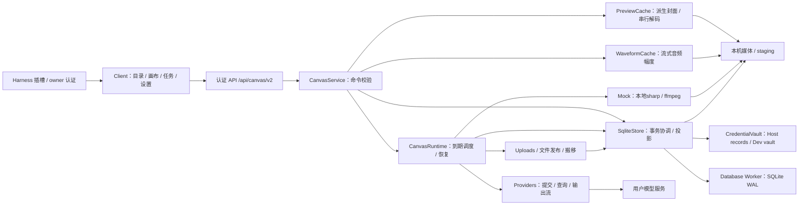

# 当前架构与执行流程

文档类型：解释；负责人：项目维护者；最近核对：2026-10-27。每次模块 / SDK / 存储边界变化时复核。

当前是单个 Harness 插件中的模块化实现。决定和取舍见 [ADR](adr/index.md)，精确接口见[数据参考](data-api.md)。

## 组件与职责

| 实际模块 | 职责 / 边界 |
| --- | --- |
| [shared/contracts](../src/shared/contracts.ts)、[v2](../src/shared/v2.ts) | 图 / 任务 DTO、领域验证、规范化 hash；不依赖 Node I/O / React / SDK |
| [client/index](../src/client/index.tsx) | main / sidebar / settings 插槽、右侧类型与正文两阶段注册 / disposer、样式生命周期；不依赖 Harness workspaces，所有入口共享API |
| [client/ui](../src/client/ui.tsx) | 共享宿主通用组件、单选组合与独立开发兜底；仅 Harness 入口导入官方运行时，不复制内部组件 / CSS |
| [CanvasApp](../src/client/Canvas.tsx) / [ProjectList](../src/client/ProjectList.tsx) | 默认项目列表、一级目录管理、点击进入编辑器；页面内保留文件夹筛选 |
| [CanvasWorkspace](../src/client/Canvas.tsx) / [Settings](../src/client/Settings.tsx) | React Flow、保存后返回列表、上传 / 拖拽、资源 / 生成名称、任务目录与详情、Host 路径设置 |
| [RelationshipEdge](../src/client/RelationshipEdge.tsx) | BaseEdge保留Bezier / 标签 / 热区，仅单选直接入出边叠加CSS流光；浏览器投影，不进入持久图 |
| [TaskDialog](../src/client/TaskDialog.tsx) / [UiDateTimeRangePicker](../src/client/UiDateTimeRangePicker.tsx) / [UiPagination](../src/client/UiPagination.tsx) | 显式联合查询、目录表格、保留列表的详情返回、取消过期请求；通用本地时区双月日期范围与受控分页 |
| [useCanvas](../src/client/useCanvas.ts) / [api](../src/client/api.ts) | 草稿与基线、对象 hash / 变更批次、重试 identity、冲突、状态读取；隐藏侧栏暂停轮询但保留自动保存，不直连模型 |
| [MentionPromptEditor](../src/client/MentionPromptEditor.tsx) / [控制器](../src/client/promptEditorController.ts) / [promptReferences](../src/client/promptReferences.ts) | 生图 / 生视频共享@编辑、光标 / 输入法 / 原子标签、portal候选与合法自动入边；只改既有prompt和edges |
| [promptMentions](../src/shared/promptMentions.ts) | UUID字符串解析、引用编号；Service构建快照前验证和解析，历史任务 / 节点原字符串不重写 |
| [TtsEditor](../src/client/TtsEditor.tsx) / [EmotionTextArea](../src/client/EmotionTextArea.tsx) / [TtsSettings](../src/client/TtsSettings.tsx) | 无模型 / 入边的语音参数、计数器、文档原始情绪标签与全局服务配置；Client只调owner API |
| [host/index](../src/host/index.ts) | apply / inject / effects；connection 与 credentials 适配 |
| [service](../src/host/service.ts) | 请求 Schema、图 / 输入 / 引用 / 队列校验、任务动作和媒体读取 |
| [runtime](../src/host/runtime.ts) | 自有 AbortController、active 网络步骤、SQL due / lease、启动恢复、停止 |
| [sqlite-store](../src/host/sqlite-store.ts) | 单写者锁、图 / 目录事务、宿主投影、任务详情、发布 / 搬移清单、旧源迁移；store.ts 保留类型 / 重导出 |
| [persistence](../src/host/persistence/database.ts) | SQL RPC、Worker 单连接、FK / CAS / token 校验，schema 为可执行字典 |
| [media/files](../src/host/media/files.ts)、[uploads](../src/host/media/uploads.ts) | 安全名称、根目录、流接收 / hash / fsync、复制发布、导入任务 |
| [media/previews](../src/host/media/previews.ts) | 独立封面缓存、sharp / ffmpeg解码；不修改资产 / 任务 / DDL，Service停止时取消并等待处理 |
| [media/waveforms](../src/host/media/waveforms.ts) / [AudioNode](../src/client/AudioNode.tsx) / [AudioPlayer](../src/client/AudioPlayer.tsx) | 真实PCM流式幅度、小JSON派生缓存、仅输出的音频卡片 / 自定义定位播放；复用认证media与共享媒体事件，不写原资产或任务 |
| [ResourceNode](../src/client/ResourceNode.tsx) / [mediaLayout](../src/client/mediaLayout.ts) | 纯媒体、悬浮名称、顶部操作栏、宽高比、当前页面旋转 / 单视频播放；原文件模态与下载仍走media |
| [credentials](../src/host/credentials.ts) | Harness 持久 record 与开发 LocalVault；新 Key 新版本 |
| [providers](../src/host/providers.ts) | 协议请求、外部 ID / 状态 / 错误与输出流；不写 SQL / 图 |
| [mockModels](../src/shared/mockModels.ts) / [mockGeneration](../src/host/mockGeneration.ts) | 固定 Mock 能力 / 严格快照身份；本地渲染暂存文件，复用同一Runtime发布 / 恢复，不读取Key或调用模型网络 |
| [GenerationNode](../src/client/GenerationNode.tsx) / [GenerationParameters](../src/client/GenerationParameters.tsx) | 最小空态、媒体无父外框、分组仅主图端点、固定收起 / 展开隐藏编辑、动态参数弹层；只改变显示，旧边assetId保持 |
| [dev/server](../src/dev/server.ts) | 回环会话认证和 Vite；复用同一应用 / Runtime |

提案中的 application / TaskCommands 独立目录目前收敛在 Service / Store 方法，没有建立所有拟议类。SQL 仍由 Service / Uploads 与 Store 共同协调；IO 发布期间的 Store 串行队列可能阻塞其他命令。启动投影仍载入全部画布 / 资产 / 生成历史，增量 SQL 不等于端到端只遍历增量。

右侧正文从宿主插槽的useTabInfo读取visible；keepMounted由宿主管理会话、停靠和标签存活，CanvasApp只保留项目与图的React状态。活跃状态不进入useCanvas载入effect的依赖，不以切换显示重建基线；媒体、键盘、弹窗与合成提示按活跃状态停止，命名容器查询适应实际面板宽度。Host API / Runtime / DB均无变更；装配依据见[ADR-0034](adr/0034-conversation-sidebar-canvas.md)。

## 生命周期与执行

1. 校验 Node≥22.13 / 配置，取得 dataDir heartbeat 锁并兼容旧 PID 锁。
2. 开 SQLite Worker：WAL、FULL、FK；校验 schema、任务目录 / 详情完整性，更新运行 token。
3. 载入配置 / 凭据版本、投影；只读迁移旧 JSON / 媒体 / 私有任务，verified 后才启动执行。
4. Runtime 恢复原 ID / 输出；issued 无确认转待确认。注册认证 exact routes，通过 ctx.effect 管理释放。
5. 停止时拒绝新 handler，停止领取、abort 可取消 IO、等待活动步骤，关 DB 后释放锁。fsync 等 OS 调用不保证固定收尾时限。

页面 / Peer / Request 不拥有 Runtime。已接受生成和完整接收的 import 不随页面关闭取消。停止 Harness、卸载后台插件或关机会停止本地执行；数据库线程不是独立守护进程。官方依据和反例见 [ADR-0017](adr/0017-harness-official-cases-and-badcases.md)。

生成请求只提交已保存的节点与修订，事务登记 catalog + details + references 后返回 202。Runtime 先持久 issued，再提交模型；回执 / 外部 ID 持久化后按 due 查询。输出描述固定输出 ID，文件 manifest 发布 / 核验后登记输出关系，全部完成才成功。

生成网络步骤有配置并发；远端等待释放槽。导入 / 文件搬移另有有界维护扫描，调度领取不等待复制完成。文件发布仍使用 Store 串行边界；不能宣称大文件不会影响接受延迟。

## 数据、引用与恢复

SQLite 是结构数据事实来源；宿主投影仅在成功 COMMIT 后发布。图 hash / receipt、目录修订、任务两表和清单独立但共享事务协调。节点 / 边通过稳定 asset ID 引用字节；名称改变只改变目标与实际位置。

文件与 SQL 不跨介质原子：先 staging manifest，复制 / hash / fsync / 不覆盖发布，再 ready；重启按 manifest 续跑。搬移复制后用 row_version + layout_revision CAS，过期操作 superseded，原文件保留。旧 JSON 和原媒体不改写；迁移完成前建立原任务凭据版本。

Harness Vault 依赖 ctx.credentials 公共 record，不假定宿主具体加密实现。开发 vault 文件权限 0600，包含明文 Key。公开任务摘要不含私有输出 URL / Key；详情包含脱敏错误与原输入快照。owner 认证是整个插件实例边界，不是多人 ACL。

## 构建与浏览器

[build.mjs](../scripts/build.mjs) 清理 lib，构建 Node ESM 与 Harness lazy client 工厂；共享 React / React DOM / JSX runtime / Cordis / Zod / Harness UI primitives，React Flow 私有打包。worker.mjs / schema.sql 放 lib 根，避免 bundled import.meta.url 位置变化导致缺文件。两个入口产出声明。控件复用边界见 [ADR-0020](adr/0020-harness-shared-ui-primitives.md)。

浏览器入口默认挂载 `ProjectList`，只读取目录；点击项目后挂载 `ReactFlowProvider` / `CanvasWorkspace`。返回等待 `flush` 成功，再卸载图与状态轮询；失败保留编辑器。文件接收 / 生成提交中暂停返回，已接受任务继续归宿主 Runtime 管理。页面刷新回列表，不新增路由 / 持久默认项目；见 [ADR-0018](adr/0018-project-list-before-canvas-editor.md)。

React Flow 稳定nodeTypes / memo和IntersectionObserver控制可见媒体。图片 / 视频节点仅加载压缩封面，点击选中的视频才挂载循环播放器，移出 / 取消选择卸载。封面在Host按需生成，队列独立于付费任务，原media继续供下载 / 放大 / 引用；无需持久数据迁移。Bezier只影响边的视图映射，见[ADR-0022](adr/0022-media-covers-and-curved-edges.md)。用户提供的SVG由[MediaIcon](../src/client/MediaIcon.tsx)统一呈现。

0.2.28使用稳定edgeTypes / memo自定义Bezier边。基础投影只依赖图边、素材与连线选择；焦点投影仅克隆单选节点的直接入出边，相关data.flowing仅浏览器使用，不相关对象复用。BaseEdge保持原交互，SVG亮段由归一化CSS动画沿source到target推进，没有逐帧React更新 / 路径测量 / 模糊滤镜。active、框选和每Workspace一个visibilitychange监听控制流光挂载，减少动态效果为静态蓝线；见[ADR-0036](adr/0036-selected-node-relationship-flow.md)。

[gpu.ts](../src/client/gpu.ts) 检查CSS能力、WebGL / 可选WebGPU硬件标识；软件 / 未确认时回退，不保存 / 上传显卡标识。0.2.20由[视口订阅](../src/client/useViewportCompositing.ts)监听实际transform，仅确认硬件且固定倍率平移暂设will-change:transform；倍率变化、混合缩放、静止200ms、隐藏 / 失焦和卸载释放。基础translate:none，React Flow inline transform保持；状态只写容器属性，不逐帧React重绘或重挂媒体。实际清晰度 / 图层 / 性能仍待人工测量，见[ADR-0032](adr/0032-scale-aware-viewport-compositing.md)和[验证记录](verification.md)。

0.2.21保留React Flow Pane的矩形、指针捕获与自动平移，由[框选订阅](../src/client/useMarqueeSelection.ts)读取已提交矩形并通过[严格几何判断](../src/client/marqueeSelection.ts)重建完整选择，阻止原生未测量候选直接进入受控选择。FlowNode的展示尺寸仅存在浏览器，尺寸缓存按结果 / 旋转 / 分组身份隔离，供屏幕外节点判断；不修改CanvasNode持久格式。同步原生lookup与受控选择，松手捕获最终坐标，取消清理。共享[选择上下文](../src/client/CanvasSelection.tsx)限制Portal工具栏与生成结果操作，框选时关闭浮动编辑器；不重挂媒体，也不因选择写图。自动平移导致的视口保存仍沿用原行为。
