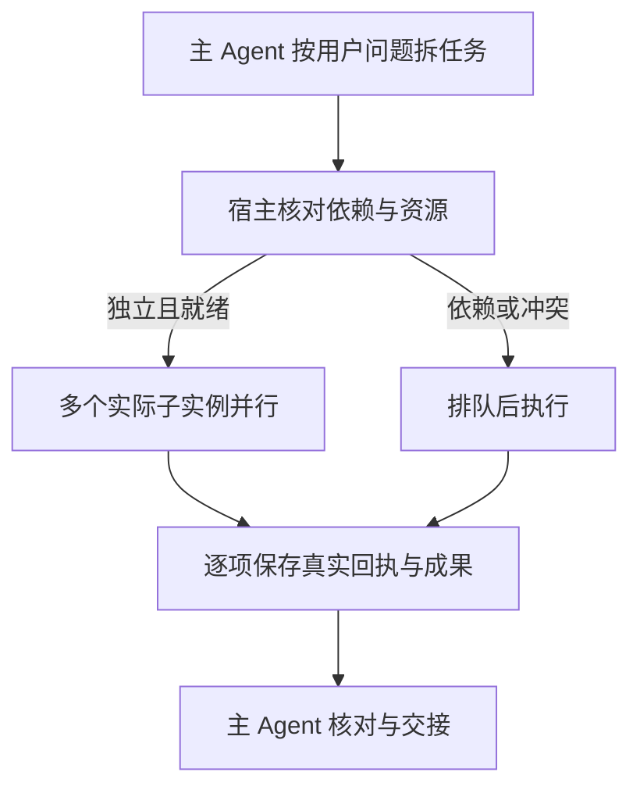

# Agent 按需并行与画布操作光标规划 v0.1

文档类型：设计提案；负责人：项目维护者 / 开发执行者；最近核对：2026-11-12。

状态：部分实施。原规划基线为源码版本 0.2.140；下文现状、建议入口和后续任务保留为规划时的记录，不代表全部已实现。

## 0.2.141 首版实施范围

已实现仅供主级使用的 `canvas_execute_parallel`，内部启动多个真实画布执行实例；独立任务并行，同节点 / 上游 / 素材冲突排队，dependsOn指定前置任务，默认最多4个活动子 Agent且可配1–4。批量入口本身不占名额；逐项保存实际回执，失败仅阻塞依赖分支。

光标只显示在执行实例所属画布内，完整画布 / 侧栏共用层；其他角色继续由 Agent 空间展示。真实操作事件、逐实例结束清理、单实例镜头、重连 / 缺口不重播与后台停止均已接入。普通编辑使用相关资源指纹与短事务提交，付费生成保持原快照。没有复制参考项目源码或新增依赖。

首版没有新增规划中的通用 `canvas_dispatch_batch`、专业角色批量 DAG、持久调度 sidecar或排队界面。专业单委派仍用原工具并共享容量。最终契约、实现与证据见 [ADR-0101](../adr/0101-parallel-canvas-executors-and-observed-cursors.md)；模型与视觉效果由用户手验，实际安装结果以141 manifest为准。

## 用户目标与方案结论

主 Agent 根据用户的问题选择必要的角色、任务和执行顺序。独立任务可以并行，有前置依赖或资源冲突的任务串行；简单问题保持最短流程，不强制多 Agent、不强制并行。

按需并行调度覆盖所有子 Agent，并允许同一角色拥有多个实际运行实例。例如，主 Agent 同时派发三个画布任务，分别修改互不相关的节点，由三个画布执行实例并行处理，各自显示对应的操作光标。不同专业角色、同一专业角色的独立资料分析也可以并行，但不使用 swarm 光标。

画布光标借鉴 [swarm-cursors](https://github.com/DhvanilPatel/swarm-cursors) 的视觉方式，仅用于 `canvas-executor` 画布操作子 Agent，只在它实际操作的画布内展示，接入自己的真实工具操作与回执。主 Agent 和其他专业子 Agent 不显示此类光标，其协作状态继续由 Agent 空间表达。同一画布最终提交仍经过宿主受控事务，保持节点、引用和任务一致性。

| 驱动因素 | 设计要求 |
| --- | --- |
| 用户问题决定工作方式 | 主级选择必要角色与串行、并行、混合顺序；宿主验证依赖与资源冲突 |
| 同角色集群执行 | 角色类型与运行实例分开；每个实例独立 childId、taskId、授权和回执，仅画布执行实例有画布内光标 |
| 操作过程可见 | 移动、落点、点击、编辑、连线反馈对应实际操作，不由成功文案或预制表演推断 |
| 存量画布兼容 | CanvasGraph、主库与任务库 DDL 保持；增量调度记录使用独立 sidecar |
| 人工接力与恢复 | 维持主级决策、用户认可和图片/视频手动生成；接管撤权、取消与幂等保持 |

## 已核实的现状

1. [委派工具](../../src/host/agent/delegation.ts)每次启动一个子 Agent，通过 `delivery: caller` 等待 `child.result`；当前没有一次派发多个独立任务的批量入口。
2. [工具注册](../../src/host/agent/preset.ts)未声明 `isConcurrencySafe`。当前安装的 Harness 工具运行时对未声明的调用采用 exclusive 调度，因此只修改提示词不能可靠获得并行。
3. [协调服务](../../src/host/agent/coordinator.ts)目前每个委派作用域最多两个活动批次，专业与执行共用容量；超额报错，没有任务就绪队列。模型工作已在 `serial` 之外，但授权预留、写入和保存仍需检查锁的范围。
4. [操作呈现](../../src/host/agent/presentation.ts)每个画布只保存一个最新意图；[客户端](../../src/client/useCanvasPresentation.ts)据此聚焦和居中。多个执行实例直接复用这个单值会互相替代，无法可靠呈现多光标。
5. [执行清单](../../src/shared/execution.ts)已经支持精确参数授权，并在意图比较中排除 revision/note；[写入入口](../../src/host/agent/preset.ts)仍用全图 revision。不同节点的合法并行任务也会因别人先提交而遇到版本冲突，必须增加受影响资源核验。
6. [Agent 空间投影](../../src/client/agentSpaceState.ts)已有按 childId 展示同角色多个实例的基础，仍需验证并行人数、实际工作状态和交接动画；不能只增加光标而遗漏协作显示。

现有边界以 [ADR-0086](../adr/0086-creative-projects-and-scoped-canvas-executor.md)、[ADR-0087](../adr/0087-visible-agent-collaboration-journal.md)、[ADR-0088](../adr/0088-saved-artifact-handoff-and-independent-identity.md)为准；本提案实施后，需要新 ADR 部分替代 0086 的同步单批次与容量策略。

## 参考项目可借鉴的部分

已读取官方 [README](https://github.com/DhvanilPatel/swarm-cursors/blob/main/README.md)及 [swarm.js](https://github.com/DhvanilPatel/swarm-cursors/blob/main/swarm-rebuild/swarm.js)，核对日期为 2026-11-12；这些是该项目的一手证据。

| 实现方式 | 本插件的应用 |
| --- | --- |
| SVG 光标及不同操作形状 | 箭头表示定位，文本光标表示真实字段更新，连线状态表示连接操作 |
| `moveTo` 的短弧线与缓入缓出 | 光标平滑移向实际目标，终点绑定真实节点、字段或端点 |
| `click` 的按压缩放 | 真实操作派发时出现短促点击反馈，提交结果另行确认 |
| 每个光标独立任务、动作与身份 | 每个实际执行实例独立光标、名称、任务和动作状态 |
| `available` 按依赖挑选任务 | 借鉴任务就绪判断用于宿主调度；不为其他角色增加光标展示 |
| 统一帧循环、transform 更新 | 动画局部更新，避免每帧刷新 React Flow 节点或整张画布 |

原项目是网页重建动画，任务和完成条件来自它的重建引擎。我们的完成条件来自实际图提交、已保存成果和原任务回执。首版不引入页面清空、重建覆盖层、音效或无任务的光标游走。

README 明确写明尚无许可，且部分实现源于另一项目。本提案采用视觉及行为思路，独立实现插件适配；直接引入代码或原始 SVG 之前需要解决对应复用许可。

## 主 Agent 如何决定并行

主级先理解用户目标，再拆出最小必要任务。每项任务明确角色、输入来源及版本、预期成果、前置条件和操作范围。宿主能验证声明的依赖和资源冲突，但不能代替主级判断创作上的语义依赖。

| 用户问题与任务关系 | 执行方式 |
| --- | --- |
| 只修改一个节点标题 | 一个执行任务，无需其他专业角色 |
| 分别修改 A、B、C 三个独立节点 | 同一执行角色的三个实例并行 |
| 修改同一节点的提示词和参考关系 | 合并为一项任务，或按明确顺序执行 |
| 用已确认的简报分别研究视觉风格与音频方案 | 输入独立、互不等待时，不同专业角色并行 |
| 同一编剧角色分析几份独立材料 | 多个同角色实例并行，分别保存独立成果 |
| 先定人物，再据此写镜头与音频 | 人物方案先完成并通过必要认可，后续独立分支再并行 |
| 审查尚未完成的产出 | 等待实际成果；有独立可审查分段时仅审查已完成部分 |
| 用户明确要求逐步确认 | 按确认点串行，不绕过用户决策 |

专业成果仍保留真实来源、独立 artifactId、版本、依赖和认可状态。执行子 Agent 仍只接受主级明确 commands，专业子 Agent 不因并行获得写图、重新委派或代用户决策权限。

## 任务派发与调度

建议新增主级批量入口 `canvas_dispatch_batch`，名称暂定。保留现有单任务工具，避免要求旧会话重写调用方式。

批量任务使用现有专业任务与执行清单的共享 Schema，包含 groupId、独立 taskId、角色/类型、输入、已明确的依赖和操作范围。主级可提交一组独立任务，也可提交包含已知前置条件的混合任务。

宿主按以下过程调度：

1. 预检整组身份、重复 ID、授权清单、来源范围、依赖环与容量。
2. 持久保存批次身份与已提交清单，再为就绪任务分配独立 childId，启动前绑定精确权限。
3. 在并发预算内启动无冲突任务，超额任务留在队列中；等待资源不占运行名额。
4. 每项独立保存成果或操作回执、释放资源，再启动新的就绪任务。
5. 某项失败仅阻塞依赖它的任务；其他独立分支继续。最终返回逐项结果和未完成原因，不用一个失败丢弃全部成功项。

首版建议每个根任务作用域最多四个活动子 Agent，专业与执行共用预算，允许配置为一以退回串行。四是建议值，实施时用真实 SDK 离线并发验证及实际供应商限流校准；增加并发可能增加上下文开销，不能保证所有问题更快或更便宜。

批量入口内部调度保证多个任务真正同时运行，不依赖模型恰好在同一步输出多个调用。不能把所有现有工具统一标记为 concurrency safe；保留宿主原有工具调度规则，不修改上游 SDK。

若后续执行参数取决于专业产出，先回传实际成果，由主级核对、完成必要决策并构造下一份精确清单。不得把“待子 Agent 自行补全”的自由模板提前授予写权限。

新增调度状态建议使用独立版本化 sidecar，记录有限批次、依赖与排队原因；既有 creative、ledger、collaboration 记录继续作为成果、操作和公开过程的事实来源。新投影增量展示排队/运行/阻塞，旧记录按原语义读取，不批量改写历史状态。

## 画布并行的冲突与提交边界

“不同节点”是并行的候选条件，还需核对其引用和布局关系。宿主从真实 commands 推导读集合、写集合与资源占用；主级给出的“互不相关”不能直接成为绕过校验的授权。

| 资源 | 并行规则 |
| --- | --- |
| 不同已有节点 | 无交叉读写时并行；首版使用节点粒度，避免过早引入字段锁 |
| 同一节点 | 写任务互斥，按明确顺序或合并清单 |
| 同一素材、来源或上游成果的读取 | 允许共享读；固定身份与版本，保留依赖校验 |
| 引用连线 | 核验源节点/素材读范围、目标引用集合写范围及实际边；目标引用变更互斥 |
| 多个新节点自动布局 | 在短临界区按最新图分配并预留位置，防止同时占用同一空位 |
| 图级或无法证明独立的操作 | 串行；不能靠不同任务名称判定独立 |

最终图提交继续走现有事务和 CAS。针对普通节点编辑：

1. 捕获获授目标和相关引用的基准指纹。
2. 执行准备可以并行，实际提交进入短临界区。
3. 在提交区重新读取图、验证 control epoch、清单与相关资源指纹。
4. 如果仅无关节点改变，则以当前 revision 提交本操作的有限补丁；不能提交子 Agent 的旧整图快照。
5. 如果目标或依赖已改变，则阻塞并回报主级，重新读取后决定，不自动覆盖。

模型等待、子任务完整生命周期、光标动画与可见性确认均不应占住图提交锁。导入中网络、媒体处理及成果文件 I/O 需逐项检查并移出不必要的长锁，保持“预留—外部处理—提交”之间的身份与撤权校验。

图片/视频仍由用户检查并点击生成；FishTTS 仍需已有明确授权。付费生成及已接受任务维持原始请求快照和幂等身份，不套用普通图编辑的 revision 更新策略。

## 真实多光标展示

新增画布局部、只读的 `AgentCursorLayer`，覆盖无限画布与素材创作项目中的画布入口，共享同一实现。只接受角色为 `executor` 且与当前画布、root、epoch 匹配的真实操作事件；主级与 story/assets/shots/audio/review/voice 的事件不能创建光标。光标限制在对应画布容器内，不显示在对话区域、Agent 空间或画布外部。

每个光标由 rootId、childId、taskId 和 operationId 关联，显示“画布操作”及实例编号。编号用于辨识同角色实例，不能只用角色名称作为状态键。颜色跟随 Harness 主题，与 Agent 空间中的画布执行角色保持辨识一致；不据此给其他专业角色创建光标。

| 实际操作 | 展示 |
| --- | --- |
| 创建节点 | 光标到已分配画布位置；开始操作时点击反馈，真实图提交后出现节点 |
| 修改节点 | 光标到对应节点或可定位字段；文本更新时显示文本光标 |
| 创建引用连线 | 光标从真实源端点移动到目标端点；正式边以成功提交为准 |
| 移动节点 | 显示原位置到真实新位置的动作；提交后的图位置是事实 |
| 导入素材 | 光标到分配位置；实际进度和原媒体加载机制继续负责处理过程 |
| 等待资源 | 不播放点击或拖动；尚未实际开始画布操作的排队实例不显示光标 |
| 操作失败或实例取消 | 停止当前动作；实例结束时收起自身光标，真实失败/取消状态留在协作记录 |

光标生命周期以对应画布执行实例的实际操作批次为准：

1. 该实例开始实际画布操作时出现；单条命令结束但同一批次仍有操作时，可以继续移向下一目标。
2. 默认在该实例结束画布操作批次后自动收起自己的光标，不等待主 Agent 的最终回复或媒体生成结束。这里的结束后自动收起为本提案的默认行为。
3. 多实例并行时，A 结束只收起 A；B、C 仍在操作则继续显示。全部执行实例结束后，画布内不残留 swarm 光标。
4. 失败终止、取消、人工接管、实例销毁、画布切换或授权 epoch 失效时清理对应光标及动画。迟到事件不能让已结束实例的光标重新出现。
5. 页面/画布恢复时只恢复仍在有效操作批次中的执行实例；历史成果、已结束批次和 Agent 空间待机状态不创建光标。

工具操作不是浏览器鼠标点击。光标表示真实工具正在作用的位置：开始反馈对应已获准派发，成功反馈对应实际回执；不会派发 DOM 点击或伪造 `isTrusted` 输入。

显示来源建议为有限的操作事件：prepared、started、committed、failed、cancelled，并提供对应执行实例操作批次的结束事实，带单调序号、运行身份、资源锚点和必要 revision。结束事实用于清理该实例光标，不能仅凭一条命令 committed 就判断整个批次完成。公开事件不包含原文全文、完整 prompt、凭据或媒体 token。

现有“最新导航意图”继续承担打开画布及主视角跟随。并行光标使用按实例管理的活动集合和有限事件缓冲，不能塞进一个最新意图字段。已有 presentation SSE 增量承载这些投影，每个 root 共享订阅，动画帧只在客户端插值，不逐帧发网络请求。

不能只靠最新快照播放动作：同一操作可能在两次快照间完成。需要序号去重与有限补偿，断连/基线恢复展示当前事实，不重放历史点击，更不重放执行。操作成功与“用户已看见动画”分别核验。

画布坐标跟随现有 React Flow 视口变换；SVG 光标按屏幕尺寸保持可辨认。节点主体位置使用已有尺寸和坐标，只有确需定位字段或端点时按事件读取实际 DOM，不新增逐帧布局测量。缩放、平移与浮窗不能导致热点漂移。

多个任务运行时，跟随视角选定一名主关注执行者，其他光标在当前视野中展示；不被每个完成事件轮流拉走。用户主动浏览的暂停、十秒空闲恢复和回复结束规则延续 [ADR-0077](../adr/0077-automatic-agent-follow-and-manual-idle.md)。隐藏页面、不可见画布与减少动态偏好停止插值动画，恢复只同步当前状态。

光标层不拦截指针、键盘或画布框选；不驱动图修改，不遮住对话正文。动画不能成为执行前提，无可见窗口时仍按原授权执行并返回真实回执。

## 模块与责任

| 上下文 / 负责人入口 | 模型 | 上游与下游关系 | 需要维护的翻译 |
| --- | --- | --- | --- |
| 主级：methods / delegation | 用户目标、任务依赖、精确清单 | 用户 → 主级 → 调度（客户/供应商） | 用户问题变成必要任务；决定语义依赖和确认点 |
| 调度：新 scheduler / coordinator | 批次、就绪队列、预算、资源读写集合 | 主级 → 子运行（客户/供应商）；共享 execution Schema | 精确清单变成活动实例，验证资源冲突 |
| 专业：creativeTools / creative | 来源范围、成果、版本、认可 | 主级 → 专业 → 成果仓储（共享契约） | 分段读取形成独立成果；不可越范围写图 |
| 执行：preset / CanvasService | 精确命令、指纹、CAS、实际回执 | 调度 → 执行 → 既有 Store（遵从既有服务） | 有限补丁转现有图事务；普通编辑与任务提交分开 |
| 观察：presentation / collaboration / client | 操作事件、实例活动、动画姿态 | 执行 → 只读投影 → 光标与 Agent 空间（共享契约） | 回执变展示；观察不能反向发起执行 |

由项目维护者决定产品取舍，开发执行者负责实现、自动化验证、文档和本地交付；用户负责浏览器视觉与交互验收。

## 备选方案与可逆性

| 方案 | 结论及原因 |
| --- | --- |
| 只改主 Agent 提示词，要求多调用 | 不采用：工具默认 exclusive，容量和单值呈现问题没有解决 |
| 所有工具开启并行，子级直接提交整图 | 不采用：同图 revision、引用和授权易互相覆盖 |
| 单个执行实例串行工作，播放多个光标 | 不采用：不能满足真实多个画布任务并行 |
| 同宿主受控任务队列、多个实例、短事务提交 | 推荐：复用原生 spawn 和持久回执，可按节点与依赖控制并行 |
| 单执行 Agent 的内部工具批量并行 | 后续评估：适合极小同类操作，但需独立子任务归属和工具并发声明，首版优先独立实例 |
| 独立分布式调度服务 | 暂不采用：当前没有跨宿主需求，增加部署与恢复成本 |

正面：独立工作减少等待，同角色可形成真实画布集群，操作和失败更容易理解。

负面：多上下文和调度记录有成本，资源核验与事件补偿增加复杂度；共享节点、用户确认和模型限流仍限制并行收益。

调度与光标是可逆模块决策：并发设为一可退回顺序，关闭光标不影响已提交操作，独立 sidecar 不改变旧图解析。代码回退成本中等，需要保持工具兼容及清楚区分未知任务。若实测事务长期占锁、来源/成果保存成为瓶颈、供应商限流明显或出现跨设备需求，再重审预算、仓储与部署边界。

## 实施顺序与验收

1. **任务与事件契约**：定义批量输入、依赖、身份、资源范围和操作事件；先验证旧工具与旧记录可读。登记新 ADR，并同步数据接口。
2. **实际并行执行**：接入批量调度、同角色多实例、资源互斥、相关指纹核验和短事务；先用离线模型确认多个执行实例确实重叠运行。
3. **画布执行光标与 Agent 空间状态**：仅为画布执行实例接入画布内光标，完成移动、点击、连线、主题、视口、去重、隐藏/恢复和结束退场；其他角色只接入原有 Agent 空间状态，复用已认可素材。
4. **专业协作与主级策略**：用单节点、独立节点、独立资料、多角色、同角色与混合依赖的请求验证“按问题选择”；不规定所有项目都走同一流水线。
5. **本地交付**：必要专项与 `npm run check` 通过后更新版本、双构建、核验包与实际安装，备份现有 web profile、安装、重启 3080 并 HTTP 加载核验；成功前保留上一可用包。浏览器由用户验收。

| 属性 / 指标门槛 | 证据入口 / 频率 | 失败处置 |
| --- | --- | --- |
| 真并行：两个以上独立执行任务的子运行时间区间实际重叠 | 扩展 [Agent 专项](../../tests/agent.test.ts)，每次调度变更；替身模型屏障验证，无需付费任务 | 停止发布，定位模型等待或工具调度串行点 |
| 冲突隔离：同一资源并发写为零；共享读取允许；无关 revision 更新不误拒绝合法有限补丁 | 新调度/提交专项，每次权限或写入变更 | 串行或阻塞，不自动覆盖 |
| 依赖与分支：前置未完成启动为零；一分支失败不取消独立成功项 | 队列、失败、逐项回执专项，每次调度变更 | 保留成果与回执，明确待处理依赖 |
| 预算：运行实例不超过配置值；资源等待不占运行名额；取消后等待任务不再启动 | 原生 SDK 离线调度专项，每次容量变更 | 关闭新增启动并释放预留，修复后复测 |
| 权限方向：专业新增写权限为零；执行仍逐项匹配 commands；接管后迟到提交为零 | 原 [Agent 专项](../../tests/agent.test.ts)及真实 SDK 测试，每轮实现 | 拒绝操作，阻止候选安装 |
| 光标真实性：每个动作可关联真实 child/task/operation；重复事件不重复点击；基线恢复不重播 | 扩展 [呈现专项](../../tests/canvasPresentationRender.test.tsx)、新 cursor 专项；每次事件/渲染变更 | 停止错误表现，实际回执继续保留 |
| 光标范围与退场：非 executor 光标为零；画布外光标为零；结束实例残留为零；一实例结束不清掉其他运行实例 | 新 cursor 专项及用户手动检查；每次实例生命周期或挂载变更 | 按实例身份清理，拒绝非执行角色和迟到事件 |
| 观察隔离：观察、重连、隐藏恢复导致的新 spawn/写图/生成次数为零 | [协作专项](../../tests/collaboration.test.ts)、[客户端专项](../../tests/collaborationClient.test.tsx)，每轮实现 | 关闭观察副作用，保留业务状态 |
| 性能：无逐帧图持久化、网络发包、整图 React 更新和新增布局测量；隐藏时无活动动画帧循环 | 动画驱动计数与现有投影测试，每次光标变更 | 降级静态当前位置，修复后恢复动画 |
| 兼容：旧 CanvasGraph、两库 DDL、任务与成果身份不变；旧单任务工具可用 | 全量 check、产物和实际安装核验，每次交付 | 不安装失败候选，保留上一包 |
| 用户观感：能辨认多个执行实例，缩放热点正确，正文/输入/拖动不被遮挡，串行任务无假并行 | 用户手动检查无限画布与素材项目画布，每次视觉交付 | 根据实际反馈修正，不以自动化代替验收 |

重启时排队/运行任务转为需要核对的中断状态，不自动再次启动；主级读取已保存成果和逐项回执后，以新授权批次继续。调度或观察记录故障应阻止新的不确定派发，不能抹去已提交图操作。有限事件缓冲满时返回需要同步的标记，不能静默伪装完整动作历史。

实施前剩余两个技术核对点：用真实 SDK 验证同根多实例的取消与交付语义；用普通编辑、连线和导入验证相关指纹及长锁拆分。均由开发执行者在第一、二步完成，不需要用户补充技术配置。

## 本轮规划核验

本轮仅新增本提案。运行全量 `npm run docs:check` 时发现四处既有本地引用目标缺失，分别位于 ADR-0093、ADR-0098（两处）和 ADR-0100；这些引用未由本轮修改。实施前需要核对原交付文件实际位置并修复引用，不能声称全量文档检查已通过，也不能用虚构文件补齐原交付证据。
