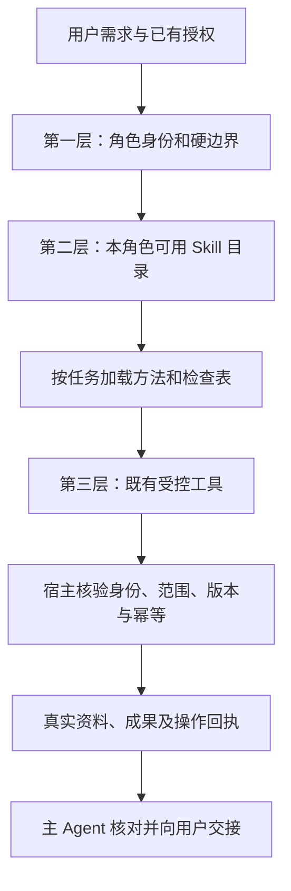

# 所有 Agent 的三层 Skill 挂载方案 v0.1

文档类型：设计提案；负责人：项目维护者 / 开发执行者；最近核对：2026-11-12。

状态：已批准实施；正式决定见[ADR-0104](../adr/0104-agent-skills-and-host-authority.md)。设计基线0.2.143，运行实现0.2.144；下文保留原方案表述，实际加载、授权和兼容行为以ADR及源码为准，安装核验以版本manifest为准。

## 1. 方案结论

保留现有 **1 个主 Agent + 7 类子 Agent**，按三层组织能力：

1. **角色提示词**：说明“你是谁、负责什么、哪些事不能做”，每次运行保留。
2. **任务 Skill**：说明“这类事怎样做好”，按当前任务加载方法、技巧、示例和检查表。
3. **工具与宿主代码**：真正读取资料、保存成果、操作画布、校验权限、调用模型及核对回执。

Skill 是可加载的工作方法。加载 Skill 不会增加工具权限，也不会使一个 Agent 自动具备视频观看、音频试听、剪辑、混音等能力。

本方案规划 **28 个 Skill：4 个共享 Skill、24 个角色 Skill**。挂载表示该角色可发现和加载这些 Skill；正文只在任务需要时进入上下文，不在每次启动时全部拼入提示词。

导演意图、镜头序列设计、单镜画面设计归属 **分镜 Agent（shots）**，分别使用独立 Skill、独立任务和成果。主 Agent 负责拆任务、协调用户决定及审阅交接，不默认兼任这些专业工作。编剧负责故事与剧本，不再重复制定摄影、机位和镜头运动。

视频声音规则采用用户要求：**支持声音生成的模型默认开启声音，只有用户明确要求无声时才关闭。** 没有固定音色、没有音频参考、没有对白，都不能作为关闭声音的理由。具体声音由镜头需求决定，不强制添加音乐或对白。

## 2. 当前实现与拟调整内容

| 内容 | 当前已核实 | 本方案拟调整 |
| --- | --- | --- |
| 专业方法 | `METHODS` 中的角色方法直接拼进专业子 Agent 的系统提示词 | 身份和硬边界留在提示词；制作方法拆为按需加载的 Skill |
| 方法查询 | `canvas_method({role})` 返回该角色整段方法 | 增加细分目录与加载入口，旧入口逐步转为兼容查询 |
| Skill 基础能力 | 当前依赖树包含 `@deepseek-ai/dsh-skill`，版本 `0.2.1-rc.2` | 在画布预设中显式接入原生注册表和自己的受控消费者 |
| 配套消费者 | 本工作区未安装 `dsh-tool-skill`、`dsh-skill-filesystem` | 首版采用插件随包内容和角色专用只读加载器，不依赖通用文件发现 |
| 角色权限 | 预设有工具限制和执行时 guard，专业角色只读授权资料、保存成果 | Skill 入口加入两处限制；原有读写权限继续由宿主校验 |
| 导演与序列设计 | 责任分散于编剧、分镜和主级制作规划，没有明确独立阶段 | 分镜 Agent 分别承担导演、序列、画面设计；复杂项目按依赖交接 |
| 声音设计 | 音频方法强调 FishTTS，容易把视频声音都理解成后期配音 | 分开规划视频原生声音、角色音色参考和独立 TTS |
| 视频音频开关 | Seedance、Wan 的默认参数已开启；主级曾在清单中主动改为 `false` | 提示词保留默认开启规则，宿主核验关闭依据，防止再次误关 |
| 成果 | 专业成果已有来源、依赖、独立 ID、版本和认可状态 | 复用现有成果格式；Skill 不引入新的画布或任务数据结构 |

现状证据：

- [角色提示词与制作方法](../../src/host/agent/methods.ts)。
- [提示词组装、方法工具和工具权限](../../src/host/agent/preset.ts)。
- [专业与执行委派](../../src/host/agent/delegation.ts)。
- [创作来源与成果契约](../../src/shared/creative.ts)。
- [模型定义](../../src/shared/modelCatalog.ts)、[默认参数](../../src/shared/contracts.ts)、[视频参数处理](../../src/shared/video.ts)。

原生 Skill 机制依据本机依赖中的 `node_modules/@deepseek-ai/dsh-skill/README.zh.md` 和 `lib/types/index.d.ts` 核对。下文出现的 `canvas_skill`、`canvas_skill_resource`、`skillNames` 和文件布局均为**本项目拟新增内容**，不是当前已有 API。

## 3. 三层分别放什么



| 第一层：始终保留 | 第二层：按需加载 | 第三层：代码强制执行 |
| --- | --- | --- |
| 角色职责；谁可以向用户提问、委派和写画布 | 叙事结构、导演方法、镜头语言、资产设计、声音设计技巧 | 真实 root/child 身份、角色白名单、资源授权 |
| 默认中文提示词；遵循用户指定语言 | 提示词结构、正负面示例、各类创作模板 | 模型与供应商的有效选择、输入能力与数量校验 |
| 不猜素材 ID；不冒充用户认可或视听审查 | 参考用途规划、依赖检查和一致性检查表 | 真实素材、历史依赖、边与提示词 token 的核对 |
| 视频默认有声音；用户明确无声才关闭 | 环境声、动作音效、音乐、对白的逐镜设计 | 音频开关支持性及用户关闭依据校验 |
| 图片/视频由用户点击生成；TTS 需明确授权 | 生成前清单、交接说明、试听流程方法 | 精确 commands、TTS 授权、CAS/epoch、稳定操作 ID |
| 已保存成果按实际 ID 交接；未知任务不重提 | 长文分页、成果组织、续作与阻塞说明 | 文件保存核验、任务回执、取消与人工接管 |

不能为了缩短提示词而把硬边界只放进 Skill。即使加载失败、模型漏读方法或任务很简单，这些边界也必须有效。

## 4. 全部角色挂载总表

下表中的 Skill 名称是拟使用的稳定名称，均采用 `canvas-` 前缀。完整触发条件及产物见后文。

| Agent | 第一层保留的职责 | 第二层角色 Skill | 第三层现有主要工具 |
| --- | --- | --- | --- |
| 主 Agent `main` | 理解需求、拆任务、用户决定、审阅、构造执行清单、核对真实回执 | `canvas-production-orchestration`、`canvas-plan-review-and-handoff`、`canvas-execution-manifest-planning`、`canvas-voice-choice-and-audition` | `canvas_open`、`canvas_inspect`、`canvas_read_reference`、`canvas_select_model`、`canvas_review_plan`、`canvas_specialist`、`canvas_execute`、`canvas_execute_parallel`、`creative_project`、`creative_artifact_decide`、`canvas_handoff_generation`、`canvas_show_audio`、受控文档及下载工具 |
| 编剧 `story` | 分析原文、故事结构、人物关系、剧本与叙事节奏 | `canvas-narrative-structure`、`canvas-long-source-adaptation`、`canvas-script-writing` | 授权来源/成果读取、`canvas_inspect`、`canvas_view_image`、`creative_artifact_save`、`creative_progress`、`structured_output` |
| 视觉资产 `assets` | 人物、服装、场景、道具设计与资产一致性 | `canvas-visual-asset-design`、`canvas-asset-consistency`、`canvas-asset-generation-spec` | 授权来源/成果/素材读取、图片查看、专业成果保存及交接 |
| 分镜 `shots` | 导演意图、镜头序列、单镜画面、视频动态提示词 | `canvas-director-intent`、`canvas-shot-sequence-design`、`canvas-shot-composition`、`canvas-video-shot-prompt` | 授权来源/成果/素材读取、图片查看、专业成果保存及交接 |
| 音频 `audio` | 逐镜声音设计、对白旁白、原生声音与独立 TTS 的分工 | `canvas-shot-sound-design`、`canvas-dialogue-and-narration`、`canvas-tts-specification` | 授权来源/成果/素材元数据读取、专业成果保存及交接 |
| 音色查找 `voice` | 依据 Fish 官网公开证据找候选，交回主级与用户选择 | `canvas-fish-voice-discovery`、`canvas-fish-voice-evidence` | `fish_voice_search`、`fish_voice_read`、授权成果读取、专业成果保存及交接 |
| 审查 `review` | 依据证据核对简报、资产、镜头、引用、声音与交付缺口 | `canvas-production-review`、`canvas-reference-continuity-review`、`canvas-sound-and-delivery-review` | 授权来源/成果/素材读取、图片查看、任务查询、专业成果保存及交接 |
| 画布执行 `executor` | 按精确清单建改节点、连线、导入原媒体及执行已授权 FishTTS | `canvas-execution-procedure`、`canvas-execution-receipts` | `canvas_inspect`、`creative_artifact_read`、`canvas_create_node`、`canvas_update_node`、`canvas_connect`、`canvas_import_attachment`、受限 `canvas_generate`、`canvas_task`、`structured_output` |

这是主要工具与职责的对应表，不替代源码中的完整 allowlist。所有角色共用的现有只读工具仍按实际授权开放。执行角色不因可以读取成果而获得读取长文原文或保存专业草稿的能力。

每个角色还挂载下表允许的共享 Skill。主级通过成果接口了解专业产出，不默认把所有专业 Skill 正文也加载到自己的上下文；每个子实例独立加载自己的方法。

## 5. 四个共享 Skill

| 编号 / Skill | 允许角色与触发 | 输入 → 输出 | 方法与检查重点 |
| --- | --- | --- | --- |
| C1 `canvas-creative-source-reading` | main、story、assets、shots、audio、review、voice；任务涉及授权原文或来源定位时加载 | `sourceId`、索引、授权范围 → 已读范围、引用位置、待读缺口 | 分页推进，不把章节标题当成全文理解。主级读取目录和进度，专业角色读取正文；加载本 Skill 不改变工具范围 |
| C2 `canvas-model-aware-references` | main、story、assets、shots、audio、review；设计或审查生成输入时加载 | 实际模型能力、素材与生成时依赖 → 逐项用途、类型计数、待补项、必要排除依据 | 分镜构图与人物/服装/场景/道具分开；音色参考按能力适用；核对真实 `assetId`、token、模式和数量 |
| C3 `canvas-generation-prompt-craft` | main、assets、shots；需要编写或汇总图片/视频提示词时加载 | 用户语言、资产规范、镜头规格 → 图片静态提示词或视频动态提示词 | 默认中文，引用逐份说明用途；动作、空间与摄影表达具体，避免互相矛盾的运动和泛化形容词 |
| C4 `canvas-saved-artifact-handoff` | 全部角色；读取、保存或交接专业成果/执行回执时加载 | 实际保存回执、版本、依赖 → 可复用成果 ID、简短交接和缺口 | `taskId` 与 `artifactId` 分开；已保存不重复输出全文或重存；主级确认和用户认可分开；执行角色只交接操作回执 |

共享表示内容复用，不表示读写权限共享。例如 voice 加载 C1 仍只能读取本批获授来源；executor 加载 C4 仍不能调用 `creative_artifact_save`。

## 6. 每个角色的 Skill 细案

### 6.1 主 Agent：统筹与决策

| 编号 / Skill | 何时必须加载 | 输入 → 交付 | 核心方法与技巧 |
| --- | --- | --- | --- |
| M1 `canvas-production-orchestration` | 多阶段创作、长文改编、多人多镜视频、跨批次续作 | 用户目标、已存成果和进度 → 必要角色、阶段、依赖、确认点及下一批任务 | 先复用已认可成果；区分专业内容依赖和可并行执行；按问题选最少必要角色；不把所有项目套成影视流水线 |
| M2 `canvas-plan-review-and-handoff` | 有尚待用户决定的完整方案，或准备交接图片/视频生成 | 方案、有效选择、授权和实际执行回执 → 审阅卡片或生成交接 | 已明确授权不重复确认；修改方案按实际影响判断重新确认；节点准备完成后使用现有交接入口，不声称已生成 |
| M3 `canvas-execution-manifest-planning` | 任何画布写入委派前 | 用户获授目标、专业成果、精确参数和实际引用 → 完整 `commands`、依赖与执行方式 | 每项稳定 `operationId`；禁止“执行 Agent 自行优化”；共用固定只读素材允许并行；目标/素材冲突排队；缺参数先补成果 |
| M4 `canvas-voice-choice-and-audition` | 用户需要固定音色、FishTTS 试听或复刻时 | 已有 voice ID/参考音频，或 voice 候选成果 → 用户选择、授权数量和试听交接 | 用户已有 ID 不重复查找；官网不可访问交给用户可访问设备选 ID；通过原 TTS 队列真实合成，播放器只跟踪原任务且不自动播放 |

主级基础提示词保留需求判断、用户决策、角色分工和方法加载规则。它可以处理简单改名和明确参数调整；需要专业创作时委派相应角色，不为每个小操作额外生成制作文档。

### 6.2 编剧 Agent：故事与剧本

| 编号 / Skill | 触发 | 输入 → 交付 | 核心方法与技巧 |
| --- | --- | --- | --- |
| S1 `canvas-narrative-structure` | 需要创作简报、故事结构、广告/教程/纪录内容结构 | 目标、受众、原文与素材 → `brief`，含内容结构、人物关系、事件与节奏 | 目的决定结构；剧情关注动机和变化，广告关注卖点，教程关注理解顺序；不固定套剧情片模板 |
| S2 `canvas-long-source-adaptation` | 长篇、多集或需要分批读取的改编 | 授权来源、已读范围、共享设定、当前批次 → 整体/分集纲要及分段改编成果 | 先保存全局框架，再逐段推进；事实与改编决定分开；保留来源位置；未读和中断保持缺口 |
| S3 `canvas-script-writing` | 写或修改可拍摄剧本 | 已明确简报和结构 → `brief` 内容中的场景、动作、对白及叙事节拍 | 场景目标清楚，动作可呈现，台词服务人物；给分镜留出摄影方案空间，不重复编写景别、机位和镜头运动 |

编剧可提出情绪和内容重点，例如“这里需要表现人物犹豫”，但具体用特写、停顿、视线匹配或运动镜头由分镜角色决定。

### 6.3 视觉资产 Agent：准备真实一致性输入

| 编号 / Skill | 触发 | 输入 → 交付 | 核心方法与技巧 |
| --- | --- | --- | --- |
| A1 `canvas-visual-asset-design` | 设计人物、服装、场景、道具或风格规范 | 简报、导演意图和用户素材 → `asset-spec` 资产清单与外观规格 | 唯一逻辑名称；稳定外观与可变项分开；考虑所需角度、表情、空间关系；避免无用途地扩大资产数量 |
| A2 `canvas-asset-consistency` | 资产复用、版本变化、多角色或多镜一致性 | 已认可规范、真实素材、依赖 → 不变量、适用范围、版本与复核项 | 人物、服装、道具分别绑定；旧镜头使用原资产版本；不能以标题或源节点最新输出猜身份 |
| A3 `canvas-asset-generation-spec` | 准备资产生图节点 | 外观规格、模型能力和真实参考 → 生图提示词、参数建议、精确引用及用户验收项 | 单张图承担明确用途；选合适视图和构图；输出给主级构造清单，专业角色不建节点、不提交生成 |

真实资产图片由用户生成和认可后才成为镜头的已认可依赖。文字方案、待生成节点和真实图片必须在成果中分清。

### 6.4 分镜 Agent：导演、序列、画面与动态

| 编号 / Skill | 触发 | 输入 → 交付 | 核心方法与技巧 |
| --- | --- | --- | --- |
| D1 `canvas-director-intent` | 多镜视频需要统一表达，或用户要求导演/风格方案 | 简报、剧本、用途、比例、时长和限制 → `shot-plan`：导演意图 | 确定观众应感受到什么、信息揭示顺序、视点、表演方向、视觉/声音风格与节奏；不替用户更换模型或增加制作范围 |
| D2 `canvas-shot-sequence-design` | 两个以上镜头需要顺序、衔接和节奏设计 | 剧本、导演意图与资产条件 → `shot-plan`：镜头序列 | 每镜目的、编号、时长、承接、轴线、视线和运动连续性；信息与情绪节拍分配；避免每镜内容相同或机械切换 |
| D3 `canvas-shot-composition` | 设计或修改单镜画面、分镜图 | 本镜目的、序列、真实资产 → `storyboard`：单镜构图/分镜说明 | 主体站位、前中后景、景别、机位、镜头运动、灯光、视觉重点；静态起点与后续动态分开 |
| D4 `canvas-video-shot-prompt` | 准备视频生成节点 | 已明确镜头、声音计划、模型和引用 → `shot-plan`：逐镜动态提示词与生成规格 | 按时间展开动作、空间变化和摄影运动；处理模型时长/模式；说明每份参考用途；同步填写声音设计与开关建议 |

复杂项目依赖顺序为：


同一个 shots 实例可以完成紧密相连的几个任务，也可以分批保存独立成果。导演与序列尚未明确时，不同时派发互相猜测的完整方案；序列明确后，独立镜头可以交给多个 shots 实例并行。

单镜、小修改或用户已有完整镜头方案时，直接加载 D3/D4 即可，不补做导演提案。主级在委派中明确本批属于哪个阶段，不能只写“帮我做一下分镜”。

### 6.5 音频 Agent：声音计划与生成方式

| 编号 / Skill | 触发 | 输入 → 交付 | 核心方法与技巧 |
| --- | --- | --- | --- |
| AU1 `canvas-shot-sound-design` | 视频需要声音计划，或调整逐镜声音 | 导演意图、镜头序列、模型声音能力 → `audio-plan`：原生声音计划 | 环境声建立空间，动作音效对应事件，音乐服务情绪，留白服从内容；默认让视频模型生成适合本镜的声音 |
| AU2 `canvas-dialogue-and-narration` | 需要对白、旁白或台词节奏 | 剧本、镜头时长、角色和表达目的 → `audio-plan`：台词、说话者、时间与节奏 | 区分画内对白/画外旁白；估算可读字数与停顿；不用“有台词”冒充已实现嘴型同步 |
| AU3 `canvas-tts-specification` | 明确需要独立 FishTTS 语音或固定音色样例 | 用户音色决定、授权、参考音频与真实原文 → `audio-plan`：TTS 文本、音色来源、参数、连接及待补项 | ID 与单参考音频互斥；`reference_text` 是参考原文，`prompt` 是新朗读文字；不在 TTS 文本插媒体 token |

三个概念必须分别记录：

| 概念 | 能解决什么 | 不能由此推断什么 |
| --- | --- | --- |
| 视频原生声音生成 | 模型随视频输出环境声、动作音效、音乐或对白，效果受模型能力影响 | 不保证固定音色、完整配乐、专业混音或跨镜声音一致 |
| 视频音频参考 | 支持该输入的模型可以参考音色、节奏或声音内容，具体用途需明确 | 不支持音频参考不等于不能生成声音；有参考也不保证最终音色一致 |
| 独立 FishTTS | 按明确音色 ID 或授权参考音频生成语音素材 | 不代表插件已有音乐生成器、剪辑、混音或自动合成成片 |

每镜声音计划至少记录：环境声、动作音效、音乐是否适用、对白/旁白、说话者、预期时间、生成方式、音色参考是否适用、待补项和用户无声要求的依据。

声音开关规则：

1. 所选模型支持可控制的声音生成开关：默认保持 `generateAudio=true`；只有用户明确要求无声的镜头才能设为 `false`。
2. 模型没有对应开关：按实际能力和参数契约处理，不强塞 `generateAudio` 字段，不把“没有开关”认定为无声或有声。
3. 模型不支持音频参考：跳过固定音色参考，不为补音色自动生成 TTS，不因此关掉原生声音。
4. 用户需要独立 TTS：原生环境声、音效和音乐仍按镜头需求保留；对白冲突通过声音方案解决，不能自行将整段视频静音。
5. 用户要求声音而模型确实不支持：向主级报告缺口，由主级协调用户决定，不承诺模型会生成、不静默换模型。

### 6.6 音色查找 Agent：候选与证据

| 编号 / Skill | 触发 | 输入 → 交付 | 核心方法与技巧 |
| --- | --- | --- | --- |
| V1 `canvas-fish-voice-discovery` | 用户需要新 Fish 音色，且没有可直接使用的 ID 或参考音频 | 主级给定角色、语言、年龄、风格 → 官网候选详情链接与筛选说明 | 公开 discovery 页筛选和分页；最多沿真实返回信息读取；找不到不猜 ID，不反复派发同一失败查找 |
| V2 `canvas-fish-voice-evidence` | 任何候选交接前 | 本批 `fish_voice_read` 真实回执 → `audio-plan` 中的候选 JSON、适合理由、限制或空候选 | 完整保留详情实际字段、URL、时间、哈希；最多 8 项；官网读取失败保留原因；不下载样音、不声称已听过或 ModelLink 兼容已验证 |

V2 是 voice 任务的必备方法，宿主仍用现有候选回执校验。网络受限或无可用候选时，主级给用户手动选 ID 的指引；收到用户提供的 ID 后，不再次要求官网核验。

### 6.7 审查 Agent：依据证据给结论

| 编号 / Skill | 触发 | 输入 → 交付 | 核心方法与技巧 |
| --- | --- | --- | --- |
| R1 `canvas-production-review` | 方案、剧本、资产或镜头阶段交付前 | 简报、阶段成果、已明确决定 → `review`：内容符合度、问题和待定项 | 先看目标，再看内容、依赖与交付；按严重程度排序；只建议相关修改，不扩大制作需求 |
| R2 `canvas-reference-continuity-review` | 多镜一致性或视频输入清单审查 | 历史资产依赖、真实图片、镜头清单和执行回执 → `review`：身份、引用、连续性与覆盖检查 | 分镜不能替代原始资产；数量与模式匹配；实际边/token/参数一起核对；未获授依赖交回主级补范围 |
| R3 `canvas-sound-and-delivery-review` | 声音方案、生成结果或最终逐镜交付核对 | 声音计划、参数、任务元数据、用户试听/观看反馈 → `review`：开关依据、声音缺口、交付状态 | 无声是否有用户依据；旁白/对白/音色不混用；视频/音频没有实际查看能力时保持待用户验收 |

问题记录包含实际证据 ID、问题、影响、严重程度、建议和验证状态。图片实际看过、视频元数据核对过、用户反馈过，是不同证据，不能统一写成“已完整审查”。

### 6.8 画布执行 Agent：精确落地与回执

| 编号 / Skill | 触发 | 输入 → 交付 | 核心方法与技巧 |
| --- | --- | --- | --- |
| E1 `canvas-execution-procedure` | 所有执行批次启动时必备 | 主级精确 commands、绑定范围、当前控制权 → 依序执行与逐项工具回执 | inspect 后执行；只调整允许更新的 revision/note；不自行改提示词/模式/引用；缺条件停止依赖链；不再委派 |
| E2 `canvas-execution-receipts` | 批次中发生重试、阻塞、部分完成及结束交接 | 宿主回执、任务状态、已完成项 → `completed` 或 `blocked`，附事实和缺口 | 原操作 ID 查回执；未知任务不重提；排队不等于成功；呈现不等于用户看到；保留独立已完成项 |

E1/E2 改善执行步骤的组织，不能覆盖宿主对 commands 的逐项匹配。实际并行、资源排队、短事务和光标生命周期继续由已有实现负责，Skill 不模拟多实例或重播操作。

## 7. 挂载、加载和资源读取

### 7.1 推荐接入方式

采用 **原生 Skill 注册表 + 随包 Skill 内容 + 本项目角色白名单消费者**。

原生已提供：

- `ctx.skills.register(...)`：注册嵌入式内容。
- `ctx.skills.registerProvider(...)`：注册内容提供方。
- `ctx.skills.list / snapshot / get`：按 `scope`、`cwd`、`signal` 查询摘要或加载正文。
- `renderSkillContent(...)`：把已加载定义渲染为统一的 `<skill_content>` 内容。
- `modelInvocable / userInvocable`：控制面向模型或用户的调用展示。

原生没有替本项目实现：

- `main/story/assets/shots/audio/review/voice/executor` 的职责白名单。
- 当前批次素材授权、执行清单及付费生成授权。
- 当前任务需要哪些制作 Skill 的判断。
- 每个批次固定的 Skill 版本、哈希和资源读取范围。

因此不能只在预设内注册 Skill 后便认为完成角色隔离。原生查询会合并作用域链与全局层；`modelInvocable=true` 也不等于“仅指定角色可以调用”。必须在目录、正文和辅助资源三个入口重复核验本项目白名单及随包身份。

注册表服务由宿主提供，各角色预设在自己的 scope 内注册对应内容。加载时从真实 Agent 和协调服务取得 role、scope、工作区及批次绑定，再调用原生查询；模型不能在工具输入中自行传入 role、scope 或 cwd。即使目录中存在全局 Skill，也先经过本项目白名单和随包身份过滤。

### 7.2 拟定文件组织

以下目录尚未创建，实施时再加入：

```text
src/host/agent/
  skills/
    manifest.ts
    loader.ts
    catalog.ts
    common/
      creative-source-reading/SKILL.md
      model-aware-references/SKILL.md
      generation-prompt-craft/SKILL.md
      saved-artifact-handoff/SKILL.md
    main/...
    story/...
    assets/...
    shots/...
    audio/...
    voice/...
    review/...
    executor/...
```

每个 Skill 的 `SKILL.md` 保持短正文；较长示例、细分制作模板和检查表放该 Skill 的 `references/`，按需读取。首版不包含需要终端执行的脚本，不开放任意本地目录或联网下载依赖。

生成的随包清单包含：稳定名称、描述、适用角色、版本、正文哈希、辅助资源及各自哈希。构建时解析 Markdown 并嵌入内容，或显式复制受控资源并核对产物；不能依赖运行机器存在源码目录。

### 7.3 原生注册示意

下例展示实际原生字段；`bundledDefinition` 是实施时由本项目构建得到的内容。

```ts
ctx.skills.register({
  name: 'canvas-director-intent',
  description: '为多镜视频制定导演意图；由分镜角色承担专业设计。',
  whenToUse: '复杂视频需要统一视点、节奏、表演和视听风格时。',
  source: 'bundled',
  invocation: { modelInvocable: true, userInvocable: false },
  resourceBase: { kind: 'opaque', description: '随包资源由 canvas_skill_resource 只读加载' },
  content: bundledDefinition.content,
  metadata: { version: bundledDefinition.version, sha256: bundledDefinition.sha256 },
})
```

`metadata` 中版本与哈希的含义由本项目实现，原生注册表不会自动固定批次版本。角色权限放宿主清单，不依赖 frontmatter 中可被内容作者任意填写的声明。

### 7.4 拟新增模型工具

所有角色开放以下两项只读能力，并加入现有 `restrict` 与执行时 guard。

| 拟新增工具 | 输入 | 输出及限制 |
| --- | --- | --- |
| `canvas_skill` | `{action:"list"}` 或 `{action:"load",name:"canvas-..."}` | list 只给本角色允许的摘要、版本和触发条件；load 校验身份后返回统一渲染的正文及本批固定版本/哈希 |
| `canvas_skill_resource` | `{name:"canvas-...",resource:"references/example.md"}` | 仅加载该批已获准 Skill 清单中的资源；校验资源 ID 和哈希；拒绝任意路径、目录遍历、外部 URL 和跨 Skill 越权 |

调用示意，不是当前可执行工具：

```json
{"action":"load","name":"canvas-director-intent"}
```

加载成功只表示工作方法可用，不产生新专业成果，不写画布，不创建生成任务。辅助资源中的案例也是方法资料，不能当成用户项目的真实素材。

### 7.5 任务如何选择 Skill

主级提示词保留简短角色目录及“专业任务按阶段选择方法”的规则。目录先给名称和触发条件；完整方法在确定任务后加载。

专业委派建议新增可选字段 `skillNames`，由主级选择本批方法。现有调用不填写时使用角色最小默认组合；原有参数、操作 ID 和回执语义保持。宿主校验 skillNames 属于真实 role，不允许用该字段改预设、模型或工具权限。

| 角色 | 无显式选择时的最小专业方法 | 按任务增加的方法 |
| --- | --- | --- |
| story | S1 + C4 | 长文加 C1/S2；剧本加 S3 |
| assets | A1 + C4 | 复用/版本加 A2；生图规格加 A3/C2/C3 |
| shots | D3 + C4 | 导演加 D1；多镜序列加 D2；视频规格加 D4/C2/C3 |
| audio | AU1 + C4 | 台词加 AU2；独立 TTS 加 AU3；输入参考加 C2 |
| voice | V1 + V2 + C4 | 仅必要授权来源读取加 C1 |
| review | R1 + C4 | 引用连续性加 R2/C2；声音/结果交接加 R3 |
| executor | E1 + E2 + C4 | 首版不加载创作设计方法 |
| main | 常驻简短目录，正文按当前动作加载 | 多阶段加 M1；待决定方案/生成交接加 M2；写入委派加 M3；音色选择/试听加 M4 |

这里的“最小默认组合”只适用于实际启动该角色任务，不意味着每次主级对话都启动全部角色。共享 Skill 还必须满足相应读取/生成规划触发条件。

宿主在子实例开始前完成必备方法加载，再把主级明确选择的方法装入该实例上下文；可选辅助资源由实例按需读取。执行任务不新增自由创作选择字段，E1/E2 由宿主固定。

专业实例发现还需要某个本角色方法时，可以从目录追加加载；每次仍复验白名单与本批固定包版本。若缺的是用户决定、未获授素材或上游成果，不能靠多加载 Skill 代替补齐条件，必须交回主级。

同一角色多个并行实例共用不可变随包内容，但各自保留任务输入、来源范围、成果和回执。一个实例加载或结束不能改变其他实例的方法或状态。

### 7.6 版本、失败与可信来源

1. 每批在宿主绑定 Skill 名称、版本、正文及资源哈希；同批不随目录变更换成新内容。新批次使用新包版本。
2. 原生注册表正文按次向提供方加载、并不缓存。本项目需保存批次已核验定义，不能把目录缓存当成版本固定。
3. 目录只展示与随包清单身份匹配的定义；同名全局 Skill 或较近作用域覆盖若不是预期内容，拒绝加载，不能按名称直接信任。
4. 必备 Skill 缺失、哈希不符或加载失败时，阻塞受影响任务并报告主级；可选示例缺失时说明限制，保留已加载的有效方法。无关任务可以继续。
5. 取消、人工接管或实例结束后，迟到加载结果不能注入新上下文；读取必须传递当前 `signal`，并复验实例绑定。
6. 用户原文、网页和素材描述仍是任务资料，不能升级成系统方法。首版仅使用维护者审阅、随包核验的 Skill；未来引入外部 Skill 需另行决定。
7. Skill 版本记录放独立宿主记录或 sidecar，关联真实批次；不写进 CanvasGraph、旧素材、已保存任务快照或历史成果，不批量迁移旧记录。

## 8. 一套 Skill 文档的统一内容

每份 Skill 使用以下结构，帮助角色明确怎样工作、何时停止：

| 部分 | 内容 |
| --- | --- |
| 名称与描述 | 精确说明适合解决什么问题，避免“万能创作” |
| 适用与不适用 | 触发条件、已有成果可直接复用的情况、是否需要前置决定 |
| 输入要求 | 真实来源/成果/素材、版本、当前角色获授范围和待补条件 |
| 工作步骤 | 先查资料，再做专业判断，再保存；长任务按阶段推进 |
| 具体技巧 | 该角色真正使用的专业方法与正反例 |
| 交付格式 | 使用现有 draft 类型、独立成果 ID、依赖、引用位置及简短交接 |
| 检查表 | 内容、引用、模型能力、声音策略及角色边界中与本任务相关的项 |
| 阻塞与降级 | 哪些缺口必须交回主级，哪些独立项还能继续 |
| 辅助资源 | 仅列需要时加载的随包模板或示例 |

“有一个 Skill 文件”不是完成标准。正文必须能指导对应角色产出可用成果；技巧、示例和检查表都要与本插件的真实能力相符。

例如 D1 的结果应明确“观众跟随哪个角色理解事件，何时揭示什么信息，紧张感怎样递增”；D2 应给可执行镜头序列；D3 应给具体站位和摄影设计。三个文件不能只是把“你是导演/分镜师”换一种说法。

## 9. 分镜视频从开始到结束怎样协作

这是复杂项目的完整流程。已有素材或用户已明确某阶段时，从有效成果继续，不强制重做全部流程。

| 阶段 | 负责人 / Skill | 交付和继续条件 |
| --- | --- | --- |
| 1. 接需求与读取已有成果 | main / M1、C4，必要时 C1 | 明确目的、时长、比例、风格、素材与实际缺口；有效模型选择复用，需要新选择时由用户决定 |
| 2. 内容和剧本 | story / S1/S2/S3 | 保存简报、纲要和本批剧本；原文读取范围真实，未读部分保留 |
| 3. 导演意图 | shots / D1 | 保存视点、叙事表达、表演、视觉和声音风格；主级汇总需要用户决定的内容 |
| 4. 镜头序列与资产规划 | shots / D2；assets / A1/A2 | 基于已明确导演意图，独立部分可并行；需资产结果的具体镜头等待依赖；主级审阅完整阶段方案 |
| 5. 资产图片准备与认可 | assets / A3/C2/C3；main / M3/M2；executor / E1/E2 | 主级给精确清单，执行者建节点；用户点击生图；读取原任务与真实图片，由用户认可后记录状态 |
| 6. 单镜画面与声音计划 | shots / D3；audio / AU1/AU2 | 在序列和必要资产明确后并行设计；分镜图如需实际生成，重复执行准备、用户点击与验收流程 |
| 7. 固定音色准备（仅需要时） | main / M4；voice / V1/V2；audio / AU3 | 已有 ID 不查找；缺 ID 才取候选；用户选择和授权；执行者通过原 TTS 队列生成，拿到真实素材后再连接 |
| 8. 视频规格与输入清单 | shots / D4/C2/C3；review / R2/R3 | 每镜动态提示词、模式、时长、真实参考与用途、声音计划；必要依赖超限交回主级协调 |
| 9. 视频节点落地 | main / M3；executor / E1/E2 | 独立已确定节点默认最多 4 个真实执行实例；依赖/冲突排队；逐项核对实际参数、连线、声音开关及回执 |
| 10. 用户生成与结果核对 | main / M2；review / R1/R2/R3 | 主级交接，用户亲自点击生成；原任务查询，不重提未知/失败任务；真实结果元数据与用户观看/试听反馈分开 |
| 11. 修改与交付 | main / M1/M2/C4，按问题委派专业与执行角色 | 保留已认可版本和成功项；用户决定后准备必要修改；交付逐镜素材、语音和制作文档 |

没有固定人物音色需求时，**跳过第 7 步即可**，第 6、8、9 步仍正常规划和开启视频声音。

终点仍是插件支持的逐镜视频、图片、语音素材与制作文档。剪辑拼接、字幕、混音和成片导出目前需要外部工具；本方案不虚构剪辑 Agent 或把制作文档称为成片。

## 10. 现有方法怎样迁移

| 当前内容 | 迁移位置 | 仍保留在第一层或代码的内容 |
| --- | --- | --- |
| `GENERATION_PROMPT_LANGUAGE` | C3 放详细示例 | 默认中文及用户显式语言优先保持常驻 |
| `GENERATION_REFERENCES`、`GENERATION_CONSISTENCY` | C2 + A2/R2，角色按需加载 | 不猜 ID、历史依赖、真实边/token、模型上限、音色适用边界继续由常驻提示词与宿主共同约束 |
| `METHODS.story` | S1/S2/S3 + C1 | 来源范围、未读不冒充已读；移除与分镜重叠的摄影设计职责 |
| `METHODS.assets` | A1/A2/A3 | 素材真实身份及认可状态仍保留 |
| `METHODS.shots` | D1/D2/D3/D4 | 专业角色不写画布，不替用户选模型 |
| `METHODS.audio` | AU1/AU2/AU3 | 明确视频原生声音与独立 FishTTS 的能力差别；声音默认开启规则常驻 |
| `METHODS.voice` | V1/V2 + M4 的主级交接接口 | 官网证据、读取限额、ID 不猜、无样音下载、用户提供 ID 不重复核验仍有代码/常驻边界 |
| `METHODS.review` | R1/R2/R3 | 不虚构实际观看、聆听或用户认可 |
| `MAIN_PROMPT` | M1/M2/M3/M4 承接详细工作流程 | 用户决定、委派方向、生成授权、人工接管与真实回执常驻 |
| `EXECUTOR_PROMPT` | E1/E2 承接步骤与示例 | 精确清单、不能自行创作、TTS 限制、CAS/epoch/幂等继续常驻且代码强制 |

不要一次机械删除全部旧方法。先接通目录和加载，核验每个角色实际拿到所需方法，再移除重复的长文本。

旧 `canvas_method` 在过渡期保留名称和输入。新预设使用新的 Skill 入口；旧入口可以返回角色默认方法的兼容组合，但不得夹带其他角色方法或绕开白名单。是否长期保留在实施 ADR 中记录。

## 11. 实施顺序与验收要求

以下均为**后续实施工作**，本轮只提交方案。

1. **记录正式决定**：审阅后新增对应 ADR，明确三层职责、28 个 Skill、声音默认策略和旧方法兼容范围；不替代既有画布结构和执行授权约定。
2. **建立随包内容与加载入口**：完成清单、原生注册、角色目录、只读加载和资源读取；同步工具 restrict 与 guard。
3. **编写共享及角色 Skill**：逐份补齐真实输入、技巧、示例、输出和缺口处理；优先完成主级、分镜、音频、执行这条视频链，再覆盖其余角色。
4. **接入委派与版本绑定**：新增可选 skillNames、角色默认组合、必备加载和批次固定版本；验证原调用兼容，不改历史 ID、回执、认可和任务快照。
5. **收敛角色提示词和声音保护**：迁移重复方法；在主级、shots、audio 提示词保留默认有声规则；宿主在写入前核验用户关闭依据。
6. **通过必要检查后本地交付**：执行现有 `npm run check` 和产物核验管线，再按现有规则更新版本、双构建、打包、安装既有 web profile、重启 3080 并核验实际加载；用户手动验收。

声音保护建议复用已有用户决定与根任务授权绑定，在精确清单被接受及实际提交前核验：本轮把声音改为 `false` 时须有明确用户无声依据。依据由宿主绑定，不能只相信模型自由填写一句“用户要求”。旧无声节点、旧任务和历史素材保持原样；普通改名等操作不因历史 `false` 被拒绝，不自动把历史内容改为有声。

| 验收项目 | 必须达到的结果 |
| --- | --- |
| 八角色覆盖 | 每个角色可发现自己的目录，默认任务拿到必要方法，executor 不收到创作权限 |
| 角色隔离 | 知道别人的 Skill 名称也不能越权加载正文或资源；同名全局内容不能替代随包方法 |
| 按需加载 | 初始上下文保留身份、硬边界与简短目录；不全量注入 28 份正文；长示例只在需要时读取 |
| 必备与可选失败 | 必备缺失阻塞受影响任务；已完成成果保留；可选示例故障不伪装成功、不无限重试 |
| 专业职责 | 多镜任务可区分导演意图、镜头序列、单镜画面、声音设计与执行清单；主级不默认代写全部专业内容 |
| 默认声音 | 无明确静音要求的受支持模型保持开启；无音色/无音频参考/独立 TTS 都不触发整体静音；无开关模型不塞入无效字段 |
| 关闭依据 | 用户明确无声的目标可以关闭；模型自述不能伪造授权；历史无声节点的无关编辑仍可进行 |
| 素材和成果 | 真实参考、原始依赖、token 与边一致；独立 artifactId 和版本继续复用，不重渲染已保存文件或改写认可 |
| 真正可执行 | 原生注册、加载内容、资源和哈希都包含在产物及安装包；离开源码目录也能正常加载 |
| 并行与恢复 | 实例各有输入和回执；方法加载不改变并发上限，不扩展光标角色；取消/重连不重派任务、不重播历史 |
| 兼容与授权 | 原委派调用可用；CanvasGraph/DDL、任务身份不变；图片/视频仍手动生成；TTS 仍受精确授权 |

验证分两部分：宿主离线测试验证身份、范围、加载、版本、回执和声音开关；使用替身模型的工作流验证各角色能获取对应 Skill 并完成结构化交接。真正的导演质量、画面观感、视频声音效果由用户实际观看/试听验收，不能只用静态提示词断言代替。

主要取舍：

| 方案 | 判断 |
| --- | --- |
| 全部技巧继续写进每个角色提示词 | 修改简单，但方法越长越难维护，也无法细分任务加载 |
| 开放通用 Skill/终端/文件工具给全部角色 | 不采用；无法自然保留当前角色与资料边界 |
| 原生注册表 + 受控随包内容 + 角色消费者 | 推荐；复用 Harness 能力，同时保持本项目授权与可复现性 |
| 新增导演、序列、画面、剪辑等角色 | 本轮不采用；先细分现有 shots 的 Skill 和交付物，剪辑需实际工具能力另行设计 |

可以逐角色迁移和回退；失败时恢复上一已核验预设与包，不重新提交媒体生成、不撤销已保存成果。维护成本主要来自 28 份方法的一致性、包内资源校验和阶段选择；后续应依据真实任务表现合并重复 Skill，而不是持续增加文件数量。

## 12. 与既有约定的关系

- [ADR-0086：专业与执行分工](../adr/0086-creative-projects-and-scoped-canvas-executor.md)：本方案细分方法，不扩展专业角色写图或再次委派权限。
- [ADR-0088：已保存成果交接](../adr/0088-saved-artifact-handoff-and-independent-identity.md)：沿用真实独立 ID、版本与回执。
- [ADR-0089：生成参考与提示词引用](../adr/0089-agent-reference-generation-and-prompt-mentions.md)、[ADR-0090：模型能力感知的一致性参考](../adr/0090-model-aware-video-consistency-references.md)：详细方法进入 C2，但真实输入校验保持。
- [ADR-0091：Fish 音色、复刻与试听](../adr/0091-fish-voice-discovery-cloning-and-chat-auditions.md)：沿用官网证据、用户 ID、真实 TTS 队列和播放器边界。
- [ADR-0101：并行执行与观察光标](../adr/0101-parallel-canvas-executors-and-observed-cursors.md)、[ADR-0102：独立创建默认派发](../adr/0102-independent-create-default-dispatch-and-small-cursors.md)：沿用最多 4 个真实实例、资源排队及逐项回执。
- [ADR-0103：Agent 空间每角色一个形象](../adr/0103-agent-space-one-figure-per-role.md)：Skill 不新增形象，也不合并真实实例日志或光标。
- [ADR-0021：本地更新与包保留](../adr/0021-local-update-and-package-retention.md)、[运行指南](../operations.md)：实施后按既有安装与核验流程交付。

本次方案交付仅新增本文件，不修改角色提示词、工具、运行配置、版本、媒体和任务，不执行安装或重启。
