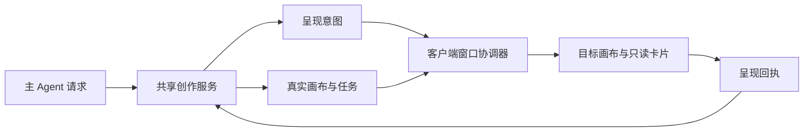

# Agent 操作可见、工作区联动与只读检视方案 v0.1

文档类型：设计提案；负责人：项目维护者 / 开发执行者；最近核对：2026-10-30。

状态：用户已批准两个批次，运行实现已完成，候选插件 0.2.89；浏览器验收待用户执行。下文保留批准时的设计依据，最终实现以 [ADR-0072](../adr/0072-agent-presentation-navigation-and-readonly-inspection.md) 和验证记录为准。

实施结果：独立窗口观察、原生导航 revision、晚加载补偿、只读输入 / 历史 / 引用预览、实际容器中心、固定起点避让、SSE 意图与读取兜底、真实 DOM 回执、用户暂停 / 恢复均已接入。已有标签通过公开 TabDomain.navigate 与 focus 复用；原生 tabActions.openTab 对浮窗会另开停靠标签，因此不用于已有标签更新。Host 最长等待 8 秒后返回延后展示，不阻塞人工接管、不重提交费任务。

## 目标与约束

用户要求 Agent 操作无限画布时“所见即所得”：自动打开工作区并进入实际操作的画布，节点位置合理，用户能查看提示词、参数与素材引用，并看到创作过程。

| 驱动因素 | 对方案的要求 |
| --- | --- |
| 操作可察觉 | 打开标签、进入目标画布、节点出现在视野和内容已呈现分别核验，调用导航方法不等于成功 |
| 只读仍可阅读 | 保留选中、详情、文本复制、素材预览、播放、历史记录和浏览视角；限制写入与任务动作 |
| 位置可理解 | 首个自动创建的节点以可见画布中心为起点，后续有序排布并避让节点和提示词卡片 |
| 用户自主观察 | Agent 跟随和用户选中分开；主动浏览暂停自动跟随，人工接管才改变写权限 |
| 稳定性与兼容 | 使用 Harness 公开导航能力；不改原模型选择器，不更改 CanvasGraph 或主库结构，不重提旧媒体任务 |
| 交付边界 | 自动化负责逻辑与 HTTP 加载检查；用户负责窗口、悬浮、布局和实际交互验收 |

## 当前代码证据

以下是源码确认的缺口；尚未自动操作浏览器复现本次现场。

1. [AgentControl](../../src/client/AgentControl.tsx) 把会话与画布观察放在原生模型选择组件的包装中。窗口控制依赖这个组件的挂载和生命周期，并不是插件独立的协作能力。
2. [客户端入口](../../src/client/index.tsx) 调用 `sidebarRight.openTabIn(sessionId, ...)`。已安装 SDK 明确说明：目标会话的窗口 store 未准备好时，此方法不执行操作。观察器在调用前更新 `lastCanvas`，没有核验成功或等待就绪后补执行。因此源码存在“请求被忽略却记为已打开”的路径。
3. [CanvasApp](../../src/client/Canvas.tsx) 仅响应 `requestedCanvas` ID 的变化，没有消费原生 `navigation.revision`。同一目标重新导航、用户先退回列表等情况缺少独立的导航处理；目录暂时找不到目标时也没有明确补偿。
4. [CanvasWorkspace](../../src/client/Canvas.tsx) 用 `!readOnly` 阻止 `FloatingEditor` 和 `GenerationSnapshotEditor` 挂载。节点可被选中，但当前输入和历史记录卡片被整个隐藏。
5. [创建工具](../../src/host/agent/preset.ts) 要求 Agent 提供 `position`，直接交给统一节点工厂；目前没有读取浏览器可见区域。手动添加节点有中心计算，Agent 没有同等机制。
6. [useCanvas](../../src/client/useCanvas.ts) 默认两秒刷新，仅同步最终图状态；连续操作可能被合并显示。`defaultViewport` 是初始值，刷新图也不会自动定位 Agent 正在处理的节点。
7. 现有模型包装和侧栏测试覆盖注册、透传、卸载、可见性及刷新，没有完成“窗口未打开 → 自动展开 → 进入目标 → 展示节点输入”的整条验证。

## 建议决策

采用插件内部的“协作呈现协调器”：Host 负责真实操作和呈现意图，客户端负责 Harness 窗口导航、实际视野与检视。呈现能力独立于模型选择器和画布标签的挂载，不给予 Agent 通用窗口或浏览器控制权限。

默认体验：

| 场景 | 预期行为 |
| --- | --- |
| 当前会话首次创建或打开画布 | 自动展开右侧工作区，激活「无限画布」，直接进入对应画布 |
| 已有画布标签显示列表或另一张画布 | 更新并核验原生导航参数，切到目标，不重复创建标签 |
| Agent 创建或修改节点 | 展示实际提交后的节点，定位到可阅读的位置，突出当前操作节点并打开只读输入卡片 |
| 用户点击节点 | 打开节点原有位置和风格的卡片，查看完整提示词、参数及引用；不需要接管 |
| 用户平移、缩放、点击其他节点、退出目标页或关闭标签 | 暂停该窗口本轮自动跟随，保留用户观察位置；Agent 写权限不因此撤销 |
| 用户恢复跟随 | 回到最新正在处理的节点；不重放过期镜头，不重新提交操作 |
| 用户人工接管 | 立即撤销 Agent 写权限和旧呈现指令，保持当前视野与检视内容 |
| 用户切到其他会话或浏览器不可见 | 不抢走其他会话窗口；保留真实执行状态与待展示位置，返回时按跟随状态同步 |

建议仅增加一个轻量「跟随 Agent」开关，默认开启；不新增完整活动面板或通用窗口操作菜单。用户主动离开后的暂停是建议规则，可在评审时调整。

## 1. 独立、可核验的窗口导航

- 将会话观察从 `AgentModelPicker` 移到插件客户端的独立生命周期；模型包装只负责原生模型资格禁用。
- 监听活动会话和原生工作区就绪状态。当前会话用公开 `sidebarRight.openTab` 导航；不把 `openTabIn` 的无返回调用当成就绪证明。
- 维护待处理导航身份：`sessionId / canvasId / epoch / presentationId`。仅在对应会话有效时执行，切换会话、接管或卸载会使旧异步回调失效。
- 同时消费 `navigation.params.canvasId` 和 `navigation.revision`，让同一画布的重新进入也可触发。
- 完成条件是目标标签处于可见状态、目标画布实际载入且身份正确。窗口未就绪或目录暂未同步时保留待办，按就绪事件或有界重试补执行；失败反馈可诊断原因，不能标记成功。
- 原标签可复用时优先复用；不改变用户现有分屏、浮窗和其他标签。原生标签标题与画布标题核对目标名称。
- 切换目标时保护其他画布未保存草稿，沿用已有保存 / 冲突策略；不得由强制导航静默丢弃草稿。

## 2. 只读检视与写操作分开

复用节点下方卡片的布局和内容，增加明确的阅读模式，不以隐藏整个卡片实施只读。

| 能力 | Agent 协作期间 |
| --- | --- |
| 单击选中、框选查看、平移、缩放 | 允许，本地浏览状态 |
| 完整提示词 / TTS 文字、模型和参数 | 可阅读；文本支持聚焦、滚动和复制 |
| 引用素材、图片放大、视频 / 音频播放 | 允许查看实际素材 |
| 历史生成输入、已提交任务详情 | 允许查看原快照 |
| 输入提示词、改参数 / 模型、重命名 | 禁止 |
| 新建 / 上传、拖动节点、连线、删除、粘贴 | 禁止 |
| 生成、重试、取消 / 放弃等改变任务的动作 | 禁止，需人工接管 |

实现时区分 `canInspect` 与 `canMutate`。文本使用真正的只读阅读语义，不能因 disabled 而难以复制；参数和动作使用原控件的禁用状态或同布局的只读值。查看组件不接收实际写入 / 生成回调，Host 原写入校验继续保留。

正在编写的内容显示节点当前值；已经提交的内容显示任务冻结快照。不能把后续修改后的节点提示词误当作刚才那次生成的输入。历史卡片现有“收起后可编辑”文案在 Agent 控制期间也需更正。

## 3. 真实视野中心与后续排布

首次在空画布自动创建：

1. 等待目标画布实际显示，侧栏尺寸和 React Flow 视野已经可读取。
2. 使用画布容器有效区域中心，经 `screenToFlowPosition` 转成画布坐标。
3. 从该中心扣除节点自身宽高的一半。不能用全屏中心，也不能把缩放前的屏幕偏移直接当作画布坐标。
4. 位置计算必须在窗口展开和布局完成之后执行，避免取到关闭侧栏时的零尺寸或旧尺寸。

后续自动创建：

- Agent 按内容组织资产、镜头和音频等组；节点从既定起点或明确相关节点旁排列。
- 提供确定性的排布辅助：输入 / 资产在前，依赖镜头在后；同一组按创作顺序排列，空间不足时换行。
- 对新节点或明确请求整理的节点做避让，计入节点标题、端点、媒体尺寸和卡片所需空间。不能移动用户原有节点来腾位置。
- 布局起点固定，用户移动视角只改变观察位置，不让后续节点追着屏幕跑。
- 已有画布优先参考选定的相关节点或空白区域；必要时定位到新增区域。批量排列需要把相关节点整体置于可阅读的视野，不每插入一个就缩放全部画布。

工具兼容建议：保留现有显式 `position`，增加默认自动放置及相对锚点策略；自动位置是执行前可核验的数据，不靠模型猜坐标。`canvas_inspect` 可补充受限视野信息和节点布局信息。新增信息在独立呈现状态中，不写入 CanvasGraph 新字段。

## 4. 操作和呈现建立回路

Host 在真实提交后发布有身份的呈现意图：`presentationId / sessionId / canvasId / epoch / graphRevision / nodeIds / action`。图和任务仍是事实来源；呈现意图只表达“应该让用户看到哪里”，不能替代实际操作或伪造进度。

客户端独立接收，先导航，再取得对应版本并渲染节点与卡片，最后回报已呈现、用户暂停、前台不可用或失败。读取真正 DOM / 渲染状态的回执是程序证据，不是人工视觉验收。

建议通过 Harness 原生连接通知即时唤醒，并用当前呈现状态读取补偿断线、刷新和晚挂载；精确传输接口在实施时做真实 SDK 专项核验。保持现有图刷新作为兜底，前台收到通知后立即刷新，不再单独等待两秒定时器。

前台且用户开启跟随时，关键可见步骤应等上一关键步骤呈现后继续，避免快速创建 / 改写全部折叠成最终结果。批量布局允许作为一个语义步骤整体展示；供应商进度也不要求每次轮询都移动视角。

界面暂不可用、用户暂停或离开当前会话时，回执明确为延后展示，避免无限阻塞；仍保留真实操作和最新定位，不声称用户已经看见。若要求“离开页面后 Agent 也必须暂停所有后续画布写入”，这是更严格的执行政策，应单独确认，本提案不默认采用。

呈现等待必须放在 Host 提交串行队列之外，避免等待窗口回执时阻塞人工接管。取消、超时和返回后补偿都不能重提付费媒体任务。Agent 不需要控制鼠标、浏览器或任意应用窗口；自动呈现由共享服务触发，避免依赖模型每次记得调用“打开窗口”。

## 模块责任与边界

| 模块 | 模型与责任 | 上下游关系及检查路径 |
| --- | --- | --- |
| CanvasAgentCoordinator | 真实身份、epoch、图提交、呈现意图；主级写入 | 受限 Agent 工具的下游，与 CanvasService 共享内核；检查 `tests/agent.test.ts` |
| CanvasService / 持久任务 | 图版本、节点位置、实际输入快照和供应商任务身份 | 呈现组件的只读事实来源；检查 `tests/service.test.ts` |
| 客户端呈现协调器（新增） | 待导航、跟随状态、目标版本、回执、前台视野 | 将 Host 意图适配成 Harness 公开导航和 React Flow 视角；新增专项并扩展侧栏测试 |
| 原生 Harness 工作区 | 会话、标签、导航 revision、可见状态 | 客户端按原契约消费，不修改 SDK 或原控件；真实原生导航专项 |
| 节点检视与视角 | 用户选择、只读内容、素材预览、可见区域 | 与图数据分离，本地浏览不改变共享图；组件专项 + 用户手动验收 |

主库和图结构不变。呈现队列与视野信息采用独立状态：待展示位置需要可恢复，客户端视野采用有身份、有时效的临时报告；接管或新 epoch 后失效。浏览器无有效报告时，自动放置不能冒称“当前视野中心”，需返回实际采用的布局起点来源。

## 取舍、风险与回退

| 方案 | 结果与选择 |
| --- | --- |
| 当前实现加长轮询或反复调用打开 | 不能证明导航成功，仍依赖模型组件，且容易抢窗口；不采用 |
| 只依靠 Agent 新增窗口工具 | 容易漏调，后台请求也不能证明前台已呈现；仅可作受限显式能力，不作自动呈现基础 |
| 独立呈现协调器 + 实际载入回执 | 覆盖晚挂载、同页再进入、视野与只读检视；建议采用 |
| 通用浏览器 / 操作系统窗口自动化 | 权限与故障面扩大，不需要；不采用 |

正面结果：窗口导航、实际内容与视野可以核验；只读允许阅读；对其他 Agent 和原存储结构的影响受限。

代价：增加呈现状态及少量回执往返；需维护 SDK 导航、视野尺寸和用户跟随状态。关键步骤等待会略增加执行时长，应按语义批次控制。

| 风险 | 可能性 / 影响 | 缓解 |
| --- | --- | --- |
| 导航迟到进入错误会话 / 接管后重新抢焦点 | 中 / 高 | 全链校验 session、canvas、epoch、presentationId；接管和卸载立即失效 |
| 强制切换丢掉其他画布的未保存内容 | 中 / 高 | 沿现有草稿保护和冲突机制；未安全切换不得确认导航完成 |
| UI 回执等待阻塞接管或恢复时重复提交 | 中 / 高 | 等待放在提交队列外；图提交与呈现身份分别幂等；原付费任务 ID 不变 |
| 自动定位与用户查看争夺视角 | 高 / 中 | 跟随与本地选中分开；主动查看暂停，一键恢复只取最新操作 |
| 节点尺寸变化后覆盖提示词卡片 | 中 / 中 | 根据实际尺寸与卡片区域避让；模型坐标只作为受限布局输入 |
| 断线或隐藏页遗失中间操作 | 中 / 中 | 关键步骤回执、恢复读取、真实版本校验；延后展示明确标注 |

这是可逆的插件模块变更：可撤回呈现协调器而保留原图和任务；回退前一已核验包时保留独立呈现记录。若 SDK 后续提供原生 Agent 窗口呈现服务，可用它替换适配层；若回执开销明显影响创作，则调整语义批次而非取消可见性核验。

## 实施顺序与验收

建议分成两个实施批次：

1. **补齐现有行为缺口。**独立会话观察、窗口就绪重试、导航 revision、自动进入目标画布、只读检视。先覆盖用户当前三个案例。
2. **补齐完整创作呈现。**实际视野报告、自动放置与排布辅助、操作意图 / 回执、视角跟随和用户暂停。两批完成后才可称为完整“所见即所得”。

| 用例 | 验收规则与证据 |
| --- | --- |
| 未打开无限画布 | Agent 在当前会话创建画布后，工作区自动展开并显示正确名称；原生导航专项 + 用户观察 |
| 已打开列表 / 另一画布 | 导航进入实际目标；同一画布重新进入也生效；不能重复标签或丢失旧草稿 |
| 窗口慢挂载 / 目录晚返回 | 最终正确进入；首次被忽略不被记为完成；异步专项 |
| 连续创建多个节点 | 每个语义步骤可见；节点在合理区域，布局不覆盖名称和卡片 |
| 首节点中心 | 节点中心落在已展开容器的有效中心；不同宽度、缩放和平移下测量，不按全屏估计 |
| 只读提示词 / 参数 / 引用 | 点击可阅读和复制，可预览素材；所有图修改与任务动作零请求 |
| 正在生成后又修改节点输入 | 本次提交展示原任务快照，当前输入展示当前节点值，身份不混淆 |
| 手动查看与恢复跟随 | 用户视角和选中不被下一步抢走；恢复后定位最新目标 |
| 接管 / 切会话 / 刷新 / 断线 | 旧 epoch 和会话指令零执行；原图、素材与任务 ID 保留 |
| SDK 升级 / 插件卸载 | 原工作区、模型菜单和其他 Agent 保持；监听与待请求均释放 |

自动化门槛：身份与写入规则零例外，旧图结构和 HTTP 契约兼容；关键导航和首节点中心在每轮修改运行专项，全量检查通过后按 AGENTS.md 交付。前台导航与内容载入的时延在人工慢加载场景记录，目标为正常本机操作不额外等待原两秒轮询；未就绪不得以降低准确性换“通过”。

实施负责人：开发执行者；规则评审和浏览器验收：用户。已确认决策同步 PRD、业务文档、ADR-0072 与人工验收清单；自动化和本机安装结果单独记录，浏览器人工结果待验收。
