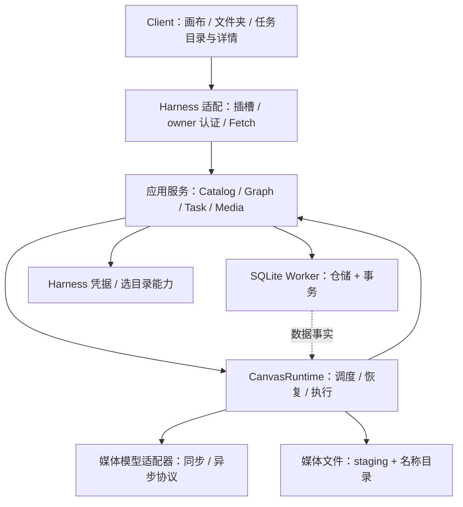

# 画布插件目标架构设计 v0.1

状态：核心方案已实施；以下保留批准时目标设计。记录日期：2026-10-26。

文档类型：解释 / 设计参考；负责人：项目维护者；最近核对：2026-10-26。
宿主 / SDK 升级、模块职责或数据契约改变时复核。本稿保留目标模块与官方来源；实际模块、字段以[当前架构](../architecture.md)、[数据参考](../data-api.md)及 [ADR](../adr/index.md) 为准。

实施核对（2026-10-26）：SQLite Worker、Runtime、Vault、Uploads、图 / 目录 / 任务 API 和客户端已落地。提案中的 application / TaskCommands 多个独立类暂收敛于 Service / Store；文件发布仍在 Store 串行队列；可选目录 picker 未接入，手动输入 Host 绝对路径可用；停机等待活动写入，不承诺阻塞 OS 调用的固定时限。真实 UI / 模型及跨盘故障验证仍待人工；不将架构目标当现有性能成绩。

## 1. 决策与约束

决策问题：如何把多画布、增量存储、按名称保存媒体与持久后台任务，放入符合 Harness 扩展方式的插件中？

决定采用**单个 Harness 宿主插件中的模块化运行时**：浏览器负责编辑；认证接口提交命令；宿主 Runtime 持有执行器；SQLite 目录 / 详情及恢复记录为任务事实来源；媒体字节保存到用户选择的宿主目录。

| 驱动因素 | 架构要求 |
| --- | --- |
| 每张画布就是一个项目，多张画布由文件夹管理 | 插件自己的 Catalog / Graph，不依附 Harness 工作区列表；没有额外 projects 对象 |
| 节点 / 边增量保存，后台输出可能同时更新图 | 共用一个事务协调层，显式修订与 hash，不通过多份完整 JSON 相互覆盖 |
| 刷新 / 关闭页面不打断已接受任务 | Runtime 不继承 HTTP、Peer、React 或面板的取消信号 |
| 任务目录轻、详情完整 | task_catalog / task_details 1:1；成功、失败、外部 ID 和恢复信息都归详情 |
| 媒体目录 / 节点名称可改 | ID 引用稳定；持久清单协调实际位置与目标名称，失败保留可读文件 |
| 插件随宿主升级、装配与卸载 | 使用 apply / inject / ctx.effect，不修改宿主内核，不自行挂开放 HTTP 服务 |
| 不能改写存量源数据 | 旧 JSON / 媒体只读导入；核验后切换，保留旧 ID 与结果引用 |

本稿不新增音频生成、项目分类、独立账号、自动媒体 GC 或跨 Harness 停机持续执行。用户明确要求的上传、改名、多画布与任务恢复才进入目标设计。

## 2. 官方文档核对

核对日期为 2026-10-26。用户提供的三页均已读取；下表把官方说明与本项目设计决定区分开。

| 来源 | 已核对的事实 | 对本插件的影响 |
| --- | --- | --- |
| [官方参考](https://deepseek-harness.github.io/deepseek-harness/reference/) | Harness 由插件树组合；扩展挂在已有插件旁，注册是随生命周期撤销的副作用 | 不修改宿主 packages / 特权内核；声明依赖，通过 profile 与 patch 装配 |
| [插件入门](https://deepseek-harness.github.io/deepseek-harness/develop/basic/) | apply(ctx)、inject 与 ctx.effect；返回清理函数在卸载时执行 | Runtime 的启动 / 停止归宿主插件，页面生命周期只清理页面资源 |
| [快速开始](https://deepseek-harness.github.io/deepseek-harness/guide/quickstart) | Harness 工作区用于会话、文件目录与 Agent；模型设置属于宿主能力 | 画布项目不与会话工作区混为同一业务对象；插件媒体模型配置不擅自改聊天模型 |
| [jobs-local 源码版本说明](https://github.com/deepseek-ai/deepseek-harness/blob/22ddee3792402c3e70ec5f86a63c3e3e895a2f60/packages/jobs/jobs-local/README.zh.md) | 内存注册表；容量满则拒绝，不排队；运行 / 输出环不跨重启恢复 | SQLite 队列不能由 ctx.jobs-local 代替，也不能依赖 Session 结算日志恢复媒体下载 |
| [jobs seam 说明](https://github.com/deepseek-ai/deepseek-harness/blob/22ddee3792402c3e70ec5f86a63c3e3e895a2f60/packages/jobs/jobs/README.zh.md) | job 归属通常是 Agent Session；无主 job 对调用方开放；生产方 / 控制器与服务有不同生命周期 | 当前画布不引入 Agent Session 所有权；可选的宿主 job 映射须另核对权限 / 取消，不能直接作为执行器 |
| [本地 connection SDK 说明](../../node_modules/@deepseek-ai/dsh-client-connection/README.md) | Host 提供准确 Fetch 路由和 owner 认证；路由声明 streaming / buffered；客户端断开取消 handler 信号 | 控制请求小 JSON，上传流式；任务 COMMIT 后转交 Runtime 信号，不能继续绑在 request 上 |
| [storage SDK 0.2.1-rc.2](https://www.npmjs.com/package/@deepseek-ai/dsh-storage/v/0.2.1-rc.2) | 公共 facet 当前是 KV，单次调用原子；顺序属于调用方 | 不能声称其提供节点、边、两端与任务两表的跨调用 SQL 事务；本插件自己隔离多表 SQLite 仓储 |
| [本地 credentials SDK 说明](../../node_modules/@deepseek-ai/dsh-credentials/README.md) | 配置只带引用；插件可管理自己的持久 record；每次操作解析引用 | 用 CredentialVault 适配宿主凭据；以新 record ID 保存版本，不在任务表保存 Key |
| [选目录 SDK 0.2.1-rc.2](https://www.npmjs.com/package/@deepseek-ai/dsh-host-directory-picker/v/0.2.1-rc.2) | capability 区分 native / browse；选择的是 Host 目录；消费方按能力呈现 | 可选适配器须按能力呈现；不以浏览器文件夹选择假装配置了远端 Host 路径 |
| [Node 22 SQLite 文档](https://nodejs.org/docs/latest-v22.x/api/sqlite.html) | v22.5 引入，v22.13 起不用 experimental-sqlite 参数；DatabaseSync API 同步，接口仍在演进 | 拟议最低 Node 版本为 22.13，数据库放入 Worker 并隔离驱动，不称其是稳定永久契约 |

在线官方源仓库当次 master 为 `22ddee3792402c3e70ec5f86a63c3e3e895a2f60`，提交日期 2026-10-23；这是资料核对基线，不是本插件已采用的 SDK 版本。当前 package.json 使用 `0.2.1-rc.2` 的客户端 SDK，本地没有安装 jobs 包；不把在线描述等同于当前编译环境已有服务。

node_modules 链接用于完整工作区核验，安装包不携带这些源码。storage / picker 在设计阶段读取过0.2.1-rc.2说明；当前不作为运行依赖，引用固定npm版本页保留出处。SDK升级按目标版本重新核对公开导出、类型、权限和生命周期。

## 3. 模块与依赖

图中的 APP ↔ RT 表示调用 / 回报关系，代码依赖不做循环：应用服务提交数据库命令并通过 Wakeup 接口唤醒；Runtime 调用独立执行服务和事务命令，应用服务不 import 具体执行器。状态回报通过同一 TaskCommands 边界写库。

| 模块 / 拟议路径 | 职责与拥有的数据 | 允许依赖 / 禁止行为 |
| --- | --- | --- |
| `shared/contracts` | 对外 DTO、Schema、hash 内容定义、领域词汇 | 无 React、Node IO、宿主 SDK、密钥 |
| `client/` | 画布草稿、资源上传交互、任务目录列表与按需详情 | shared + CanvasApi + client SDK；不能 import host / SQLite / Provider |
| `host/harness/` | apply / inject / ctx.effect、认证路由、凭据与目录 capability 适配 | 应用接口与 SDK；不定义图规则、不另建公开端口 |
| `host/application/` | CatalogService、GraphService、TaskService、MediaService；权限、校验与事务命令 | 领域与仓储接口；不直接拼 SQL / 操作供应商 HTTP |
| `host/runtime/` | 生命周期、到期调度、恢复、执行并发、停止与资源限额 | TaskCommands、Provider、Media、数据库接口；不依赖 React / request scope |
| `host/persistence/` | SqliteDatabase、各仓储、TransactionUnit、数据库 Worker | 单连接 / 短事务、参数化 SQL；不调用网络 / 复制大文件 |
| `host/media/` | PathPlanner、UploadReceiver、FilePublisher、FileMover | 文件流、hash、清单命令；不能私自改 task_catalog 或直接重写节点 |
| `host/providers/` | 能力声明，输入编码，submit / poll / 输出流，错误与 ID 规范化 | 媒体读取接口与脱敏凭据值；不依赖数据库 / 画布列表 / UI |
| `host/migration/` | 只读旧源导入、checkpoint、核验与切换 | 仓储与文件读取；迁移期间不启动模型新请求 |
| `dev/` | 开发 HTTP / UI 载体 | 同一应用与 Runtime；不另写一套存储 / 调度逻辑 |

拟议路径是后续实现边界，本次不创建空目录 / stub 文件，也不重构现有源码。所有者为项目维护者；每次修改通过对应服务契约、文档检查和用户手动验收核对。

### 3.1 上下文与模型转换

| 上下文 | 模型 / 术语 | 相邻边界与转换位置 | 责任 / 核对路径 |
| --- | --- | --- | --- |
| Harness 集成 | Peer、Context、panel、credential record、directory capability | 对宿主遵循公开契约；HarnessAdapter 把 Peer / 能力翻译成应用接口，形成隔离层 | host/harness；公开 SDK 类型与本文来源表 |
| 画布目录 / 图 | folder、canvas、node、edge、relation、revision | 与媒体 / 任务共用 shared ID 与版本定义；事务协调，不互相复制数据 | Catalog / GraphService；SQLite 图约束 |
| 任务 | catalog、details、phase、attempt、external task | 对外部供应商以 ProviderAdapter 隔离状态 / 错误词汇；对媒体交付固定输出身份 | TaskService / Runtime；任务两表与状态验收 |
| 媒体 | asset、storage location、actual / target path、file hash | 对画布提供 ID 和可读性；对任务交付已核验文件，FilePublisher 转换输出描述 | MediaService；路径清单与 hash 核验 |
| 持久化 | row、FK、CAS、mutation、WAL | 仓储把领域命令转换为 SQL；各服务只通过事务接口提交 | persistence；EXPLAIN / FK / 恢复核验 |

这些是一个插件内部的责任边界，先保持模块化；只有需要脱离 Harness 存活、独立伸缩或独立发布时，才支付拆成独立服务的部署成本。

## 4. Harness 装配与运行时所有权

Host 入口仍使用 `apply(ctx, config)`。拟议必需依赖为 connection 与 credentials；面板只依赖其插槽 / 布局能力。选目录是可选 capability，缺少提供方时仍可输入并验证 Host 绝对路径。ctx.jobs 不作为必需依赖。

Client 的画布列表来自自己的 CanvasApi；移除“必须订阅 ctx.workspaces.list 才能显示画布”的依赖。若目录交互复用 `ctx.remote.directoryPicker`，只消费该能力，不自动创建 Harness Workspace 或 Session。

宿主启动顺序：

1. 校验配置、最低 Node / SDK 条件与路径权限，取得 dataDir 排他执行锁。
2. 启动 SQLite Worker，打开数据库、设置 FK / WAL / FULL，核对 Schema 版本和目录 / 详情完整性。
3. 创建凭据、Provider、Media、TaskCommands 与 Runtime；先恢复未完成清单和任务，不盲目重提外部请求。
4. 注册有限认证路由，启动到期扫描；只有上述就绪后才对页面报告可接受任务。
5. 通过 ctx.effect 注册 Runtime 停机、路由撤销和 Worker / 锁释放；部分初始化失败按相反顺序释放。

Runtime 持有长期 AbortController / 生命周期，位于 Host 插件 context，不位于 Peer / handler / Agent / React context。数据库 Worker 是宿主内部线程，随 Runtime 退出；不是独立守护进程，也不是绕过 dsh profile 的第二个应用启动器。

HTTP 信号只控制当前校验 / 字节接收和响应；任务事务提交后即归 Runtime，即便响应写回时浏览器断开仍要恢复 / 执行。目录和任务详情查询可随请求取消；已接受生成、已完整接收的导入不随之取消。

停机先拒绝新命令、停止领取，取消本地 IO 并保存可解释的步骤状态，等待有界收尾，再关 Worker / DB、释放锁。外部接收不明记 needs_attention；已知 external_task_id 保留原查询；已下载结果保留原输出清单。不能把因停机 abort 的请求直接写成“供应商失败”。

关闭面板 / 浏览器不会销毁 Runtime；禁用实际后台插件、停止 Harness / 电脑关机会停止本地执行。独立服务形态仅是未来要求的退出方案，当前不额外部署。

## 5. 任务目录、详情与模型适配

| 表 / 边界 | 负责内容 | 不重复存储 |
| --- | --- | --- |
| task_catalog | 本地 task_id、画布 / 节点归属、种类、名称摘要、顺序、状态、进度和时间 | 提示词 / 参数、外部回执、错误详情、租约 |
| task_details | 请求幂等、输入快照、凭据引用、phase / 调度 / lease、external_task_id、成功摘要、外部与本地失败 | 目录 status、输入 / 输出 asset_id 数组 |
| task_attempts | 每个 submit / poll / download / publish 步骤的 issued、结果及失败原因 | 不成为另一个当前任务状态来源 |
| task_references / task_outputs | 素材输入快照 / 结果及顺序 | 文件路径与字节 |
| canvas_assets / file operations | 实际文件、hash、发布 / 改名 / 搬移恢复 | 不修改提示词 / 供应商任务身份 |

任务列表只读目录；点击一项才在读事务 JOIN 详情、结果。成功 / 失败查询不把私有下载 URL、凭据或未脱敏响应交给浏览器。目录和详情的完整字段 / 索引只在[存储设计第 4、6 节](sqlite-canvas-storage-v0.2.md)维护。

三个身份必须分开：本地 task_id 是插件 UUID；external_task_id 是供应商异步任务 ID；未来若接入宿主注册表，其 job ID 是另一个运行期身份，不能覆盖前两者。

ProviderAdapter 的内部契约返回以下语义，接口名是本插件设计，不冒充 SDK 现成接口：

- submit：已接受异步任务（外部 ID） / 立即得到输出描述 / 明确失败。
- poll：仍等待 / 输出就绪 / 明确外部失败；保留供应商原状态与错误。
- transport 错误：独立于外部明确失败；超时不自动代表任务未被接受。
- output stream：流读取原结果，只恢复下载 / 保存，不创建新生成任务。

TaskService 在一个事务里更新目录状态与详情回执。成功条件是媒体已落盘、输出关系齐全，才写 success_at 与目录 succeeded；外部完成只先写 external_completed_at。外部已成功但磁盘失败，同时保留外部成功与 storage 失败信息。

CredentialVault 复用 `ctx.credentials` 的插件 record 能力，以 `dsh-canvas/<不同版本记录ID>` 区分版本。宿主提供方拥有实际存储；本插件只管理自己的记录。模型改 Key 创建新版本，已接受任务仍指向旧版本；每步按固定引用读取，不能误把宿主“每次读取当前引用”理解为自动历史快照。凭据写入与 SQLite 不跨介质原子：先持久记录，再事务绑定；中断时按引用对账，不删除仍被任务使用的记录。

可选 ctx.jobs 集成暂不实现。若未来需要把画布执行映射到宿主 job 面板，只能通过经过类型 / 权限验证的桥接：SQLite 保持权威、唯一执行者保持不变，不引入 Session 所有权或把 registry 的 stopping / killed 等状态直接当作供应商取消确认。

## 6. 对外命令、读取与一致性

拟议新接口位于版本化命名空间 `/api/canvas/v2`，通过 connection 注册 exact routes。当前接口先保持可读，迁移核验后客户端整体切换；新旧存储不同时执行任务。

| 接口族 | 行为与提交边界 |
| --- | --- |
| catalog | 文件夹 / 画布 CRUD；meta_revision、hash 与目录回执；仅返回当前用户数据 |
| graph | 图 / 视口基线、增量保存 / 读取；每批原子、旧基线冲突返回 409 |
| generate | 保存基线、节点 / 输入 / 凭据 / 配额校验；目录 + 详情 + references COMMIT 后返回 202 |
| tasks | 当前画布目录游标分页；详情按 task_id 读取；原任务重试保存 / 恢复查询 / 结束本地等待 |
| upload | 开始会话 / 资源占位；原始字节 streaming；完整接收持久化后入 import 任务 |
| media | asset_id 定位、归属校验、HEAD / GET / Range；不接受客户端提供的任意文件路径 |
| storage / models | 存储目录和模型配置；只读凭据是否配置，Key 为只写输入 |

接口族不是未经 SDK 验证的 Remote 方法名；正式实现需给每个 exact path 声明允许方法和请求体模式。大型媒体不能放到 buffered JSON / Base64 控制请求中。

前端先使用当前画布的轻量状态查询，任务目录无需每次带详情；断线后读取新快照。可以后续在同一 API 边界增加 Remote follow，当前不假设自定义事件已自动映射到宿主 WebSocket。本地唤醒 / 通知只提示“有变化”，不是持久日志，不影响断线恢复。

SQLite Worker 通过一个 Database 接口处理读 / 写命令与短 TransactionUnit：一次图保存、任务创建 / 结算、目录改名 + 文件操作都共享事务，仓储方法不得私自提前 COMMIT。服务通过参数化 SQL、UUID 与版本寻址，UI 不接触 SQL。

读取在同一个数据库读事务中获取状态 / 修订，满足已确认提交后的 read-your-writes。冲突由应用显式返回，保留草稿，不做最后时间戳覆盖。文件 / 凭据 / 供应商效果用清单与标记恢复，不能宣称与 SQLite 原子提交。

## 7. 运行依赖、取舍与可逆性

| 依赖 / 决策 | 采用理由 | 调试、降级与变更代价 |
| --- | --- | --- |
| Harness / SDK 适配层 | 复用认证、插槽、生命周期和凭据 | 固定支持版本，核对类型 / 公开路由；不兼容时拒绝激活而非开放认证；适配层可单独替换 |
| node:sqlite + Worker | 无额外原生二进制，同步 DB API 不堵主线程 | 拟议 Node≥22.13；API 仍演进，驱动隔离、Schema 固定；驱动不支持时停止启动，不静默退回 JSON |
| 本地单库 / 单执行者 | 同画布图与任务两表可短事务提交 | 查看 WAL、锁与事务时间；磁盘失败暂停写入；另换驱动容易，换持久 Schema 要迁移核验 |
| 用户媒体目录 | 大文件流式播放，按名称可查看 | 磁盘离线暂停保存 / 搬移；历史实际指针保留；迁移目录成本与媒体总字节相关 |
| 自有持久任务队列 | 输入、外部 ID、步骤与文件恢复统一 | 查目录 / 详情 / attempt / 清单；改调度器不改任务身份，不能从含糊 submit 状态盲目重提 |
| 单插件模块化运行时 | 生命周期简单，不另加后台部署 | 脱离 Harness 执行才需要独立服务；复用应用 / 仓储接口，但需新增认证、安装、升级和停机责任 |

| 备选方案 | 当前处理 / 代价 |
| --- | --- |
| 继续当前 CanvasService + 全图 JSON | 不采用为目标；职责集中且不能完成跨表增量事务，仍保留其作为迁移来源 |
| 全部交给官方 storage KV | 不采用为关系图事务层；当前公共契约没有多表 SQL 事务控制，需重编码业务 |
| 全部交给 jobs-local | 不采用为持久队列；不排队、不恢复执行，并带 Session / 控制器语义 |
| 立即独立后台服务 | 当前不采用；用户尚未要求跨 Harness 停机存活，会增加部署 / 权限 / 升级成本 |

模块拆分、驱动适配、前端传输属于可逆选择；任务 / 媒体身份与持久 Schema 属于切换后需要数据迁移的选择。出现跨进程执行需求、DB 主线程堵塞、SDK 契约变化或不可恢复的文件 / 外部提交窗口时重审对应决策，不推翻用户业务形态。

## 8. 风险与可验证约束

| 风险 | 可能性 / 影响 | 处理与停止条件 | 责任 / 证据 |
| --- | --- | --- | --- |
| 在线文档与本地 SDK 不同 | 中 / 集成失败 | 固定版本、检查公开类型；缺少服务不假定存在 | 维护者；来源表、package.json |
| 浏览器 signal 传到已接受任务 | 中 / 刷新打断工作 | Runtime 自己拥有信号，COMMIT 后脱离 handler；违反即阻止交付 | Runtime / HarnessAdapter；刷新验收 |
| 目录成功但详情 / 文件未成功 | 中 / 错误完成、丢结果 | TaskCommands 同事务，ready / outputs 核验后成功 | Task / persistence；两表 / 文件验收 |
| 超时后重复生成 | 中 / 重复计费 | issued 标记、外部 ID、原输出恢复；含糊结果停自动提交 | Provider / Runtime；中断恢复验收 |
| 同步数据库堵住 Harness | 中 / 响应卡顿 | Worker、短事务、候选量有界；超预算缩小批次或检查驱动 | persistence；事务耗时与事件循环监测 |
| 改名 / 跨盘复制中断 | 高 / 路径错乱、空间不足 | 持久清单、版本 fence、文件核验、实际指针；失败保留旧文件 | Media；断点核验 |
| 两个 profile 用同一 dataDir | 中 / 重复外部请求 | 一个排他 Runtime 锁；第二实例停止执行 | Runtime；双实例验收 |
| 私有回执泄露密钥 / 签名链接 | 中 / 凭据泄露 | 白名单 DTO、脱敏 / 截断，日志不返回私有恢复字段 | Task / Provider；API 与日志核对 |

| 性质 | 指标 / 规则 | 测量来源与频率 | 失败响应 / 核对路径 |
| --- | --- | --- | --- |
| 依赖方向 | client 不 import host；shared 无 IO / SDK；Provider 不写 DB | 每次实现变更的导入检查、独立 tsconfig | 修复依赖后继续；模块表 |
| 契约兼容 | 旧 DTO / IDs 可读；新命名空间不能悄悄改旧结构 | 每次 API / 迁移变更的 Schema 与旧数据核验 | 不切换存储；存储设计迁移节 |
| 任务两表完整 | 每目录恰好一详情；非终态有明确阶段；成功输出全部 ready | 每次提交、启动恢复、深度核验 | 回滚或暂停不完整任务；TaskCommands |
| 后台所有权 | 202 已接受任务刷新 / 关面板后继续；未完成上传可中断 | 每次 Runtime / adapter 变更的用户手动验收 | 阻止交付；生命周期节 |
| 外部效果唯一性 | issued 无确认不自动再次 submit；external ID 保存后只查原任务 | 每次 Provider / 恢复变更的中断验收 | needs_attention；任务详情 / attempts |
| 请求关键路径 | 提交 handler 不等待模型；p95 接受目标≤500ms，DB 写事务目标≤50ms，均待实测 | 性能验收 / 发布前本地测量，记录媒体数量与批次 | 缩小批次、检查 Worker / IO；不称目标为现有成绩 |
| 隔离与身份 | 一个 dataDir 一个执行者；旧 token 不能提交；跨画布 FK 拒绝 | 每次锁 / 事务变更和恢复验收 | 停第二执行器、回滚错误；Runtime / FK |
| 文件可恢复 | 指针只指向核验文件；改名失败可读旧文件；ID / hash 不变 | 每次 Media 变更的 IO 中断与跨盘验收 | 暂停发布 / 搬移；文件操作清单 |

本机不提供自动 failover；长队列有明确容量限额。定期检查逾期调度、待保存结果、未收敛路径和失败清单；修复由维护者负责，不自动删除不明文件或重提不明生成。

## 9. 后续实施顺序与核对门槛

1. 完成共享新契约与数据库仓储：核心图表、目录 / 详情、事务和只读迁移 / 核验。
2. 实现 TaskCommands、Runtime、Provider 错误映射与 issued / 外部 ID / 原输出恢复。
3. 实现名称路径规划、上传会话、发布 / 搬移清单和凭据适配。
4. 对接版本化认证接口与 Client：自有画布目录、上传自动建节点、按需任务详情。
5. 在旧数据副本验证图增量、目录 / 详情结算、刷新恢复、跨盘 / 改名中断；核验后才切换存储。

实施前剩余核对归为两项：目标 SDK 公开导出 / 凭据 / 目录 capability 的契约；目标 Node / SQLite Worker / 排他锁与文件提交行为。按本稿默认选择验证，不把这些条件当成重新询问业务范围的理由。

本稿是设计基线；实施、测试和安装包记录见[验证记录](../verification.md)。官方 case / badcase 单独维护于 [ADR-0017](../adr/0017-harness-official-cases-and-badcases.md)。
