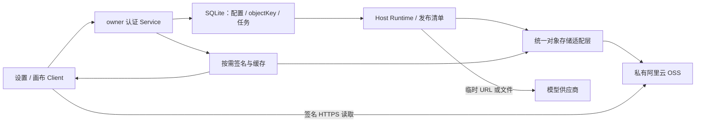

# 对象存储与阿里云 OSS 接入方案 v0.1

状态：已批准并实施；当前决策见[ADR-0043](../adr/0043-object-storage-and-expiring-media-access.md)，原规划正文保留。真实Bucket与用户浏览器 / 模型验收待配置后完成。

文档类型：解释 / 实施方案；负责人：项目维护者 / 开发执行者；最近核对：2026-10-28。
依据：用户本轮对象存储需求、当前 0.2.36 源码和本机插件库只读盘点。需求、厂商 SDK、访问方式或清理范围变化时复核。正式实施后补充 ADR，并同步当前架构、接口、运维和验收文档。

## 1. 决策摘要

决策问题：怎样让画布资源可被外部模型临时访问，同时支持切换对象存储厂商、保持页面加载效率和后台任务恢复能力？

建议采用：**多提供商适配层、单个新写入目标、私有 Bucket、数据库持久保存对象定位信息、浏览器链接按需批量签名并缓存、后台提交模型前重新签名。**

| 驱动因素 | 对设计的要求 |
| --- | --- |
| 外部模型无法访问本机认证媒体接口 | 提供外网 HTTPS 预签名 URL；文件实体持久保存在 OSS |
| 后续会增加其他对象存储厂商 | 业务代码依赖统一接口，首期只实现阿里云 OSS |
| 当前生效提供商只能有一个 | 数据库以一个 nullable 指针指定当前目标；保存并启用新配置时原子切换 |
| 大画布不能被签名操作拖慢 | 图接口不等待全部媒体；可见资源分批解析链接，使用有界缓存 |
| 任务排队可能超过页面链接有效期 | 接受任务时保存稳定引用，真正发送模型请求前重新准备参考文件 |
| 本次明确放弃旧本地数据兼容 | 新存储 schema 使用新版本；本机旧业务库在实施验证后一次性清理，不建设本地资产迁移功能 |

首期范围包括图片、视频、音频原文件，生成结果、封面、音频波形，以及设置入口、创建检查和任务引用。图的节点 / 边继续通过 assetId 引用资源。数据库、模型配置和凭据仍属于 Harness 本机；仅媒体实体改用对象存储。

本方案采用 `staff-engineer-mode / architecture-decisions` 的架构决策方法，主决策为资源持久化与访问边界，设计阶段，路由置信度高。责任由开发执行者落实代码和自动检查，项目维护者保管云端配置并进行真实模型、浏览器验收。

## 2. 当前实现与修改位置

| 已核实的实现 | 需要改变的边界 |
| --- | --- |
| [设置入口](../../src/client/index.tsx)和[模型设置](../../src/client/Settings.tsx)使用“无限画布 模型设置” | 改为统一“无限画布”设置页；拆分对象存储、模型、TTS 标签 |
| [画布设置](../../src/client/Canvas.tsx)内含独立的本地目录面板 | 与宿主设置共用新的设置组件，移除本地媒体目录输入 |
| [Store](../../src/host/sqlite-store.ts)启动时自动建立本地媒体根目录 | 首次安装没有活动对象存储；设置页和列表可以使用，创建画布必须拦截 |
| [Service](../../src/host/service.ts)、[Providers](../../src/host/providers.ts)使用 stat / readFile / mediaPath 读参考素材 | 改为元信息校验和统一的对象读取 / 签名接口 |
| [上传](../../src/host/media/uploads.ts)和 Runtime 输出经过本地 staging / copyVerified 发布 | staging 作为任务恢复暂存；持久发布目标改为 OSS |
| [封面](../../src/host/media/previews.ts)与[波形](../../src/host/media/waveforms.ts)是本地派生缓存 | 在临时目录解码后上传派生文件；页面直接读取 OSS 的相应对象 |
| [schema](../../src/host/persistence/schema.sql)和[Worker](../../src/host/persistence/worker.mjs)只接受旧 schema 版本 | 制定新 schema 与明确的旧版本拒绝提示，不隐式清空任意用户的库 |
| Store 启动会扫描旧 workspaces JSON | 新版本移除旧数据自动导入入口，防止清理后历史数据重新出现 |

本机只读盘点：`/Users/bytedance/.dsh-canvas/canvas.sqlite` 有 1 张画布、15 份素材、13 个节点、2 条边、9 个任务、4 个上传会话；9 个任务均 succeeded。当前唯一登记的本地媒体根目录为 `/Users/bytedance/.dsh-canvas/media`。这些是规划时快照，实施停机前重新核对。

## 3. 设置与配置切换

### 页面

宿主设置导航和页面标题统一为“无限画布”。页面内采用顶部标签：**对象存储 / 模型设置 / TTS 设置**；窄侧栏可横向滚动标签。复用现有 Harness 通用组件、主题和表单样式。画布内设置弹窗与项目列表中的设置入口使用同一组件，并能直接打开对象存储标签。

对象存储标签展示已保存配置及“当前使用 / 已停用”状态，提供配置表单。首期提供商选择只有“阿里云 OSS”，不展示尚未实现的厂商。

| 首期字段 | 规则 |
| --- | --- |
| 配置名称 | 便于区分不同 Bucket 或配置版本 |
| 地域 Region | 使用 Bucket 所在地域 |
| Bucket | 使用已有 Bucket，插件不自动创建 Bucket |
| 外网 Endpoint | 优先按地域生成并校验；首期限定阿里云标准外网 HTTPS Endpoint |
| AccessKey ID / AccessKey Secret | 通过 Harness 凭据接口保存；读取 API 仅返回配置状态和掩码 |
| 根路径前缀 | 默认 `dsh-canvas`，规范化后作为所有对象的限定前缀 |

首期使用有最小范围权限的 RAM 用户 AK。暂不增加手工 STS Token 输入、角色扮演、CDN、自定义域名和其他厂商实现；统一凭据接口保留扩展能力。

表单提供“测试连接”和“保存并启用”。验证使用配置前缀内的唯一探测对象，完成写入、HEAD、签名 GET 读取、内容比对及探测对象删除；不扫描整个 Bucket，不要求 ListBuckets 权限。验证失败不得停用旧配置。网络验证在数据库串行写入边界外执行，提交时用 revision 检查防止覆盖并发修改。

### 唯一生效与旧配置

1. `owner_settings.active_storage_provider_id` 是唯一新写入目标。首次安装可以为 NULL；存在有效配置后只能指向一份配置。
2. 验证并保存新配置后，在同一 SQL 事务中切换该指针。界面中的“当前使用”由指针推导，不维护多个可能冲突的 enabled 布尔值。
3. **建议将“旧提供商关闭”解释为停止接受新上传和新生成任务。** 旧配置保留读取已有资产的能力，否则切换后旧画布会立即失效。
4. 已接受的上传和生成任务固定输出目标、配置版本及凭据引用，按原目标完成。切换影响新接受的任务，不改变已经接受的任务。
5. Bucket、地域、Endpoint、前缀变化时创建新的配置记录，不把原资源误指向新 Bucket。密钥轮换保留任务所需凭据版本，并使旧链接缓存失效。
6. 首期不自动跨厂商迁移旧资源，不自动删除停用配置。界面明确显示停用配置仍可能被历史资源或未完成任务引用。

用户已批准此业务建议，实施采用停止新写入、保留历史读取的语义。

### 创建前检查

项目列表所有“新建画布”入口先检查当前配置，缺失时展示准确文案：**“请前往设置页面设置对象存储”**，提供进入对象存储设置的按钮。设置加载失败单独显示读取失败，不能当作已配置。

服务端在创建画布事务中再次检查，返回 `STORAGE_NOT_CONFIGURED`，不能仅依赖前端禁用。新上传、接受生成任务也需要有效目标，避免配置后又被停用时继续接收无法保存的结果。瞬时云端网络故障不被解释成“未配置”，并有独立错误。

## 4. 对象路径与数据库

### 路径

按“根前缀 / 文件夹 / 画布 / 资源”归纳，建议名称后带稳定 ID，防止同名资源覆盖：

```text
dsh-canvas/
  产品素材__<folderId>/
    宣传画布__<canvasId>/
      角色参考__<assetId>.png
      视频结果__<assetId>.mp4
      配音结果__<assetId>.mp3
      _derived/
        <assetId>/preview-v1.webp
        <assetId>/waveform-v1.json
  未归档/
    测试画布__<canvasId>/...
```

名称由宿主规范化；objectKey 由后端分配，不能由前端任意指定。完整 ID 保证跨画布、不同安装实例和相同 Bucket 内的唯一性。不覆盖已经发布的原文件；OSS 适配器使用禁止覆盖能力，并校验重试时的既有对象身份。

为保持目录与业务归属一致，文件夹 / 画布重命名、移动画布、资源重命名沿用后台搬移清单思想，改用 **OSS Copy + 校验 + 数据库 CAS 更新实际定位**。界面立即改名，读取继续使用数据库中的真实 objectKey，不能根据新名称猜路径。已接受任务引用的旧对象定位保持可读，首期不自动删除旧对象副本；增加存储成本会在运维文档说明。

若以后希望彻底避免改名引发 Copy，可以改用全 ID 目录；这是可逆的路径策略，但会降低 OSS 控制台中按名称查找的便利。本稿默认名称 + ID，以保持现有改名行为并满足文件夹归纳需求。

### 持久记录

“数据库只存 objectKey”指不持久存储 OSS 预签名 URL，仍需保存正常元信息和提供商归属：

| 记录 | 建议内容 |
| --- | --- |
| 对象存储配置 | 配置 ID、类型、Bucket、地域、Endpoint、前缀、凭据引用、revision、验证信息 |
| 用户设置 | 当前配置 ID，可为空；配置修订与运行 token |
| 素材 | assetId、canvasId、配置 ID、objectKey、可选 versionId、ETag、SHA-256、MIME、大小、尺寸 / 时长、发布状态 |
| 派生素材 | 原素材 ID、变体类型与版本、自己的 objectKey、配置 ID、状态 |
| 任务参考 | assetId、固定对象定位 / 配置版本、文件 hash / ETag，保持引用顺序 |
| 上传 / 输出发布清单 | 固定目标 objectKey、暂存引用、预期 hash、阶段、重试状态 |
| 对象搬移清单 | 原定位、目标定位、素材版本、布局修订、阶段、错误 |

原始字节的 SHA-256 与 ETag 分开保存，不能把分片上传的 ETag 当作 SHA-256。Bucket 开启版本控制时记录并使用 versionId；未开启时使用唯一不可覆盖 key 和发布时的 ETag 检测外部修改。

新版本替换本地 `storage_roots / canvas_storage_locations / file_operations` 的文件路径语义。节点 / 连线 / 任务身份仍保留稳定 ID 设计，不把签名 URL 写入图、输入快照或图 hash。

## 5. URL 缓存与过期处理

### 推荐方案

| 方案 | 优点 | 成本与取舍 |
| --- | --- | --- |
| 数据库只存定位，每次显示都重新签名 | 持久数据简单 | 重复计算及链接变化可能导致多余媒体请求 |
| 数据库保存定位 + URL + expiresAt | 重启后可复用部分 URL | 临时访问凭证进入数据库 / 备份，增加大量更新、凭据轮换失效逻辑；不建议首期采用 |
| **数据库存定位，Host / 页面缓存 URL + expiresAt** | **不改持久资源身份，批量和按需解析，失效可重建** | **需要有界缓存和集中刷新逻辑；推荐** |

官方 `ali-oss` 的 V4 实现在持有有效 AK 时直接构造 URL 并计算签名，不为每个对象调用 OSS 网络接口。使用可自动刷新的临时凭据时可能需要刷新凭据；这应合并并发刷新，而不是变成每个资源一次刷新。因此数据库存 URL 对首期性能的收益有限。

新增认证的批量资源解析接口，例如 `POST /api/canvas/v2/media-urls`。输入为当前画布内的一批 assetId / variant，后端校验归属后返回 `{ assetId, variant, url, expiresAt }`，不允许客户端提交任意 objectKey。每批上限建议 100；只解析画面附近、正在播放或被打开的资源，图接口不全量签名。

Host 使用有界缓存和同请求合并，键包含配置 / 凭据版本、Bucket、key、versionId、变体、GET 方法、下载参数及签名用途。前端使用共享资源缓存，多个相同资源节点复用；任务 / 图轮询不能不断换媒体 URL。URL 不写 localStorage，不保存进 SQLite。

默认值建议：浏览器访问 URL 有效期 1 小时，剩余不足 5 分钟时刷新；模型参考 URL 有效期 24 小时，由 Host 配置控制，受 OSS 签名及实际凭据寿命上限约束。这是设计默认值，不是实测模型抓取时限。

浏览器恢复标签页、重新播放 / seek、打开预览和下载前检查剩余时间；更新地址时恢复音视频当前播放位置及播放状态。媒体加载失败时只强制重新解析一次，持续 403 / 404 给出明确错误，不无限刷新或误判为一定过期。

保留当前认证媒体入口作为下载 / HEAD 等操作的适配入口，需要时重定向到新的签名地址。HEAD 使用 HEAD 签名，不能复用 GET 签名。重定向和 URL JSON 响应使用 no-store；媒体内容是否可缓存与签名是否有效分别处理。

## 6. 上传、输出、预览与后台生成

### 发布流程

首期保留 **浏览器上传到 Harness，Harness 后台上传 OSS** 的方式，复用文件格式识别、大小限制、上传占位与持久任务。不直接把 AK 交给浏览器，也不要求用户配置 OSS 回调到无法外网访问的 localhost。

处理链路：接收 / 下载到受控 staging → 识别类型、计算 hash → 事务登记固定目标和发布清单 → 在 SQL 串行边界外上传 OSS → HEAD / 元信息校验 → 事务标记 ready 并登记节点 / 输出关系 → 清理已完成暂存文件。

OSS 上传失败保留暂存和发布清单，进入 storage / save_failed，重试只保存原结果，不重新请求付费模型。上传完成但 DB 提交失败时，恢复过程校验同一 key 后续写登记，不随机新建另一个对象。并发受限，避免云端慢请求占住全局 Store 队列。

原文件发布成功后，封面 / 波形可以异步生成、上传独立派生对象；派生失败不使已经保存的原文件和生成任务失败。它们继续使用有界解码队列。视频 / 音频解码需要本地随机读取时使用临时文件，不让 ffmpeg 直接打开不受控外部 URL。完成后删除临时文件，恢复暂存仅为尚未完成任务保留；本机没有永久媒体库。

### 模型引用

当前协议需要区别处理：图片编辑使用 multipart 文件，视频参考当前是 data URL；不能假定所有模型都接受 HTTP URL。

1. 接受任务时保存稳定参考定位、文件身份和固定输出目标，不生成长期保存的页面链接。
2. Runtime 真正执行提交步骤时，通过统一参考解析器检查对象身份、凭据可用性，并准备模型所需的 URL 或文件字节。
3. 支持 URL 的协议在此时使用新签名，绕开页面链接缓存；需要 multipart / base64 的协议从 OSS 限额读取并按既有格式发送，不擅自把文件字段改成 URL。
4. 所有参考准备在 `submit_issued=true` 之前完成。准备阶段失败可以重试；只有完成准备、准备发送付费请求时才持久 issued，保持“未知提交不自动重提”原则。
5. 模型 URL 只存在于此次网络请求内。任务等待期间、重启后、下一次明确的新提交都重新准备，不改变已经接受的任务引用顺序或素材身份。

**已传给外部模型的 URL 无法由插件在原处延长寿命。** 24 小时只覆盖一个合理的延迟抓取窗口；如果真实渠道可能更晚抓取，须调整有效期，或使用该渠道支持的文件上传 / 文件 ID。不能通过本机定时刷新或反复付费提交解决这个问题。首期按真实渠道文档确认 URL 支持和延迟窗口。

## 7. 模块、数据流与依赖责任

沿用单插件模块化设计，不拆新服务。建议增加 `src/host/object-storage/`，业务使用 `put / head / openRead / signRead / copy / deleteProbe` 等能力；`aliyun.ts` 封装官方 `ali-oss`，SDK 只进入 Host 构建，不进入 client / shared。



| 上下文 / 责任路径 | 模型 / 自有数据 | 相邻上下文与关系 | 转换位置 |
| --- | --- | --- | --- |
| Client；设置组件与资源缓存检查 | 公开配置、assetId、临时 URL | 上游 Service，遵循公开契约；下游 OSS，只进行已授权读取 | assetId / variant → URL，不持有 AK |
| Service；接口与创建检查 | owner 归属、命令、配置修订 | 与 shared 使用共享契约；向 Store 请求事务；向存储层请求能力 | 浏览器输入 → 校验后的命令，配置输出脱敏 |
| Store；schema 与事务检查 | 图、object locator、任务、发布 / 搬移清单 | 上游 Service / Runtime，事务接口；不依赖厂商 SDK | 持久记录 → 稳定领域对象 |
| Runtime / 媒体处理；恢复测试 | 任务阶段、受控暂存、prepared reference | 上游 Store，读取固定身份；下游存储 / 模型，使用适配层隔离厂商 | object locator → URL / multipart；远端输出 → 待发布字节 |
| 对象存储；厂商适配器契约检查 | Bucket / key / version / 请求回执 | 上游 Service / Runtime；下游 OSS，隔离厂商协议 | 统一能力 → ali-oss 请求；云端错误 → 脱敏存储错误 |

设置验证采用同步有界请求，正式发布使用现有异步清单 / 流式上传，页面链接采用按需批量响应。首期不做浏览器直传、每个节点独立轮询签名或整张画布全量签名。若实测 Harness 上传中转成为带宽瓶颈，再增加受约束的浏览器直传和服务端完成校验。

云端依赖支持标准读、写、复制、签名与校验后才接入。错误记录操作阶段、HTTP / OSS 错误码、RequestId 和配置 ID，不记录 AK 或完整签名 URL。OSS 不可用时图 / 目录 / 设置仍可读，媒体显示读取失败，新任务按阶段暂停 / 失败；不悄悄回退本地持久媒体。更换厂商通过新适配器和新配置完成，历史资产仍由原配置定位；厂商全面退出需要单独迁移资源。

## 8. 本机历史数据清理与交付

本次用户授权：在对象存储功能完成后清理当前本地 DeepSeek Harness 插件数据库内历史数据，不考虑旧本地资产兼容。此授权是本次限定操作，不把数据库清空逻辑加入正常启动，也不扩大到 Harness 对话、账号或其他插件。

执行顺序：

1. 实现与必要自动检查完成，使用独立临时数据目录验证新 schema 启动、配置空态、存储契约和恢复流程。正式数据保持原状。
2. 核对 `web / 3080` 实际进程、插件 dataDir、任务状态；正常停机并取得一致的 DB、配置与所需媒体 / 暂存备份。备份和回执存于工作区外的受限临时目录。
3. 一次性重建目标插件业务库，清理画布、目录、节点 / 边、素材记录、任务 / 引用 / 回执、上传与搬移历史。旧媒体、派生缓存、暂存及存在的旧 JSON 源从活动数据目录移入同一受限回退备份，不导入 OSS。
4. 保留 `models.json`、`model-bindings.json`、`tts-settings.json`、Harness 凭据和 profile 配置。若切换时已经保存了新对象存储配置，仅保留该配置及有效凭据引用，不带回旧业务历史。
5. 按 [ADR-0021](../adr/0021-local-update-and-package-retention.md)执行版本更新、构建 / 包身份核验、同包安装、重启与认证 HTTP 加载核验。自动检查不能替代用户浏览器和真实模型验收。
6. 核对业务列表为空、保留配置内容一致、没有旧 JSON 重新导入、没有旧任务恢复 / 重提；未配置 OSS 时创建返回指定提示。候选失败则恢复一致备份及原可用包。

若没有用户提供的 OSS 配置，可以完成代码、隔离测试和本机无配置状态核验；真实 Bucket 读写、浏览器跨域和模型抓取效果必须在用户配置后验收，不能写成已通过。

实施交付更新0.2.37；正式清理使用工作区外的一次性受限操作，不作为通用“重置全部数据”按钮。实际检查与清理结果见[验证记录](../verification.md)。

## 9. 风险、验证与可逆性

| 风险 | 可能性 | 影响 | 应对 | 责任与证据路径 |
| --- | --- | --- | --- | --- |
| 切换后旧配置被删除，资源 / 已接受任务失效 | 中 | 高 | 原配置保留读取与任务完成能力；每份对象保存配置归属 | 配置切换、任务恢复测试 |
| 删库或升级失败，回退遗漏数据 / 凭据 | 低 | 高 | 停机一致备份、限定插件目录、候选失败恢复整套身份 | 本机清理回执、安装核验 |
| 参考准备失败已被标记“模型已提交” | 中 | 高 | 准备在 issued 之前；实际模型提交失败仍遵循未知提交原则 | Runtime 故障注入测试 |
| OSS 成功、SQL 失败导致重复对象或重复付费生成 | 中 | 高 | 固定目标、发布清单、身份校验；仅重试保存 | 发布恢复测试 |
| 内网 Endpoint、防盗链 / 网络限制使模型无法抓取 | 中 | 高 | 外网 HTTPS、签名 GET 探测；真实渠道验收，不把 CORS 当作模型服务端的限制 | 存储测试、用户模型联调 |
| 浏览器 CORS 或签名过期导致播放 / 下载失败 | 中 | 中 | 准确来源与 GET / HEAD / Range 配置、到期刷新、一次强制解析、恢复播放位置 | 用户手动验收、资源缓存测试 |
| 过期模型 URL 被延迟抓取 | 渠道待核对 | 高 | 提交前新签名、足够 TTL；超长延迟采用该渠道文件上传能力 | 真实模型协议与抓取窗口核验 |
| AK / 签名 URL 泄漏到日志或数据库 | 低 | 高 | Harness 凭据、公开 API 脱敏、URL 只进临时缓存与必要请求 | 凭据与 API 输出检查 |
| 改名产生副本、云端流量与存储成本增长 | 中 | 中 | 有界 Copy、原对象身份不变、首期明确不自动 GC | 搬移测试、运维说明 |

| 架构不变量 | 指标 / 规则与阈值 | 测量来源 / 频次 | 失败响应 | 本地检查路径 |
| --- | --- | --- | --- | --- |
| SDK 只属于 Host | client / shared 不导入 ali-oss，浏览器包无 AK / SDK | 类型 / 构建产物，每轮 | 阻止交付 | `npm run check`、产物检查 |
| 单个新写入目标 | 初次配置前 0，正常启用后恰好 1；并发冲突不覆盖 | SQL 与配置测试，每轮 | 事务失败，保留原配置 | 拟新增 `objectStorageSettings.test.ts` |
| 缺配置不能建画布 | 所有 UI 入口提示一致，直接 API 同样拒绝 | Service / UI 检查，每轮 | 不创建半成品记录 | Service 测试、用户手动用例 |
| URL 不属于持久事实 | SQLite / 图 / 自有参考快照无 OSS 签名 URL；正常图读取签名次数 0 | DB / DTO 检查，每轮 | 修复持久化或接口边界 | 存储与接口测试 |
| 签名开销有界 | 每批最多 100；有效固定 AK 下签名阶段 OSS 请求数 0 | 适配器调用计数，每轮 | 拆批 / 修复意外远端调用 | 签名缓存测试 |
| 签名阶段性能 | 100 URL 本地签名 p95 ≤ 200ms，30 次测量，排除网络与解码；这是待验证设计预算 | Node 24 本机基准，接入与签名逻辑变更时 | 分析性能并调整批次，不假报通过 | 实施时临时基准回执 |
| 过期与轮换刷新 | 剩余不足 5 分钟刷新；同版本并发合并；配置轮换立即失效 | 可控时钟与调用次数，每轮 | 禁止使用已失效缓存 | 拟新增 `mediaUrlCache.test.ts` |
| 付费提交身份保持 | 准备失败 issued=0；未知提交不自动再 submit；save_failed 不再生成 | 故障注入 / 重启，每轮 | 停在明确阶段供重试或核对 | Runtime / Provider 测试 |
| 清理隔离 | 仅指定插件业务库；保留模型 / TTS / 凭据内容一致；历史任务数 0 | 停机前后计数与内容 hash，本次清理 | 恢复一致备份 | 清理回执、HTTP 核验 |

浏览器人工用例包括：未配置创建拦截，保存 OSS 后可创建，上传三类媒体，预览 / 播放 / seek / 下载，排队超过旧链接有效期后生成，重新打开画布，切换配置后历史读取与新写入，改名 / 移动后真实目录与引用正确，云端保存失败仅重试保存。

正面：外部模型可访问私有媒体，持久资源身份稳定，单目标切换明确，媒体读流量直接到 OSS，后续厂商扩展集中在适配器。

负面：新引入云端网络、费用和配置依赖；本机仍需要受限任务暂存 / 解码空间；名称目录的 Copy 与恢复比本地文件操作复杂；已经传给模型的 URL 无法续期。

| 决策 | 默认 | 未采用的备选 | 改弦条件与逆转成本 |
| --- | --- | --- | --- |
| 持久媒体 | 统一适配器 + OSS | 保持本地媒体；单独建立公网媒体代理服务 | 增加厂商适配器成本中；退出 OSS 需资源迁移，不能只改指针 |
| URL 保存 | 定位入 DB，URL / expiresAt 在缓存 | 把预签名 URL 作为数据库字段 | 若实际签名服务必须远程调用且性能不足，可增独立持久缓存；数据身份无需改变 |
| 上传链路 | Host 接收与后台发布 | 首期浏览器直传 | 若中转带宽 / 上传延迟超出实测需求，再加直传校验，成本中 |
| 对象命名 | 名称 + ID，受控后台 Copy | 全 ID 目录 | 名称搬移成本过高时改 ID 路径；需要对象搬移 / 双定位过渡 |
| 历史本地数据 | 仅本次指定实例清理 | 自动迁移全部旧媒体；每次启动清空 | 清理后恢复只依赖一致备份，是本次最高回退成本；正常版本不自动清理 |

## 10. 实施批次与待核对项

| 顺序 | 工作 | 完成条件 |
| --- | --- | --- |
| 1 | 统一对象定位契约、新 schema、凭据与单目标设置事务、OSS 适配器 | 隔离初始化、唯一目标、SDK 边界、基本读写 / 签名契约通过 |
| 2 | 统一设置页、TTS 拆页、项目列表设置入口、前后端创建检查 | 空配置提示准确，已有模型 / TTS 配置仍从同一来源读取 |
| 3 | 上传 / 生成输出发布、临时文件生命周期、封面 / 波形、命名搬移 | 三类素材进入 OSS；保存和 Copy 失败可恢复，不重复付费生成 |
| 4 | 按需批量 URL 解析、缓存 / 过期刷新、Runtime 参考准备 | 图加载不全量签名；真实提交前刷新；原协议的文件输入保持正确 |
| 5 | ADR 与当前文档同步、自动检查、停机备份、指定实例清理、安装核验 | 业务历史清空，模型 / 凭据保持，3080 加载新代码 |
| 6 | 用户配置真实 OSS 并手动验收 | CORS、真实媒体和模型抓取实际通过 |

外部验收待用户配置后进行：

1. **云端与模型能力**：用户配置已有 Bucket / 地域 / RAM AK 后，核对读写权限、精确 CORS 来源 `http://127.0.0.1:3080`、GET / HEAD / Range 和必要响应头；核对各模型是否支持 HTTP 参考 URL 与实际抓取窗口。插件不自动放开整个 Bucket 权限，也不改变现有防盗链策略。
2. **设置参考图**：本轮可见输入未附新的对象存储参考图，先按当前原生风格和上述字段 / 标签规划；具体布局在实施时对照用户原图核对。

## 11. 官方资料

- [阿里云：Node.js 预签名 URL 下载](https://help.aliyun.com/zh/oss/developer-reference/download-objects-using-a-presigned-url-generated-with-oss-sdk-for-node-js)：外网 / 内网 Endpoint、GET 权限、HTTPS、V4 最大有效期 7 天、图片处理和 versionId。
- [官方 ali-oss：signatureUrlV4 实现](https://github.com/ali-sdk/ali-oss/blob/master/lib/common/object/signatureUrlV4.js)：签名本地计算；仅临时凭据刷新路径可能调用外部凭据服务。实施时固定选用 SDK 版本并再次核对。
- [阿里云：Node.js 凭据配置](https://help.aliyun.com/zh/oss/node-js-configure-access-credentials)：RAM AK、临时凭据与自动刷新机制；推荐最小授权 RAM 用户。
- [阿里云：跨域设置](https://help.aliyun.com/zh/oss/user-guide/configure-cross-origin-resource-sharing)：精确来源、GET / HEAD、允许请求头、暴露响应头和多来源 Vary: Origin。
